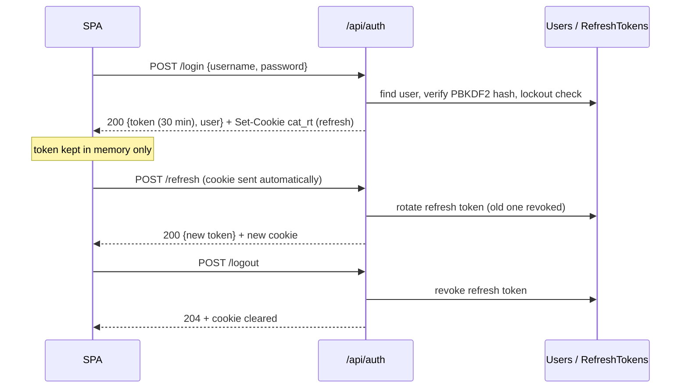

# Authentication: `AuthEndpoints.cs`

Base route **`/api/auth`** (route group `api.MapGroup("/auth").WithTags("Auth")`).

Sign-in, company registration, token refresh, sign-out, the current user's profile and password changes.

**How sessions work**
- **Access token:** a short-lived JWT (30 minutes) that the SPA keeps in memory and sends as `Authorization: Bearer …`.
- **Refresh token:** a long-lived random token in an httpOnly, `SameSite=Strict` cookie named `cat_rt`, scoped to
  `/api/auth`. JavaScript can't read it, and the browser only sends it to these endpoints.
- **Rotation:** every refresh replaces the refresh token. Presenting an already-used token is treated as theft, and
  the whole token family is revoked.



| # | Method | Route | Access | Purpose |
|---|---|---|---|---|
| 1 | POST | `/api/auth/login` | anonymous · rate limit `login` | Sign in and start a session |
| 2 | POST | `/api/auth/register` | anonymous · rate limit `register` | Register a company and its first user |
| 3 | POST | `/api/auth/refresh` | anonymous (cookie) | Exchange the refresh cookie for a new access token |
| 4 | POST | `/api/auth/logout` | anonymous (cookie) | End the session |
| 5 | GET | `/api/auth/me` | signed in | Current user's profile |
| 6 | POST | `/api/auth/change-password` | signed in | Change password and end other sessions |

The controller examples below all belong to one class:

```csharp
[ApiController]
[Route("api/auth")]
[Tags("Auth")]
public sealed class AuthController(ICatalogueDbContext db, IPasswordHasher<AppUser> hasher, TokenService tokens,
    JwtSettings jwt, TimeProvider clock, CurrentUser me) : ControllerBase
{
    // actions below
}
```

---

### 1. `POST /api/auth/login` · Sign in

| | |
|---|---|
| Access | Anonymous (`.AllowAnonymous()`), rate limit `login`: 10 requests per minute per IP |
| Request body | `LoginRequest { username, password }`; `username` may be the email or the short username |
| Responses | **200** `LoginResponse { token, expiresAtUtc, user, username, roles, customerId, customerName }` and `Set-Cookie: cat_rt`<br>**401** wrong email/username or password · **403** account disabled, or company pending/suspended/rejected · **423** locked after 5 failures · **429** too many attempts |

**Flow**
1. The rate limiter counts the request against the caller's IP. The 11th request in a minute gets 429.
2. The username is trimmed and lower-cased, then the user is loaded by email **or** username, together with its organization.
3. **Unknown user:** a dummy hash is still verified, so the response takes as long as for a real user. This prevents
   finding out which accounts exist from response times. Returns 401.
4. **Locked user** (5 failed attempts, 15 minutes): returns 423 with the unlock time.
5. The password is verified with ASP.NET Core Identity's PBKDF2 hasher. On failure the attempt is counted
   (`LoginFailed`) and 401 is returned. If the stored hash uses old parameters, it is re-hashed.
6. A disabled user, or a company that isn't `Active`, gets 403 with a reason.
7. Success: the failure counter resets, `UserSignedIn` is audited, and `IssueSessionAsync` creates the JWT, issues a
   refresh token (stored as a SHA-256 hash), sets the `cat_rt` cookie and returns the profile.

**Minimal API** (abridged)

```csharp
auth.MapPost("/login", async (LoginRequest req, HttpContext http, ICatalogueDbContext db, IPasswordHasher<AppUser> hasher,
    TokenService tokens, JwtSettings jwt, TimeProvider clock, CancellationToken ct) =>
{
    var key = (req.Username ?? "").Trim().ToLowerInvariant();
    var user = await db.Users.Include(u => u.Organization).FirstOrDefaultAsync(u => u.Email == key || u.Username == key, ct);
    var now = clock.GetUtcNow().UtcDateTime;
    if (user is null) { hasher.VerifyHashedPassword(null!, DummyHash, req.Password ?? ""); return Results.Problem(statusCode: 401, title: "Invalid email/username or password."); }
    if (user.IsLockedOut(now)) return Results.Problem(statusCode: 423, title: "Account temporarily locked", detail: ...);
    var verdict = hasher.VerifyHashedPassword(user, user.PasswordHash, req.Password ?? "");
    if (verdict == PasswordVerificationResult.Failed) { user.LoginFailed(now); await db.SaveChangesAsync(ct); return Results.Problem(statusCode: 401, ...); }
    // ... disabled user / inactive company → 403
    user.LoginSucceeded(now);
    db.AuditEvents.Add(new AuditEvent(user.SignInName, "UserSignedIn", "User", user.Id.ToString(), http.Connection.RemoteIpAddress?.ToString(), null));
    await db.SaveChangesAsync(ct);
    return await IssueSessionAsync(http, user, null, db, tokens, jwt, ct);
}).AllowAnonymous().RequireRateLimiting(Policies.Login);
```

**Controller equivalent**

```csharp
[HttpPost("login")]
[AllowAnonymous]
[EnableRateLimiting(Policies.Login)]
[ProducesResponseType<LoginResponse>(200)]
public async Task<IActionResult> Login([FromBody] LoginRequest req, CancellationToken ct)
{
    var key = (req.Username ?? "").Trim().ToLowerInvariant();
    var user = await db.Users.Include(u => u.Organization).FirstOrDefaultAsync(u => u.Email == key || u.Username == key, ct);
    var now = clock.GetUtcNow().UtcDateTime;
    if (user is null) { hasher.VerifyHashedPassword(null!, DummyHash, req.Password ?? ""); return Problem(statusCode: 401, title: "Invalid email/username or password."); }
    if (user.IsLockedOut(now)) return Problem(statusCode: 423, title: "Account temporarily locked");
    if (hasher.VerifyHashedPassword(user, user.PasswordHash, req.Password ?? "") == PasswordVerificationResult.Failed)
    {
        user.LoginFailed(now);
        await db.SaveChangesAsync(ct);
        return Problem(statusCode: 401, title: "Invalid email/username or password.");
    }
    // ... same 403 checks
    user.LoginSucceeded(now);
    await db.SaveChangesAsync(ct);
    return await IssueSession(user, ct);   // HttpContext is a property of ControllerBase, not a parameter
}
```

*Difference:* the controller gets `HttpContext` from its base class and its services from the constructor. The minimal
API lists everything in the lambda signature.

---

### 2. `POST /api/auth/register` · Register a company

| | |
|---|---|
| Access | Anonymous, rate limit `register`: 5 per hour per IP |
| Request body | `RegisterRequest { companyName, vatNumber?, country?, wantsToBuy, wantsToSell, displayName, email, password }` |
| Responses | **202** `{ organizationId, status: "PendingVerification", message }` · **400** ValidationProblem (field errors) · **429** |

**Flow**
1. Validate: company name (2+ characters), at least one of buy/sell, display name, a valid email, and the password
   policy (≥ 10 characters, upper, lower, digit, not containing the email name). All errors are returned together as
   a ValidationProblem (`errors: { field: [messages] }`).
2. Reject a duplicate email (also as a ValidationProblem).
3. Create the `Organization` with status `PendingVerification` and the chosen capabilities.
4. Create the first `AppUser` with roles `OrgAdmin`, plus `Buyer` and/or `Seller`, and hash the password.
5. Audit `CompanyRegistered` and return **202 Accepted**: nothing is usable until a platform admin approves the company
   (see [Organizations](11-organizations.md)).

**Minimal API** (abridged)

```csharp
auth.MapPost("/register", async (RegisterRequest req, HttpContext http, ICatalogueDbContext db,
    IPasswordHasher<AppUser> hasher, CancellationToken ct) =>
{
    var errors = new Dictionary<string, string[]>();
    var email = (req.Email ?? "").Trim().ToLowerInvariant();
    if (string.IsNullOrWhiteSpace(req.CompanyName) || req.CompanyName.Trim().Length < 2) errors["companyName"] = ["Company name is required."];
    if (!req.WantsToBuy && !req.WantsToSell) errors["capabilities"] = ["Choose buying, selling or both."];
    // ... displayName, email, PasswordPolicy.Check
    if (errors.Count > 0) return Results.ValidationProblem(errors);
    if (await db.Users.AnyAsync(u => u.Email == email, ct)) return Results.ValidationProblem(...);
    var org = new Organization(req.CompanyName, caps, req.Country ?? "GB", req.VatNumber);
    // ... save org, create user with roles, hash password, audit
    return Results.Accepted($"/api/organizations/{org.Id}", new { organizationId = org.Id, status = org.Status.ToString(), message = "..." });
}).AllowAnonymous().RequireRateLimiting(Policies.Register);
```

**Controller equivalent**

```csharp
[HttpPost("register")]
[AllowAnonymous]
[EnableRateLimiting(Policies.Register)]
public async Task<IActionResult> Register([FromBody] RegisterRequest req, CancellationToken ct)
{
    // With a controller the simple rules could be DataAnnotations on RegisterRequest
    // ([Required], [EmailAddress], [MinLength(2)]): [ApiController] would then return 400 before this method runs.
    // Cross-field rules (buy or sell) and the password policy still need code:
    if (!req.WantsToBuy && !req.WantsToSell) ModelState.AddModelError("capabilities", "Choose buying, selling or both.");
    foreach (var p in PasswordPolicy.Check(req.Password, req.Email)) ModelState.AddModelError("password", p);
    if (!ModelState.IsValid) return ValidationProblem(ModelState);
    // ... same create logic
    return Accepted($"/api/organizations/{org.Id}", new { organizationId = org.Id, status = org.Status.ToString() });
}
```

*Difference:* minimal APIs have no `ModelState` and no automatic DataAnnotations validation, so the handler builds the
error dictionary itself. Controllers collect errors in `ModelState`.

---

### 3. `POST /api/auth/refresh` · Refresh the access token

| | |
|---|---|
| Access | Anonymous, but needs the `cat_rt` cookie (the browser sends it only to `/api/auth`) |
| Request | no body |
| Responses | **200** `LoginResponse` with a new token and a rotated cookie · **401** no cookie, expired, revoked or reused |

**Flow**
1. Read the `cat_rt` cookie. Missing → 401.
2. `TokenService.RotateAsync` looks up the token by its SHA-256 hash.
   - **Valid:** the old token is revoked and a new one is issued in the same family.
   - **Already used:** treated as theft. Every token in the family is revoked and `RefreshTokenReuseDetected` is audited.
   - **Expired, or the user's security stamp changed** (password changed, user disabled): rejected.
3. On failure the cookie is cleared and 401 returned. The SPA then sends the user to the login page.
4. On success the same `IssueSessionAsync` as login builds the response.

**Minimal API**

```csharp
auth.MapPost("/refresh", async (HttpContext http, TokenService tokens, ICatalogueDbContext db, JwtSettings jwt, CancellationToken ct) =>
{
    if (!http.Request.Cookies.TryGetValue(TokenService.RefreshCookie, out var raw) || string.IsNullOrEmpty(raw))
        return Results.Problem(statusCode: 401, title: "No session.");
    var (outcome, user, next) = await tokens.RotateAsync(raw, http.Connection.RemoteIpAddress?.ToString(), ct);
    if (outcome != TokenService.RefreshOutcome.Ok || user is null || next is null)
    {
        TokenService.ClearCookie(http);
        // reuse → audit RefreshTokenReuseDetected
        return Results.Problem(statusCode: 401, title: "Session expired. Please sign in again.");
    }
    return await IssueSessionAsync(http, user, next, db, tokens, jwt, ct);
}).AllowAnonymous();
```

**Controller equivalent**

```csharp
[HttpPost("refresh")]
[AllowAnonymous]
public async Task<IActionResult> Refresh(CancellationToken ct)
{
    if (!Request.Cookies.TryGetValue(TokenService.RefreshCookie, out var raw) || string.IsNullOrEmpty(raw))
        return Problem(statusCode: 401, title: "No session.");
    var (outcome, user, next) = await tokens.RotateAsync(raw, HttpContext.Connection.RemoteIpAddress?.ToString(), ct);
    if (outcome != TokenService.RefreshOutcome.Ok || user is null || next is null)
    {
        TokenService.ClearCookie(HttpContext);
        return Problem(statusCode: 401, title: "Session expired. Please sign in again.");
    }
    return await IssueSession(user, next, ct);
}
```

---

### 4. `POST /api/auth/logout` · Sign out

| | |
|---|---|
| Access | Anonymous (it only needs the cookie) |
| Responses | **204 No Content**, always, even with no cookie, so signing out never fails |

**Flow:** if the `cat_rt` cookie is present, that refresh token is revoked with reason `logout`. Then the cookie is
cleared. The access token in memory is simply dropped by the SPA and expires within 30 minutes.

**Minimal API**

```csharp
auth.MapPost("/logout", async (HttpContext http, TokenService tokens, CancellationToken ct) =>
{
    if (http.Request.Cookies.TryGetValue(TokenService.RefreshCookie, out var raw) && !string.IsNullOrEmpty(raw))
        await tokens.RevokeAsync(raw, "logout", ct);
    TokenService.ClearCookie(http);
    return Results.NoContent();
}).AllowAnonymous();
```

**Controller equivalent**

```csharp
[HttpPost("logout")]
[AllowAnonymous]
public async Task<IActionResult> Logout(CancellationToken ct)
{
    if (Request.Cookies.TryGetValue(TokenService.RefreshCookie, out var raw) && !string.IsNullOrEmpty(raw))
        await tokens.RevokeAsync(raw, "logout", ct);
    TokenService.ClearCookie(HttpContext);
    return NoContent();
}
```

---

### 5. `GET /api/auth/me` · Current user

| | |
|---|---|
| Access | Any signed-in user (`.RequireAuthorization()` with no policy) |
| Responses | **200** `UserProfile { id, username, displayName, email, roles, organization, customerId, supplierId, … }` · **401** |

**Flow:** `CurrentUser` reads the user id from the JWT claims (`uid`), the user is loaded without change tracking,
and `ProfileBuilder` adds the organization, customer account and supplier details.

**Minimal API**

```csharp
auth.MapGet("/me", async (CurrentUser me, ICatalogueDbContext db, CancellationToken ct) =>
{
    var user = await db.Users.AsNoTracking().FirstOrDefaultAsync(u => u.Id == me.UserId, ct);
    return user is null ? Results.Unauthorized() : Results.Ok(await ProfileBuilder.BuildAsync(db, user, ct));
}).RequireAuthorization();
```

**Controller equivalent**

```csharp
[HttpGet("me")]
[Authorize]
public async Task<ActionResult<UserProfile>> Me(CancellationToken ct)
{
    var user = await db.Users.AsNoTracking().FirstOrDefaultAsync(u => u.Id == me.UserId, ct);
    return user is null ? Unauthorized() : await ProfileBuilder.BuildAsync(db, user, ct);   // ActionResult<T> allows returning T directly
}
```

---

### 6. `POST /api/auth/change-password` · Change password

| | |
|---|---|
| Access | Any signed-in user |
| Request body | `ChangePasswordRequest { currentPassword, newPassword }` |
| Responses | **200** `LoginResponse` (a fresh session for this browser) · **400** ValidationProblem (wrong current password or weak new one) · **401** |

**Flow**
1. Load the user and verify `currentPassword`. Wrong → 400 on the `currentPassword` field.
2. Check the new password against the policy. Weak → 400 on the `newPassword` field.
3. Hash the new password. This also changes the user's **security stamp**, so every older refresh token stops working.
4. Revoke all active refresh tokens (other devices are signed out) and audit `PasswordChanged`.
5. Issue a new session for the current browser so the user stays signed in here.

**Minimal API** (abridged)

```csharp
auth.MapPost("/change-password", async (ChangePasswordRequest req, HttpContext http, CurrentUser me, ICatalogueDbContext db,
    IPasswordHasher<AppUser> hasher, TokenService tokens, JwtSettings jwt, CancellationToken ct) =>
{
    var user = await db.Users.FirstOrDefaultAsync(u => u.Id == me.UserId, ct);
    if (user is null) return Results.Unauthorized();
    if (hasher.VerifyHashedPassword(user, user.PasswordHash, req.CurrentPassword ?? "") == PasswordVerificationResult.Failed)
        return Results.ValidationProblem(new Dictionary<string, string[]> { ["currentPassword"] = ["Current password is incorrect."] });
    // ... policy check
    user.SetPasswordHash(hasher.HashPassword(user, req.NewPassword));
    foreach (var t in await db.RefreshTokens.Where(t => t.UserId == user.Id && t.RevokedAtUtc == null).ToListAsync(ct)) t.Revoke("password-changed");
    await db.SaveChangesAsync(ct);
    return await IssueSessionAsync(http, user, null, db, tokens, jwt, ct);
}).RequireAuthorization();
```

**Controller equivalent**

```csharp
[HttpPost("change-password")]
[Authorize]
public async Task<IActionResult> ChangePassword([FromBody] ChangePasswordRequest req, CancellationToken ct)
{
    var user = await db.Users.FirstOrDefaultAsync(u => u.Id == me.UserId, ct);
    if (user is null) return Unauthorized();
    if (hasher.VerifyHashedPassword(user, user.PasswordHash, req.CurrentPassword ?? "") == PasswordVerificationResult.Failed)
    {
        ModelState.AddModelError(nameof(req.CurrentPassword), "Current password is incorrect.");
        return ValidationProblem(ModelState);
    }
    // ... same policy check, re-hash, revoke sessions
    return await IssueSession(user, null, ct);
}
```

---

### Shared helper: `IssueSessionAsync`

Used by login, refresh and change-password. It creates the 30-minute JWT (claims: user id, roles, organization,
customer and supplier ids), issues or reuses a refresh token, sets the cookie and returns the profile. In a controller
this would be a `private` method of `AuthController`. Here it is a `private static` method of the `AuthEndpoints`
class, and the handlers pass in the services it needs.
