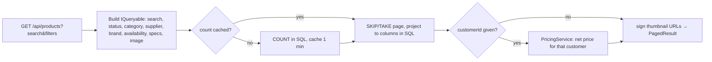

# Products: `ProductEndpoints.cs`

Routes under **`/api/products`**. This file maps each endpoint directly on the `/api` group with its full path
(`api.MapGet("/products", …)`) instead of using a sub-group. That is a matter of style: it behaves the same as
`api.MapGroup("/products")`.

The catalogue holds about 7 million products, so the list endpoint is written to stay fast at that size. Searches use
prefix matches that can use an index; the page is projected in SQL, so only the requested rows and columns are read;
and the total count is cached for a minute.



| # | Method | Route | Access | Purpose |
|---|---|---|---|---|
| 1 | GET | `/api/products` | `ReadCatalogue` | Search and filter products, paged |
| 2 | GET | `/api/products/facets` | `ReadCatalogue` | Filter options (brands, spec values) for a category |
| 3 | GET | `/api/products/{id}` | `ReadCatalogue` | Full product detail |
| 4 | POST | `/api/products` | `CatalogueAdmin` | Create a product |
| 5 | PUT | `/api/products/{id}` | `CatalogueAdmin` | Update a product |
| 6 | POST | `/api/products/{id}/activate` | `CatalogueAdmin` | Set status Active |
| 7 | POST | `/api/products/{id}/deactivate` | `CatalogueAdmin` | Set status Inactive |

Controller class used by the examples:

```csharp
[ApiController]
[Route("api/products")]
[Tags("Products")]
public sealed class ProductsController(ICatalogueDbContext db, IReferenceDataProvider refProvider, PricingService pricing,
    HybridCache cache, IActorContext actor, MediaUrlSigner signer) : ControllerBase
{
    // actions below; each one declares its own [Authorize(Policy = ...)]
}
```

---

### 1. `GET /api/products` · Search and filter

| | |
|---|---|
| Access | `ReadCatalogue` |
| Query | `search`, `deep` (substring search on the name), `status`, `categoryId` (includes child categories), `supplierId`, `brand` (comma list), `availability`, `incomplete` (missing required specs), `hasImage`, `spec` (repeatable, `CODE:op:value`), `customerId` + `qty` (customer-specific price), `page`, `pageSize` (max 100), `sort` (`name`, `name_desc`, `sku`, `sku_desc`, `updated`, `updated_desc`, `id_desc`) |
| Responses | **200** `PagedResult<ProductDto> { items, total, page, pageSize }` · **400** malformed `spec` filter (an `ArgumentException` turned into a problem response) |

**Flow**
1. Start from `db.Products.AsNoTracking()`. Nothing runs yet; it is an `IQueryable`.
2. **Search:**
   - a GTIN (8+ digits) → exact match on the normalised GTIN;
   - a SKU-like term → prefix match on SKU, or exact match on MPN;
   - otherwise a prefix match on SKU, name or brand;
   - `deep=true` → substring match on the name, which scans the table.
3. **Filters:** each one adds a `Where`. Supplier and availability use `Offers.Any(...)`. Image uses a `ProductAssets`
   existence check. Specs use `ApplySpecFilter`, with operators `eq`, `in`, `gte`, `lte` and `between`.
   `incomplete=true` finds products missing a required spec of their category.
4. **Sort**, then **count**. The count is cached under a key built from all the filters, for one minute with tag
   `products`; any product write clears it.
5. **Page:** `Skip/Take`, then `Select` into an anonymous shape. EF translates the whole projection into one SQL
   statement: active price, stock, category names, offer availabilities, the primary image id and the first 4 specs.
6. When `customerId` is given, `PricingService` resolves that customer's price-list chain and adds the net price, its
   source and the saving.
7. Image ids become signed, short-lived thumbnail URLs. The response is `PagedResult<ProductDto>`.

**Minimal API** (abridged)

```csharp
api.MapGet("/products", async (HttpContext http, ICatalogueDbContext db, IReferenceDataProvider refProvider,
    PricingService pricing, HybridCache cache, string? search, string? status,
    long? categoryId, long? supplierId, string? brand, string? availability, bool? incomplete, bool? hasImage, long? customerId, int? qty,
    MediaUrlSigner signer, int? page, int? pageSize, string? sort, bool? deep, CancellationToken ct) =>
{
    var specFilters = http.Request.Query["spec"].Where(v => !string.IsNullOrWhiteSpace(v)).Select(v => v!).ToList();
    var query = db.Products.AsNoTracking();
    // ... search, filters, sort
    var total = await cache.GetOrCreateAsync(countKey, async token => await query.CountAsync(token), ..., [CacheTags.Products], ct);
    var rows = await query.Skip((pg - 1) * ps).Take(ps).Select(p => new { /* columns computed in SQL */ }).ToListAsync(ct);
    // optional customer pricing, signed image URLs
    return Results.Ok(new PagedResult<ProductDto>(items, total, pg, ps));
}).RequireAuthorization("ReadCatalogue").WithTags("Products");
```

Each query-string value is an ordinary nullable parameter (`string? search`, `long? categoryId`). Minimal APIs bind
simple types that aren't in the route from the query string automatically. The repeatable `spec` parameter is read
from `HttpContext` so every occurrence is collected.

**Controller equivalent**

```csharp
public sealed record ProductQuery(string? Search, bool? Deep, string? Status, long? CategoryId, long? SupplierId, string? Brand,
    string? Availability, bool? Incomplete, bool? HasImage, string[]? Spec, long? CustomerId, int? Qty, int? Page, int? PageSize, string? Sort);

[HttpGet]
[Authorize(Policy = "ReadCatalogue")]
[ProducesResponseType<PagedResult<ProductDto>>(200)]
public async Task<IActionResult> Search([FromQuery] ProductQuery q, CancellationToken ct)
{
    var query = db.Products.AsNoTracking();
    // ... identical query building using q.Search, q.CategoryId, q.Spec ...
    return Ok(new PagedResult<ProductDto>(items, total, page, pageSize));
}
```

*Difference:* a controller usually gathers many query parameters into one class with `[FromQuery]`. Minimal APIs can do
the same with `[AsParameters] ProductQuery q`; this project lists them inline. Both read the same query string.

---

### 2. `GET /api/products/facets` · Filter options

| | |
|---|---|
| Access | `ReadCatalogue` |
| Query | `categoryId` (optional; a parent category includes its children) |
| Responses | **200** `{ brands: [{value, count}], facets: [{ code, name, unit, dataType, required, values: [{value,count}], min, max }] }` |

**Flow**
1. The whole result is cached for 10 minutes per category (tag `products`), because it aggregates millions of rows.
2. Scope: products that are not pending approval, within the category tree when one is given.
3. Brands: the top 25 by product count.
4. For each **filterable** attribute in the category's template:
   - **number:** the min and max values (shown as a range slider);
   - **text or enum:** the top 25 values with counts.

**Minimal API**

```csharp
api.MapGet("/products/facets", async (long? categoryId, ICatalogueDbContext db, IReferenceDataProvider refProvider,
    HybridCache cache, CancellationToken ct) =>
    Results.Ok(await cache.GetOrCreateAsync($"products:facets:{categoryId}", async token =>
    {
        // ... scope, brands, per-attribute counts or min/max
        return new { brands, facets };
    }, new HybridCacheEntryOptions { Expiration = TimeSpan.FromMinutes(10), LocalCacheExpiration = TimeSpan.FromMinutes(10) },
    [CacheTags.Products], ct)))
    .RequireAuthorization("ReadCatalogue").WithTags("Products");
```

**Controller equivalent**

```csharp
[HttpGet("facets")]
[Authorize(Policy = "ReadCatalogue")]
public async Task<IActionResult> Facets([FromQuery] long? categoryId, CancellationToken ct) =>
    Ok(await cache.GetOrCreateAsync($"products:facets:{categoryId}", async token => await BuildFacets(categoryId, token),
        new HybridCacheEntryOptions { Expiration = TimeSpan.FromMinutes(10) }, [CacheTags.Products], ct));
```

---

### 3. `GET /api/products/{id}` · Product detail

| | |
|---|---|
| Access | `ReadCatalogue` |
| Route / query | `id` (`{id:long}` constraint: a non-numeric id doesn't match the route and gives 404) · `customerId`, `qty` (optional customer price) |
| Responses | **200** `ProductDetailDto` (identity, price history, specs with required/missing flags, supplier offers, pending changes, media, optional `quote`) · **404** |

**Flow**
1. `LoadDetail` reads the product and its relations (supplier, prices, stock, categories, spec values, offers) with
   `AsSplitQuery()`, so each collection is a separate SQL query instead of one huge join. It then builds the full spec
   list from the category templates and adds pending change requests. The result is cached for 5 minutes under
   `product:{id}`.
2. Media assets are read on every request, **not** cached, because their signed URLs expire. They are added with
   `detail with { Assets = ..., ImageUrl = ... }`; the record is immutable, so `with` makes a copy.
3. With `customerId`, a customer-specific `PriceQuote` is added per request. Without one, the cached detail is
   returned as it is.

**Minimal API**

```csharp
api.MapGet("/products/{id:long}", async (long id, long? customerId, int? qty, ICatalogueDbContext db,
    PricingService pricing, HybridCache cache, MediaUrlSigner signer, CancellationToken ct) =>
{
    var detail = await cache.GetOrCreateAsync(CacheTags.Product(id), async token => await LoadDetail(id, db, token),
        new HybridCacheEntryOptions { Expiration = TimeSpan.FromMinutes(5) }, [CacheTags.Products], ct);
    if (detail is null) return Results.NotFound();
    var assets = await db.ProductAssets.AsNoTracking().Where(a => a.ProductId == id).OrderByDescending(a => a.IsPrimary)/*...*/.ToListAsync(ct);
    detail = detail with { Assets = assets.Select(a => MediaEndpoints.ToDto(a, signer)).ToList(), ImageUrl = /* primary */ };
    if (customerId is null) return Results.Ok(detail);
    var (_, chain) = await pricing.ContextAsync(customerId, null, ct);
    var quotes = await pricing.QuoteAsync([(id, detail.Price, detail.Currency ?? "GBP")], chain, qty ?? 1, ct);
    return Results.Ok(detail with { Quote = quotes[id] });
}).RequireAuthorization("ReadCatalogue").WithTags("Products");
```

`id` binds from the route because its name matches `{id:long}`. `customerId` and `qty` aren't in the route, so they
bind from the query string.

**Controller equivalent**

```csharp
[HttpGet("{id:long}")]
[Authorize(Policy = "ReadCatalogue")]
public async Task<ActionResult<ProductDetailDto>> Get(long id, [FromQuery] long? customerId, [FromQuery] int? qty, CancellationToken ct)
{
    var detail = await cache.GetOrCreateAsync(CacheTags.Product(id), async t => await LoadDetail(id, t), /*...*/ cancellationToken: ct);
    if (detail is null) return NotFound();
    // ... same media and pricing
    return detail;
}
```

---

### 4. `POST /api/products` · Create

| | |
|---|---|
| Access | `CatalogueAdmin` |
| Body | `UpsertProductRequest { sku, name, description, price, currency, quantity, supplierId, categoryIds, brand, manufacturerPartNumber, gtin, attributes: { CODE: "value" } }` |
| Responses | **201** `{ id, sku }` with `Location: /api/products/{id}` · **400** ValidationProblem · **409** SKU already exists for that supplier |

**Flow**
1. Reject a duplicate SKU for the same supplier (409).
2. `ValidateProduct` (shared with update and the seller portal) checks:
   - name required, GTIN check digit, price ≥ 0;
   - every attribute exists, applies to the chosen categories, and parses to its data type (number range, enum value…);
   - every **required** spec of the categories is present.

   Errors are keyed by field, e.g. `attr.CAPACITY_KW`, so the editor can show each one beside its input.
3. Build the `Product` aggregate: identity, specs, first price, stock and categories. Audit `ProductCreated`.
4. Save, then clear every cached list and count (`RemoveByTagAsync("products")`). Return `201 Created`.

**Minimal API** (abridged)

```csharp
api.MapPost("/products", async (UpsertProductRequest req, ICatalogueDbContext db, IReferenceDataProvider refProvider,
    IActorContext actor, HybridCache cache, CancellationToken ct) =>
{
    if (await db.Products.AnyAsync(p => p.Sku == req.Sku.ToUpper() && p.SupplierId == req.SupplierId, ct))
        return Results.Conflict(new { error = "A product with this SKU already exists for the supplier." });
    var problems = ValidateProduct(req, await refProvider.GetAsync(ct), out var attributes);
    if (problems.Count > 0) return Results.ValidationProblem(problems);
    var product = new Product(req.Sku, req.Name, req.Description, req.SupplierId);
    // ... identity, attributes, price, inventory, categories, audit
    await db.SaveChangesAsync(ct);
    await cache.RemoveByTagAsync(CacheTags.Products, ct);
    return Results.Created($"/api/products/{product.Id}", new { product.Id, product.Sku });
}).RequireAuthorization("CatalogueAdmin").WithTags("Products");
```

**Controller equivalent**

```csharp
[HttpPost]
[Authorize(Policy = "CatalogueAdmin")]
public async Task<IActionResult> Create([FromBody] UpsertProductRequest req, CancellationToken ct)
{
    if (await db.Products.AnyAsync(p => p.Sku == req.Sku.ToUpper() && p.SupplierId == req.SupplierId, ct))
        return Conflict(new { error = "A product with this SKU already exists for the supplier." });
    var problems = ProductValidation.Validate(req, await refProvider.GetAsync(ct), out var attributes);
    foreach (var (field, messages) in problems) foreach (var m in messages) ModelState.AddModelError(field, m);
    if (!ModelState.IsValid) return ValidationProblem(ModelState);
    // ... same aggregate building and save
    return CreatedAtAction(nameof(Get), new { id = product.Id }, new { product.Id, product.Sku });
}
```

*Difference:* `CreatedAtAction` builds the `Location` URL from the route of another action. A minimal API writes the URL
itself, or uses `Results.CreatedAtRoute` with a named endpoint (`.WithName("GetProduct")`).

---

### 5. `PUT /api/products/{id}` · Update

| | |
|---|---|
| Access | `CatalogueAdmin` |
| Body | `UpsertProductRequest` (same shape as create; SKU and supplier don't change) |
| Responses | **200** `{ id, sku }` · **400** ValidationProblem · **404** |

**Flow**
1. Load the product with its categories, spec values and **active** prices (`Include(p => p.Prices.Where(x => x.ValidToUtc == null))`, a filtered include).
2. Validate exactly as in create.
3. Update name, description and identity. Categories and specs are **replaced** with what the editor sent: missing
   ones are removed, new ones added.
4. If the price changed, close the active price (`ValidToUtc = now`) and add a new one, so the price history is kept.
5. Audit `ProductUpdated`, save, and clear this product's cache entry plus all lists.

**Minimal API** (abridged)

```csharp
api.MapPut("/products/{id:long}", async (long id, UpsertProductRequest req, ICatalogueDbContext db,
    IReferenceDataProvider refProvider, IActorContext actor, HybridCache cache, CancellationToken ct) =>
{
    var product = await db.Products.Include(p => p.ProductCategories).Include(p => p.AttributeValues)
        .Include(p => p.Prices.Where(x => x.ValidToUtc == null)).FirstOrDefaultAsync(p => p.Id == id, ct);
    if (product is null) return Results.NotFound();
    // validate, update, replace categories/specs, close + add price, audit
    await db.SaveChangesAsync(ct);
    await cache.RemoveAsync(CacheTags.Product(id), ct);
    await cache.RemoveByTagAsync(CacheTags.Products, ct);
    return Results.Ok(new { product.Id, product.Sku });
}).RequireAuthorization("CatalogueAdmin").WithTags("Products");
```

**Controller equivalent**

```csharp
[HttpPut("{id:long}")]
[Authorize(Policy = "CatalogueAdmin")]
public async Task<IActionResult> Update(long id, [FromBody] UpsertProductRequest req, CancellationToken ct)
{
    var product = await db.Products.Include(p => p.ProductCategories).Include(p => p.AttributeValues)
        .Include(p => p.Prices.Where(x => x.ValidToUtc == null)).FirstOrDefaultAsync(p => p.Id == id, ct);
    if (product is null) return NotFound();
    // ... same
    return Ok(new { product.Id, product.Sku });
}
```

---

### 6 & 7. `POST /api/products/{id}/activate` and `POST /api/products/{id}/deactivate`

| | |
|---|---|
| Access | `CatalogueAdmin` |
| Responses | **200** `{ id, status }` · **404** |

**Flow:** both routes call the shared `SetStatus(id, activate, …)` helper. It loads the product, calls the domain
method `Activate()` or `Deactivate()`, audits `ProductActivated`/`ProductDeactivated`, saves and clears the cached
lists (status filter counts change).

**Minimal API**

```csharp
api.MapPost("/products/{id:long}/activate", (long id, ICatalogueDbContext db, IActorContext a, HybridCache c, CancellationToken ct)
    => SetStatus(id, true, db, a, c, ct)).RequireAuthorization("CatalogueAdmin").WithTags("Products");
api.MapPost("/products/{id:long}/deactivate", (long id, ICatalogueDbContext db, IActorContext a, HybridCache c, CancellationToken ct)
    => SetStatus(id, false, db, a, c, ct)).RequireAuthorization("CatalogueAdmin").WithTags("Products");
```

**Controller equivalent**

```csharp
[HttpPost("{id:long}/activate")]
[Authorize(Policy = "CatalogueAdmin")]
public Task<IActionResult> Activate(long id, CancellationToken ct) => SetStatus(id, true, ct);

[HttpPost("{id:long}/deactivate")]
[Authorize(Policy = "CatalogueAdmin")]
public Task<IActionResult> Deactivate(long id, CancellationToken ct) => SetStatus(id, false, ct);

private async Task<IActionResult> SetStatus(long id, bool activate, CancellationToken ct)
{
    var product = await db.Products.FirstOrDefaultAsync(p => p.Id == id, ct);
    if (product is null) return NotFound();
    if (activate) product.Activate(); else product.Deactivate();
    // audit, save, invalidate cache
    return Ok(new { product.Id, Status = product.Status.ToString() });
}
```

*Difference:* in both styles two routes share one private helper. The minimal API version is a one-line lambda per
route that forwards its parameters.
