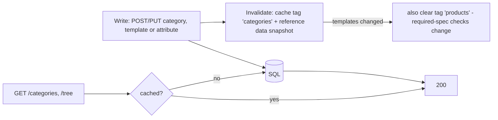

# Categories & attributes: `CategoryEndpoints.cs`

Routes under **`/api/categories`** and **`/api/attributes`**, mapped directly on the `/api` group.

The file covers three related concepts:

- **Category tree:** two levels, e.g. *Heating → Boilers*.
- **Attribute dictionary:** the typed specifications, e.g. `CAPACITY_KW` (number, kW, 0.5–100) or `REFRIGERANT`
  (enum: R32, R290).
- **Category template:** which attributes a category uses and which are **required**. Product validation, the
  required-spec checks and the facets in [Products](02-products.md) all depend on templates.

Reads are cached (`HybridCache`, tag `categories`). Every write clears that tag and the in-process
`IReferenceDataProvider` snapshot, so the next request sees the change.



| # | Method | Route | Access | Purpose |
|---|---|---|---|---|
| 1 | GET | `/api/categories` | `ReadCatalogue` | Flat list for pickers |
| 2 | GET | `/api/categories/tree` | `ReadCatalogue` | Tree with product and attribute counts |
| 3 | POST | `/api/categories` | `CatalogueAdmin` | Create a category |
| 4 | PUT | `/api/categories/{id}` | `CatalogueAdmin` | Rename, move, activate or deactivate |
| 5 | GET | `/api/categories/{id}/attributes` | `ReadCatalogue` | The category's attribute template |
| 6 | PUT | `/api/categories/{id}/attributes` | `CatalogueAdmin` | Replace the template |
| 7 | GET | `/api/attributes` | `ReadCatalogue` | Attribute dictionary with usage counts |
| 8 | POST | `/api/attributes` | `CatalogueAdmin` | Create an attribute |
| 9 | PUT | `/api/attributes/{id}` | `CatalogueAdmin` | Update an attribute |

With controllers this file would usually become **two** classes, one per route prefix:

```csharp
[ApiController, Route("api/categories"), Tags("Categories")]
public sealed class CategoriesController(ICatalogueDbContext db, HybridCache cache, IActorContext actor, IReferenceDataProvider refData) : ControllerBase { }

[ApiController, Route("api/attributes"), Tags("Attributes")]
public sealed class AttributesController(ICatalogueDbContext db, HybridCache cache, IActorContext actor, IReferenceDataProvider refData) : ControllerBase { }
```

With minimal APIs one static class can map both prefixes. Grouping follows the feature, not the URL.

---

### 1. `GET /api/categories` · Flat list

| | |
|---|---|
| Access | `ReadCatalogue` |
| Responses | **200** `CategoryDto[] { id, code, name, parentCategoryId, isActive, sortOrder }` |

**Flow:** returned from cache key `categories:all` (10 minutes). On a cache miss, categories are read without tracking,
ordered by sort order and name, and projected in SQL.

```csharp
// Minimal API
api.MapGet("/categories", async (ICatalogueDbContext db, HybridCache cache, CancellationToken ct) =>
    Results.Ok(await cache.GetOrCreateAsync("categories:all",
        async token => await db.Categories.AsNoTracking().OrderBy(c => c.SortOrder).ThenBy(c => c.Name)
            .Select(c => new CategoryDto(c.Id, c.Code, c.Name, c.ParentCategoryId, c.IsActive, c.SortOrder)).ToListAsync(token),
        new HybridCacheEntryOptions { Expiration = TimeSpan.FromMinutes(10) }, [CacheTags.Categories], ct)))
    .RequireAuthorization("ReadCatalogue").WithTags("Categories");
```

```csharp
// Controller
[HttpGet]
[Authorize(Policy = "ReadCatalogue")]
public async Task<IReadOnlyList<CategoryDto>> List(CancellationToken ct) =>
    await cache.GetOrCreateAsync("categories:all", async t => await db.Categories.AsNoTracking()
        .OrderBy(c => c.SortOrder).ThenBy(c => c.Name)
        .Select(c => new CategoryDto(c.Id, c.Code, c.Name, c.ParentCategoryId, c.IsActive, c.SortOrder)).ToListAsync(t),
        new HybridCacheEntryOptions { Expiration = TimeSpan.FromMinutes(10) }, [CacheTags.Categories], ct);
```

*Difference:* a controller action may return the data type directly, and MVC wraps it in 200. A minimal API can do the
same (returning a DTO serialises it as 200 JSON); this project uses `Results.Ok(...)` consistently.

---

### 2. `GET /api/categories/tree` · Tree with counts

| | |
|---|---|
| Access | `ReadCatalogue` |
| Responses | **200** `CategoryNodeDto[] { …, productCount, attributeCount, requiredAttributeCount }` |

**Flow:** cache key `categories:tree`, 5 minutes. Product counts come from grouping `ProductCategories` (millions of
rows, hence the cache), and attribute counts from `CategoryAttributes`. The SPA assembles the tree from the
`parentCategoryId` values.

```csharp
// Minimal API (abridged)
api.MapGet("/categories/tree", async (ICatalogueDbContext db, HybridCache cache, CancellationToken ct) =>
    Results.Ok(await cache.GetOrCreateAsync("categories:tree", async token =>
    {
        var counts = await db.ProductCategories.GroupBy(pc => pc.CategoryId).Select(g => new { g.Key, Count = g.Count() }).ToDictionaryAsync(x => x.Key, x => x.Count, token);
        var attrs = await db.CategoryAttributes.GroupBy(ca => ca.CategoryId).Select(g => new { g.Key, All = g.Count(), Required = g.Count(x => x.IsRequired) }).ToDictionaryAsync(x => x.Key, token);
        return (await db.Categories.AsNoTracking().OrderBy(c => c.SortOrder).ToListAsync(token)).Select(c => new CategoryNodeDto(/* ... */)).ToList();
    }, new HybridCacheEntryOptions { Expiration = TimeSpan.FromMinutes(5) }, [CacheTags.Categories], ct)))
    .RequireAuthorization("ReadCatalogue").WithTags("Categories");
```

```csharp
// Controller
[HttpGet("tree")]
[Authorize(Policy = "ReadCatalogue")]
public async Task<IActionResult> Tree(CancellationToken ct) =>
    Ok(await cache.GetOrCreateAsync("categories:tree", BuildTree, new HybridCacheEntryOptions { Expiration = TimeSpan.FromMinutes(5) }, [CacheTags.Categories], ct));
```

---

### 3. `POST /api/categories` · Create

| | |
|---|---|
| Access | `CatalogueAdmin` |
| Body | `UpsertCategoryRequest { code, name, parentCategoryId?, sortOrder?, isActive? }` |
| Responses | **201** `CategoryDto` · **400** parent not found · **409** code already exists |

**Flow:** check the code is unique (stored upper-case) and that the parent exists, create the `Category`, audit
`CategoryCreated`, save, then clear the cache and reference data.

```csharp
// Minimal API (abridged)
api.MapPost("/categories", async (UpsertCategoryRequest req, ICatalogueDbContext db, IActorContext actor,
    HybridCache cache, IReferenceDataProvider refData, CancellationToken ct) =>
{
    if (await db.Categories.AnyAsync(c => c.Code == req.Code.ToUpper(), ct)) return Results.Conflict(new { error = "Category code already exists." });
    if (req.ParentCategoryId is { } pid && !await db.Categories.AnyAsync(c => c.Id == pid, ct)) return Results.BadRequest(new { error = "Parent category not found." });
    var category = new Category(req.Code, req.Name, req.ParentCategoryId);
    // add, audit, save, Invalidate(cache, refData)
    return Results.Created($"/api/categories/{category.Id}", new CategoryDto(/* ... */));
}).RequireAuthorization("CatalogueAdmin").WithTags("Categories");
```

```csharp
// Controller
[HttpPost]
[Authorize(Policy = "CatalogueAdmin")]
public async Task<IActionResult> Create([FromBody] UpsertCategoryRequest req, CancellationToken ct)
{
    if (await db.Categories.AnyAsync(c => c.Code == req.Code.ToUpper(), ct)) return Conflict(new { error = "Category code already exists." });
    if (req.ParentCategoryId is { } pid && !await db.Categories.AnyAsync(c => c.Id == pid, ct)) return BadRequest(new { error = "Parent category not found." });
    // ... same
    return Created($"/api/categories/{category.Id}", dto);
}
```

---

### 4. `PUT /api/categories/{id}` · Update or move

| | |
|---|---|
| Access | `CatalogueAdmin` |
| Body | `UpsertCategoryRequest` |
| Responses | **200** `CategoryDto` · **404** · **409** moving it under its own descendant (the domain throws `InvalidOperationException`, which `GlobalExceptionHandler` maps to 409) |

**Flow**
1. Load all categories. There are only a few dozen, so walking ancestors in memory is fine.
2. If the parent changes, collect the new parent's ancestors. `Category.MoveTo` refuses a move that would create a
   cycle.
3. Rename and re-order, optionally activate or deactivate. Audit, save, invalidate.

```csharp
// Minimal API (abridged)
api.MapPut("/categories/{id:long}", async (long id, UpsertCategoryRequest req, ICatalogueDbContext db, IActorContext actor,
    HybridCache cache, IReferenceDataProvider refData, CancellationToken ct) =>
{
    var all = await db.Categories.ToListAsync(ct);
    var category = all.FirstOrDefault(c => c.Id == id);
    if (category is null) return Results.NotFound();
    if (req.ParentCategoryId != category.ParentCategoryId) category.MoveTo(req.ParentCategoryId, /* ancestors */);
    category.Rename(req.Name, req.SortOrder ?? category.SortOrder);
    // SetActive, audit, save, invalidate
    return Results.Ok(new CategoryDto(/* ... */));
}).RequireAuthorization("CatalogueAdmin").WithTags("Categories");
```

```csharp
// Controller
[HttpPut("{id:long}")]
[Authorize(Policy = "CatalogueAdmin")]
public async Task<IActionResult> Update(long id, [FromBody] UpsertCategoryRequest req, CancellationToken ct)
{
    var all = await db.Categories.ToListAsync(ct);
    var category = all.FirstOrDefault(c => c.Id == id);
    if (category is null) return NotFound();
    // ... same; a cycle throws InvalidOperationException → the global handler returns 409 in both styles
    return Ok(dto);
}
```

---

### 5. `GET /api/categories/{id}/attributes` · Read the template

| | |
|---|---|
| Access | `ReadCatalogue` |
| Responses | **200** `TemplateItemDto[] { attributeId, code, name, dataType, unit, required, sortOrder, inherited }` · **404** |

**Flow:** returns the category's own template items plus those of its parent. Items from the parent have
`inherited: true`, are listed first and are read-only in the editor.

```csharp
// Minimal API (abridged)
api.MapGet("/categories/{id:long}/attributes", async (long id, ICatalogueDbContext db, CancellationToken ct) =>
{
    var category = await db.Categories.AsNoTracking().FirstOrDefaultAsync(c => c.Id == id, ct);
    if (category is null) return Results.NotFound();
    var ids = new List<long> { id };
    if (category.ParentCategoryId is { } pid) ids.Add(pid);
    var items = await db.CategoryAttributes.AsNoTracking().Include(ca => ca.Attribute).Where(ca => ids.Contains(ca.CategoryId)).ToListAsync(ct);
    return Results.Ok(items.OrderBy(i => i.CategoryId == id ? 1 : 0).ThenBy(i => i.SortOrder).Select(i => new TemplateItemDto(/* ..., inherited: */ i.CategoryId != id)));
}).RequireAuthorization("ReadCatalogue").WithTags("Categories");
```

```csharp
// Controller
[HttpGet("{id:long}/attributes")]
[Authorize(Policy = "ReadCatalogue")]
public async Task<ActionResult<IEnumerable<TemplateItemDto>>> Template(long id, CancellationToken ct) { /* same */ }
```

---

### 6. `PUT /api/categories/{id}/attributes` · Replace the template

| | |
|---|---|
| Access | `CatalogueAdmin` |
| Body | JSON **array** `TemplateItemRequest[] { attributeId, required, sortOrder }` |
| Responses | **204** · **400** unknown attribute · **404** |

**Flow:** the body describes the full template. Rows that aren't in the body are removed, new rows added, existing
rows updated (required flag, sort order). Audit `CategoryTemplateChanged`. The cache is cleared for **categories and
products**, because whether a product is "incomplete" depends on the template.

```csharp
// Minimal API (abridged)
api.MapPut("/categories/{id:long}/attributes", async (long id, IReadOnlyList<TemplateItemRequest> items, ICatalogueDbContext db,
    IActorContext actor, HybridCache cache, IReferenceDataProvider refData, CancellationToken ct) =>
{
    if (!await db.Categories.AnyAsync(c => c.Id == id, ct)) return Results.NotFound();
    // validate ids, diff existing rows: remove / add / update
    await db.SaveChangesAsync(ct);
    await Invalidate(cache, refData, ct);
    await cache.RemoveByTagAsync(CacheTags.Products, ct);
    return Results.NoContent();
}).RequireAuthorization("CatalogueAdmin").WithTags("Categories");
```

The body is a JSON array here: the `IReadOnlyList<TemplateItemRequest>` parameter is the one complex parameter, so
minimal APIs bind it from the body.

```csharp
// Controller
[HttpPut("{id:long}/attributes")]
[Authorize(Policy = "CatalogueAdmin")]
public async Task<IActionResult> ReplaceTemplate(long id, [FromBody] IReadOnlyList<TemplateItemRequest> items, CancellationToken ct)
{
    if (!await db.Categories.AnyAsync(c => c.Id == id, ct)) return NotFound();
    // ... same diff logic
    return NoContent();
}
```

---

### 7. `GET /api/attributes` · Attribute dictionary

| | |
|---|---|
| Access | `ReadCatalogue` |
| Responses | **200** `AttributeDto[] { id, code, name, dataType, unit, allowedValues, minValue, maxValue, isFilterable, sortOrder, description, usedByCategories }` |

**Flow:** counts how many category templates use each attribute, then lists every attribute definition with that count.

```csharp
// Minimal API
api.MapGet("/attributes", async (ICatalogueDbContext db, CancellationToken ct) =>
{
    var usage = await db.CategoryAttributes.GroupBy(ca => ca.AttributeDefinitionId).Select(g => new { g.Key, Count = g.Count() }).ToDictionaryAsync(x => x.Key, x => x.Count, ct);
    var defs = await db.AttributeDefinitions.AsNoTracking().OrderBy(a => a.SortOrder).ThenBy(a => a.Name).ToListAsync(ct);
    return Results.Ok(defs.Select(a => ToDto(a, usage.GetValueOrDefault(a.Id))));
}).RequireAuthorization("ReadCatalogue").WithTags("Attributes");
```

```csharp
// Controller (AttributesController)
[HttpGet]
[Authorize(Policy = "ReadCatalogue")]
public async Task<IActionResult> List(CancellationToken ct) { /* same */ return Ok(result); }
```

---

### 8. `POST /api/attributes` · Create an attribute

| | |
|---|---|
| Access | `CatalogueAdmin` |
| Body | `UpsertAttributeRequest { code, name, dataType ("Text", "Number", "Boolean", "Enum"), unit, allowedValues, minValue, maxValue, isFilterable, sortOrder, description }` |
| Responses | **201** `AttributeDto` · **400** unknown data type · **409** code already exists |

**Flow:** parse the data type, check the code is unique, create the `AttributeDefinition` (the domain validates
ranges and enum values), audit, save, refresh the reference data.

```csharp
// Minimal API (abridged)
api.MapPost("/attributes", async (UpsertAttributeRequest req, ICatalogueDbContext db, IActorContext actor,
    IReferenceDataProvider refData, CancellationToken ct) =>
{
    if (!Enum.TryParse<AttributeDataType>(req.DataType, true, out var type)) return Results.BadRequest(new { error = $"Unknown data type '{req.DataType}'." });
    if (await db.AttributeDefinitions.AnyAsync(a => a.Code == req.Code.ToUpper(), ct)) return Results.Conflict(new { error = "Attribute code already exists." });
    var def = new AttributeDefinition(req.Code, req.Name, type, req.Unit, req.AllowedValues, req.MinValue, req.MaxValue, req.IsFilterable, req.SortOrder, req.Description);
    // add, audit, save, refData.Invalidate()
    return Results.Created($"/api/attributes/{def.Id}", ToDto(def, 0));
}).RequireAuthorization("CatalogueAdmin").WithTags("Attributes");
```

```csharp
// Controller
[HttpPost]
[Authorize(Policy = "CatalogueAdmin")]
public async Task<IActionResult> Create([FromBody] UpsertAttributeRequest req, CancellationToken ct)
{
    if (!Enum.TryParse<AttributeDataType>(req.DataType, true, out var type)) return BadRequest(new { error = $"Unknown data type '{req.DataType}'." });
    // ... same
    return Created($"/api/attributes/{def.Id}", dto);
}
```

---

### 9. `PUT /api/attributes/{id}` · Update an attribute

| | |
|---|---|
| Access | `CatalogueAdmin` |
| Body | `UpsertAttributeRequest` (the code and data type don't change) |
| Responses | **200** `AttributeDto` · **404** |

**Flow:** update the name, unit, allowed values, range, filterable flag, sort order and description. Audit, save,
refresh the reference data and clear the `products` cache, because specs are shown and validated with these rules.

```csharp
// Minimal API
api.MapPut("/attributes/{id:long}", async (long id, UpsertAttributeRequest req, ICatalogueDbContext db, IActorContext actor,
    IReferenceDataProvider refData, HybridCache cache, CancellationToken ct) =>
{
    var def = await db.AttributeDefinitions.FirstOrDefaultAsync(a => a.Id == id, ct);
    if (def is null) return Results.NotFound();
    def.Update(req.Name, req.Unit, req.AllowedValues, req.MinValue, req.MaxValue, req.IsFilterable, req.SortOrder, req.Description);
    // audit, save, refData.Invalidate(), clear products cache
    return Results.Ok(ToDto(def, 0));
}).RequireAuthorization("CatalogueAdmin").WithTags("Attributes");
```

```csharp
// Controller
[HttpPut("{id:long}")]
[Authorize(Policy = "CatalogueAdmin")]
public async Task<IActionResult> Update(long id, [FromBody] UpsertAttributeRequest req, CancellationToken ct)
{
    var def = await db.AttributeDefinitions.FirstOrDefaultAsync(a => a.Id == id, ct);
    if (def is null) return NotFound();
    // ... same
    return Ok(dto);
}
```
