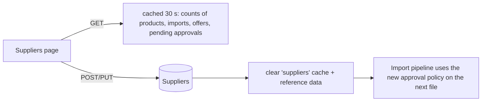

# Suppliers: `SupplierEndpoints.cs`

Routes under **`/api/suppliers`**, mapped directly on `/api`. All of them require **`SupplierAdmin`** (Admin or SupplierManager).

A supplier is a source of product data: an EDI/CSV feed or a REST API, or a member company selling on the
marketplace. Each supplier also carries the **approval policy** that the import pipeline applies to its feeds:
- whether new products need manual approval;
- the price-change percentage above which a change is held for approval (see [Approvals](08-approvals.md)).



| # | Method | Route | Access | Purpose |
|---|---|---|---|---|
| 1 | GET | `/api/suppliers` | `SupplierAdmin` | List suppliers with statistics |
| 2 | POST | `/api/suppliers` | `SupplierAdmin` | Create a supplier |
| 3 | PUT | `/api/suppliers/{id}` | `SupplierAdmin` | Update name, status and approval policy |
| 4 | GET | `/api/suppliers/demo-products` | `SupplierAdmin` | Fetch products from a demo supplier REST API |

Controller class for the examples. Because every action needs the same policy, it goes on the class once:

```csharp
[ApiController]
[Route("api/suppliers")]
[Authorize(Policy = "SupplierAdmin")]
[Tags("Suppliers")]
public sealed class SuppliersController(ICatalogueDbContext db, HybridCache cache, IActorContext actor) : ControllerBase { }
```

In the minimal API version every endpoint repeats `.RequireAuthorization("SupplierAdmin")`. The equivalent of the
class-level attribute would be `var g = api.MapGroup("/suppliers").RequireAuthorization("SupplierAdmin");`, which is
what [Approvals](08-approvals.md) and [Organizations](11-organizations.md) do.

---

### 1. `GET /api/suppliers` · List with statistics

| | |
|---|---|
| Responses | **200** `SupplierDto[] { id, code, name, integrationType, isActive, mappingVersion, productCount, importCount, lastImportUtc, requireApprovalForNewProducts, priceChangeApprovalThresholdPercent, offerCount, pendingApprovals }` |

**Flow:** one SQL query projects each supplier with correlated sub-queries: counts of products, imports, offers and
pending approvals, plus the date of the last import. Counting across millions of rows is expensive, so the result is
cached for **30 seconds** (key `suppliers:all`, tag `suppliers`).

```csharp
// Minimal API (abridged)
api.MapGet("/suppliers", async (ICatalogueDbContext db, HybridCache cache, CancellationToken ct) =>
    Results.Ok(await cache.GetOrCreateAsync("suppliers:all", async token => await db.Suppliers.AsNoTracking().OrderBy(s => s.Code)
        .Select(s => new SupplierDto(s.Id, s.Code, s.Name, s.IntegrationType.ToString(), s.IsActive, s.MappingVersion,
            db.Products.Count(p => p.SupplierId == s.Id), db.ImportFiles.Count(i => i.SupplierId == s.Id), /* ... */))
        .ToListAsync(token),
        new HybridCacheEntryOptions { Expiration = TimeSpan.FromSeconds(30), LocalCacheExpiration = TimeSpan.FromSeconds(30) },
        [CacheTags.Suppliers], ct)))
    .RequireAuthorization("SupplierAdmin").WithTags("Suppliers");
```

```csharp
// Controller
[HttpGet]
public async Task<IActionResult> List(CancellationToken ct) =>
    Ok(await cache.GetOrCreateAsync("suppliers:all", async t => await QuerySuppliers(t),
        new HybridCacheEntryOptions { Expiration = TimeSpan.FromSeconds(30) }, [CacheTags.Suppliers], ct));
```

---

### 2. `POST /api/suppliers` · Create

| | |
|---|---|
| Body | `CreateSupplierRequest { code, name, integrationType }` (`Csv`, `Edi`, `Rest` or `Manual`) |
| Responses | **201** `SupplierDto` · **400** unknown integration type · **409** code already exists |

**Flow:** parse the integration type, check the code is unique (stored upper-case), create the supplier, audit
`SupplierCreated`, save and clear the `suppliers` cache.

```csharp
// Minimal API
api.MapPost("/suppliers", async (CreateSupplierRequest req, ICatalogueDbContext db,
    IActorContext actor, HybridCache cache, CancellationToken ct) =>
{
    if (!Enum.TryParse<IntegrationType>(req.IntegrationType, true, out var type))
        return Results.BadRequest(new { error = $"Unknown integration type '{req.IntegrationType}'." });
    if (await db.Suppliers.AnyAsync(s => s.Code == req.Code.ToUpper(), ct))
        return Results.Conflict(new { error = "Supplier code already exists." });
    var supplier = new Supplier(req.Code, req.Name, type);
    db.Suppliers.Add(supplier);
    db.AuditEvents.Add(new AuditEvent(actor.ActorId, "SupplierCreated", "Supplier", supplier.Code, req.Name, actor.CorrelationId));
    await db.SaveChangesAsync(ct);
    await cache.RemoveByTagAsync(CacheTags.Suppliers, ct);
    return Results.Created($"/api/suppliers/{supplier.Id}", new SupplierDto(/* ... */));
}).RequireAuthorization("SupplierAdmin").WithTags("Suppliers");
```

```csharp
// Controller
[HttpPost]
public async Task<IActionResult> Create([FromBody] CreateSupplierRequest req, CancellationToken ct)
{
    if (!Enum.TryParse<IntegrationType>(req.IntegrationType, true, out var type))
        return BadRequest(new { error = $"Unknown integration type '{req.IntegrationType}'." });
    if (await db.Suppliers.AnyAsync(s => s.Code == req.Code.ToUpper(), ct))
        return Conflict(new { error = "Supplier code already exists." });
    // ... same create, audit, save, invalidate
    return Created($"/api/suppliers/{supplier.Id}", dto);
}
```

---

### 3. `PUT /api/suppliers/{id}` · Update supplier and approval policy

| | |
|---|---|
| Body | `UpdateSupplierRequest { name, mappingVersion, isActive, requireApprovalForNewProducts, priceChangeApprovalThresholdPercent }` |
| Responses | **204** · **404** |

**Flow**
1. Load the supplier, update its name and mapping version, and activate or deactivate it.
2. `SetApprovalPolicy` stores the approval rules. An inactive supplier's imports are rejected.
3. Audit the new values, save, clear the `suppliers` cache, and **invalidate the reference data** so import workers
   apply the new policy to the very next file.

```csharp
// Minimal API
api.MapPut("/suppliers/{id:long}", async (long id, UpdateSupplierRequest req, ICatalogueDbContext db,
    IActorContext actor, HybridCache cache, IReferenceDataProvider refData, CancellationToken ct) =>
{
    var supplier = await db.Suppliers.FirstOrDefaultAsync(s => s.Id == id, ct);
    if (supplier is null) return Results.NotFound();
    supplier.Update(req.Name, req.MappingVersion);
    if (req.IsActive) supplier.Activate(); else supplier.Deactivate();
    supplier.SetApprovalPolicy(req.RequireApprovalForNewProducts, req.PriceChangeApprovalThresholdPercent);
    // audit, save, clear cache, refData.Invalidate()
    return Results.NoContent();
}).RequireAuthorization("SupplierAdmin").WithTags("Suppliers");
```

```csharp
// Controller (needs IReferenceDataProvider too: add it to the constructor, or use [FromServices] on this action only)
[HttpPut("{id:long}")]
public async Task<IActionResult> Update(long id, [FromBody] UpdateSupplierRequest req, [FromServices] IReferenceDataProvider refData, CancellationToken ct)
{
    var supplier = await db.Suppliers.FirstOrDefaultAsync(s => s.Id == id, ct);
    if (supplier is null) return NotFound();
    // ... same
    return NoContent();
}
```

*Difference:* `[FromServices]` lets a controller action take a dependency only it uses, which is how every minimal API
handler works by default.

---

### 4. `GET /api/suppliers/demo-products` · Supplier REST adapter demo

| | |
|---|---|
| Responses | **200** list of products in the canonical import model |

**Flow:** `ISupplierProductClient` is the boundary to an external supplier's REST API. The adapter fetches products
(from a fake client, or DummyJSON when `SupplierApis:UseDummyJson=true`) and maps them to the canonical model the import
pipeline uses. The HTTP call goes through the standard resilience handler (retry, circuit breaker, timeout).

> **Route order note:** `/suppliers/demo-products` doesn't clash with `/suppliers/{id:long}`, because the `long`
> constraint means `demo-products` can't match `{id}`. Without the constraint, the more specific literal route would
> still win: ASP.NET Core routing ranks literal segments above parameters in both styles.

```csharp
// Minimal API
api.MapGet("/suppliers/demo-products", async (ISupplierProductClient client, CancellationToken ct) =>
    Results.Ok(await client.GetProductsAsync(ct)))
    .RequireAuthorization("SupplierAdmin").WithTags("Suppliers");
```

```csharp
// Controller
[HttpGet("demo-products")]
public async Task<IActionResult> DemoProducts([FromServices] ISupplierProductClient client, CancellationToken ct) =>
    Ok(await client.GetProductsAsync(ct));
```
