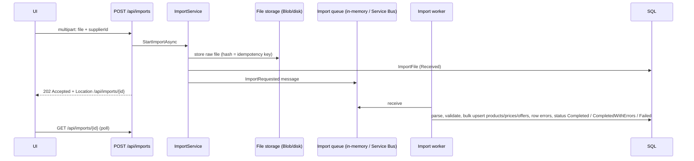

# Imports: `ImportEndpoints.cs`

Routes under **`/api/imports`**, mapped directly on `/api`.

Suppliers send price and product files (CSV or EDI PRICAT). An upload is accepted immediately (**202**) and processed
in the background:
- **Dev setup:** by the in-process `LocalImportWorker`.
- **Scaled-out setup:** by the separate `Catalogue.Workers` service, reading from Service Bus.

The endpoints let operations staff follow progress, inspect row errors and reprocess failures. Large EDI files can also
be streamed through Event Hubs; see [Event Hub](06-eventhub.md).



| # | Method | Route | Access | Purpose |
|---|---|---|---|---|
| 1 | POST | `/api/imports` | `SupplierAdmin` · 15-min timeout | Upload a CSV/EDI file |
| 2 | GET | `/api/imports` | `ImportOps` | List imports (array plus `X-Total-Count` header) |
| 3 | GET | `/api/imports/{id}` | `ImportOps` | One import |
| 4 | GET | `/api/imports/{id}/errors` | `ImportOps` | Row errors, paged |
| 5 | GET | `/api/imports/{id}/errors/summary` | `ImportOps` | Error counts per field |
| 6 | POST | `/api/imports/{id}/reprocess` | `ImportOps` | Run a failed import again |

```csharp
[ApiController]
[Route("api/imports")]
[Tags("Imports")]
public sealed class ImportsController(ICatalogueDbContext db) : ControllerBase { }
```

---

### 1. `POST /api/imports` · Upload a file

| | |
|---|---|
| Access | `SupplierAdmin` · request timeout `long-running` (15 min) · antiforgery disabled (API called with a bearer token, not a cookie form) |
| Request | `multipart/form-data` with one file plus the form field `supplierId` |
| Responses | **202** `ImportDto` with `Location: /api/imports/{id}` · **400** no file, no supplierId, or rejected (supplier inactive, duplicate file) · **404** unknown supplier |

**Flow**
1. Check that the request is multipart and has a file and a numeric `supplierId`.
2. `ImportService.StartImportAsync` hashes the file, so the same file isn't imported twice. It stores the raw file in
   Blob storage (Azurite under `./.azurite`, or disk under `./.storage`), creates the `ImportFile` record, audits, and
   publishes an `ImportRequested` message with the correlation id and trace context.
3. Domain errors become clear status codes: `KeyNotFoundException` → 404, `InvalidOperationException` → 400.
4. Return **202 Accepted**: the work continues in the background and the client polls endpoint 3.

```csharp
// Minimal API
api.MapPost("/imports", async (HttpRequest http, ImportService imports, CancellationToken ct) =>
{
    if (!http.HasFormContentType || http.Form.Files.Count == 0)
        return Results.BadRequest(new { error = "Multipart form with a file is required." });
    var file = http.Form.Files[0];
    if (!long.TryParse(http.Form["supplierId"], out var supplierId))
        return Results.BadRequest(new { error = "supplierId form field is required." });
    try
    {
        await using var stream = file.OpenReadStream();
        var import = await imports.StartImportAsync(supplierId, stream, file.FileName, ct);
        return Results.Accepted($"/api/imports/{import.Id}", ToDto(import));
    }
    catch (KeyNotFoundException ex) { return Results.NotFound(new { error = ex.Message }); }
    catch (InvalidOperationException ex) { return Results.BadRequest(new { error = ex.Message }); }
}).RequireAuthorization("SupplierAdmin").WithTags("Imports").DisableAntiforgery().WithRequestTimeout(Policies.LongRunning);
```

```csharp
// Controller
[HttpPost]
[Authorize(Policy = "SupplierAdmin")]
[RequestTimeout(Policies.LongRunning)]
[Consumes("multipart/form-data")]
public async Task<IActionResult> Upload(IFormFile file, [FromForm] long supplierId, [FromServices] ImportService imports, CancellationToken ct)
{
    // [ApiController] has already returned 400 if 'file' or 'supplierId' is missing or malformed.
    try
    {
        await using var stream = file.OpenReadStream();
        var import = await imports.StartImportAsync(supplierId, stream, file.FileName, ct);
        return AcceptedAtAction(nameof(Get), new { id = import.Id }, ToDto(import));
    }
    catch (KeyNotFoundException ex) { return NotFound(new { error = ex.Message }); }
    catch (InvalidOperationException ex) { return BadRequest(new { error = ex.Message }); }
}
```

*Difference:* the controller binds `IFormFile file` and `[FromForm] long supplierId` declaratively. The minimal API
reads `HttpRequest.Form` itself, which gives it full control over the error messages. Minimal APIs can also bind
`IFormFile` and `[FromForm]` parameters.

---

### 2. `GET /api/imports` · List imports

| | |
|---|---|
| Access | `ImportOps` |
| Query | `page`, `pageSize` (max 100), `status` (comma list, e.g. `Failed,CompletedWithErrors`), `format` (`CSV`, `EDI`, `EDI-STREAM`), `supplierId`, `search` (file name contains) |
| Responses | **200** `ImportDto[]`, a **plain array**, with the total in the **`X-Total-Count`** response header |

**Flow:** build the filtered query, write the count to the response header, then return the newest page. It returns an
array rather than a paged object because the Azure Logic Apps workflows in `logicapps/` were built against this shape.

```csharp
// Minimal API (abridged)
api.MapGet("/imports", async (ICatalogueDbContext db, HttpResponse response, int? page, int? pageSize,
    string? status, string? format, long? supplierId, string? search, CancellationToken ct) =>
{
    var q = db.ImportFiles.AsNoTracking();
    // ... filters
    response.Headers["X-Total-Count"] = (await q.CountAsync(ct)).ToString();
    var items = await q.OrderByDescending(i => i.ReceivedAtUtc).Skip((pg - 1) * ps).Take(ps).Select(i => new ImportDto(/* ... */)).ToListAsync(ct);
    return Results.Ok(items);
}).RequireAuthorization("ImportOps").WithTags("Imports");
```

`HttpResponse response` is a special parameter: the handler gets the current response object so it can add headers.

```csharp
// Controller
[HttpGet]
[Authorize(Policy = "ImportOps")]
public async Task<ActionResult<IReadOnlyList<ImportDto>>> List([FromQuery] int? page, [FromQuery] int? pageSize, [FromQuery] string? status,
    [FromQuery] string? format, [FromQuery] long? supplierId, [FromQuery] string? search, CancellationToken ct)
{
    var q = db.ImportFiles.AsNoTracking();
    // ... filters
    Response.Headers["X-Total-Count"] = (await q.CountAsync(ct)).ToString();   // Response is a ControllerBase property
    return await q.OrderByDescending(i => i.ReceivedAtUtc).Skip(...).Take(...).Select(...).ToListAsync(ct);
}
```

---

### 3. `GET /api/imports/{id}` · One import

| | |
|---|---|
| Access | `ImportOps` |
| Responses | **200** `ImportDto { id, supplierId, fileName, format, status, totalRows, processedRows, errorRows, failureReason, receivedAtUtc, completedAtUtc, correlationId, supplierCode }` · **404** |

**Flow:** read the import and its supplier without tracking and map to the DTO. The SPA polls this while the import
runs. The correlation id links it to the logs and traces of every step.

```csharp
// Minimal API
api.MapGet("/imports/{id:long}", async (long id, ICatalogueDbContext db, CancellationToken ct) =>
{
    var import = await db.ImportFiles.AsNoTracking().Include(i => i.Supplier).FirstOrDefaultAsync(i => i.Id == id, ct);
    return import is null ? Results.NotFound() : Results.Ok(ToDto(import));
}).RequireAuthorization("ImportOps").WithTags("Imports");
```

```csharp
// Controller
[HttpGet("{id:long}")]
[Authorize(Policy = "ImportOps")]
public async Task<ActionResult<ImportDto>> Get(long id, CancellationToken ct)
{
    var import = await db.ImportFiles.AsNoTracking().Include(i => i.Supplier).FirstOrDefaultAsync(i => i.Id == id, ct);
    return import is null ? NotFound() : ToDto(import);
}
```

---

### 4. `GET /api/imports/{id}/errors` · Row errors

| | |
|---|---|
| Access | `ImportOps` |
| Query | `page`, `pageSize` (default 1,000, max 5,000), `field`, `search` (in message or raw value) |
| Responses | **200** `ImportErrorDto[] { id, rowNumber, field, message, rawValue }` with `X-Total-Count` |

**Flow:** a large streamed import can produce tens of thousands of errors, so they are paged. The order is row number,
then id. Each error points at the exact row and field, with the rejected value.

```csharp
// Minimal API (abridged)
api.MapGet("/imports/{id:long}/errors", async (long id, ICatalogueDbContext db, HttpResponse response,
    int? page, int? pageSize, string? field, string? search, CancellationToken ct) =>
{
    var q = db.ImportItemErrors.AsNoTracking().Where(e => e.ImportId == id);
    // ... field/search filters
    response.Headers["X-Total-Count"] = (await q.CountAsync(ct)).ToString();
    return Results.Ok(await q.OrderBy(e => e.RowNumber).ThenBy(e => e.Id).Skip(...).Take(...).Select(e => new ImportErrorDto(/* ... */)).ToListAsync(ct));
}).RequireAuthorization("ImportOps").WithTags("Imports");
```

```csharp
// Controller
[HttpGet("{id:long}/errors")]
[Authorize(Policy = "ImportOps")]
public async Task<IActionResult> Errors(long id, [FromQuery] int? page, [FromQuery] int? pageSize, [FromQuery] string? field, [FromQuery] string? search, CancellationToken ct)
{
    // ... same; Response.Headers["X-Total-Count"] = ...
    return Ok(items);
}
```

---

### 5. `GET /api/imports/{id}/errors/summary` · Errors per field

| | |
|---|---|
| Access | `ImportOps` |
| Responses | **200** `[{ field, count }]`, largest first |

**Flow:** one `GROUP BY Field` query. It shows at a glance whether a file failed mostly on price, GTIN or a missing
spec, for example.

```csharp
// Minimal API
api.MapGet("/imports/{id:long}/errors/summary", async (long id, ICatalogueDbContext db, CancellationToken ct) =>
    Results.Ok(await db.ImportItemErrors.Where(e => e.ImportId == id)
        .GroupBy(e => e.Field).Select(g => new { field = g.Key, count = g.Count() })
        .OrderByDescending(x => x.count).ToListAsync(ct)))
    .RequireAuthorization("ImportOps").WithTags("Imports");
```

```csharp
// Controller
[HttpGet("{id:long}/errors/summary")]
[Authorize(Policy = "ImportOps")]
public async Task<IActionResult> ErrorSummary(long id, CancellationToken ct) =>
    Ok(await db.ImportItemErrors.Where(e => e.ImportId == id).GroupBy(e => e.Field)
        .Select(g => new { field = g.Key, count = g.Count() }).OrderByDescending(x => x.count).ToListAsync(ct));
```

---

### 6. `POST /api/imports/{id}/reprocess` · Run again

| | |
|---|---|
| Access | `ImportOps` |
| Responses | **202** with `Location: /api/imports/{id}` · **404** · **409** still running, or the stream can't be replayed |

**Flow**
1. `ImportReprocessService` is also used when someone approves an assistant proposal to reprocess an import (see
   [Assistant](14-agent-analytics.md)).
2. Streamed imports are replayed through Event Hubs. File imports are re-queued unless they are still `Received` or
   `Processing`.
3. Audit `ImportReprocessRequested` and publish a new `ImportRequested` message. The worker owns the change to
   `Processing`.

```csharp
// Minimal API
api.MapPost("/imports/{id:long}/reprocess", async (long id, ImportReprocessService reprocess, IActorContext actor, CancellationToken ct) =>
{
    try
    {
        return await reprocess.ReprocessAsync(id, actor.ActorId, actor.CorrelationId, ct)
            ? Results.Accepted($"/api/imports/{id}") : Results.NotFound();
    }
    catch (InvalidOperationException ex) { return Results.Conflict(new { error = ex.Message }); }
}).RequireAuthorization("ImportOps").WithTags("Imports");
```

```csharp
// Controller
[HttpPost("{id:long}/reprocess")]
[Authorize(Policy = "ImportOps")]
public async Task<IActionResult> Reprocess(long id, [FromServices] ImportReprocessService reprocess, [FromServices] IActorContext actor, CancellationToken ct)
{
    try
    {
        return await reprocess.ReprocessAsync(id, actor.ActorId, actor.CorrelationId, ct) ? AcceptedAtAction(nameof(Get), new { id }, null) : NotFound();
    }
    catch (InvalidOperationException ex) { return Conflict(new { error = ex.Message }); }
}
```
