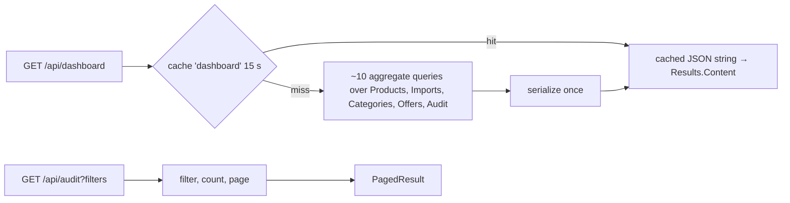

# Dashboard & audit log: `DashboardEndpoints.cs`

Routes **`/api/dashboard`**, **`/api/audit`** and **`/api/audit/actions`**, mapped directly on `/api`.

- **Dashboard:** the operations overview on the home page: product counts, import health, a 14-day ingestion chart,
  top categories, recent imports and recent activity. For time-range analytics see
  [Analytics](14-agent-analytics.md#analytics).
- **Audit log:** every significant action (sign-in, product change, import, approval, order, payment, agent action) is
  written to `AuditEvents` with the actor and correlation id. These endpoints let staff search it.



| # | Method | Route | Access | Purpose |
|---|---|---|---|---|
| 1 | GET | `/api/dashboard` | `ReadCatalogue` | Home-page overview |
| 2 | GET | `/api/audit` | `ImportOps` | Search the audit log, paged |
| 3 | GET | `/api/audit/actions` | `ImportOps` | Distinct action names (for the filter list) |

With controllers this would be two classes, `DashboardController` (`api/dashboard`) and `AuditController`
(`api/audit`). Here one static class maps both because they share the `AuditDto`.

---

### 1. `GET /api/dashboard` · Overview

| | |
|---|---|
| Access | `ReadCatalogue` |
| Responses | **200** `{ products: {total, active, inactive, draft}, suppliers: {total, active}, categories, pendingApprovals, multiSourcedProducts, pendingProducts, imports: {total, byStatus, rowsLast14Days, errorsLast14Days}, daily: [{day, rows, errors, imports} × 14], topCategories, recentImports, activity, generatedUtc }` |

**Flow**
1. Cache key `dashboard`, **15 seconds**, tag `dashboard`. On a 7-million-product catalogue the aggregates take
   seconds, so a few seconds of staleness keeps the page fast for everyone.
2. On a miss: product counts by status, imports by status, imports per day for 14 days (missing days are filled with
   zeros in memory), top 8 categories (a `GROUP BY` joined to `Categories` in one query), recent imports, pending
   approvals, products offered by more than one supplier, and the last 8 audit events.
3. The anonymous result is **serialised once** to a JSON string and that string is cached. Every hit returns it with
   `Results.Content(json, "application/json")`, so cached responses skip serialisation. (Anonymous types can't be
   deserialised back, so caching the string is also what makes this work with the Redis L2 cache.)

```csharp
// Minimal API (abridged)
api.MapGet("/dashboard", async (ICatalogueDbContext db, HybridCache cache, CancellationToken ct) =>
    Results.Content(await cache.GetOrCreateAsync("dashboard", async token =>
    {
        var byStatus = await db.Products.GroupBy(p => p.Status).Select(g => new { Status = g.Key, Count = g.Count() }).ToListAsync(token);
        // ... imports, daily, topCategories, recentImports, pendingApprovals, activity
        return JsonSerializer.Serialize(result, JsonSerializerOptions.Web);
    }, new HybridCacheEntryOptions { Expiration = TimeSpan.FromSeconds(15), LocalCacheExpiration = TimeSpan.FromSeconds(15) },
    [CacheTags.Dashboard], ct), "application/json")).RequireAuthorization("ReadCatalogue").WithTags("Dashboard");
```

```csharp
// Controller
[ApiController, Route("api/dashboard"), Tags("Dashboard")]
public sealed class DashboardController(ICatalogueDbContext db, HybridCache cache) : ControllerBase
{
    [HttpGet]
    [Authorize(Policy = "ReadCatalogue")]
    public async Task<ContentResult> Get(CancellationToken ct) =>
        Content(await cache.GetOrCreateAsync("dashboard", async t => JsonSerializer.Serialize(await Build(t), JsonSerializerOptions.Web),
            new HybridCacheEntryOptions { Expiration = TimeSpan.FromSeconds(15) }, [CacheTags.Dashboard], ct), "application/json");
}
```

*Difference:* `Results.Content` and the controller's `Content()` both send a pre-built string with a content type and
bypass the JSON formatter.

---

### 2. `GET /api/audit` · Search the audit log

| | |
|---|---|
| Access | `ImportOps` |
| Query | `search` (actor, entity id, details or correlation id contains), `action`, `entityType`, `page`, `pageSize` (max 200) |
| Responses | **200** `PagedResult<AuditDto> { items: [{ id, actorId, action, entityType, entityId, timestampUtc, details, correlationId }], total, page, pageSize }` |

**Flow:** filter, count, then page newest first. Searching by **correlation id** finds every audited action from a
single request or import run, even when one user action produced many events.

```csharp
// Minimal API (abridged)
api.MapGet("/audit", async (ICatalogueDbContext db, HttpResponse response, string? search, string? action,
    string? entityType, int? page, int? pageSize, CancellationToken ct) =>
{
    var q = db.AuditEvents.AsQueryable();
    if (!string.IsNullOrWhiteSpace(action)) q = q.Where(a => a.Action == action);
    // ... entityType, search
    var total = await q.CountAsync(ct);
    var items = await q.OrderByDescending(a => a.Id).Skip((pg - 1) * ps).Take(ps).Select(a => new AuditDto(/* ... */)).ToListAsync(ct);
    return Results.Ok(new PagedResult<AuditDto>(items, total, pg, ps));
}).RequireAuthorization("ImportOps").WithTags("Audit");
```

```csharp
// Controller
[ApiController, Route("api/audit"), Authorize(Policy = "ImportOps"), Tags("Audit")]
public sealed class AuditController(ICatalogueDbContext db) : ControllerBase
{
    [HttpGet]
    public async Task<PagedResult<AuditDto>> Search([FromQuery] string? search, [FromQuery] string? action, [FromQuery] string? entityType,
        [FromQuery] int? page, [FromQuery] int? pageSize, CancellationToken ct) { /* same */ }
}
```

---

### 3. `GET /api/audit/actions` · Action names

| | |
|---|---|
| Access | `ImportOps` |
| Responses | **200** `string[]`, distinct action names in alphabetical order (`AgentTurn`, `ImportReprocessRequested`, `PaymentRefunded`, `UserSignedIn`, …) |

```csharp
// Minimal API
api.MapGet("/audit/actions", async (ICatalogueDbContext db, CancellationToken ct) =>
    Results.Ok(await db.AuditEvents.Select(a => a.Action).Distinct().OrderBy(a => a).ToListAsync(ct)))
    .RequireAuthorization("ImportOps").WithTags("Audit");
```

```csharp
// Controller (AuditController)
[HttpGet("actions")]
public async Task<IReadOnlyList<string>> Actions(CancellationToken ct) =>
    await db.AuditEvents.Select(a => a.Action).Distinct().OrderBy(a => a).ToListAsync(ct);
```
