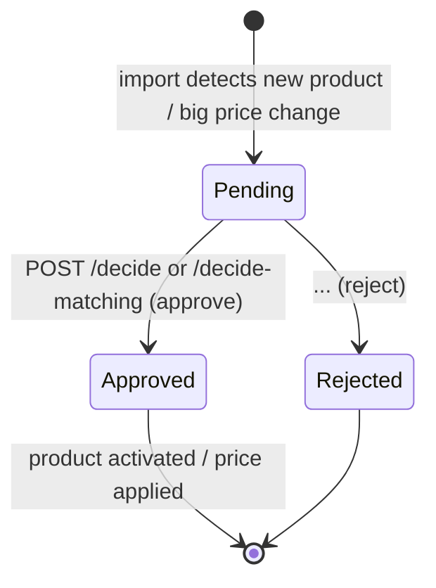

# Approvals: `ApprovalEndpoints.cs`

Base route **`/api/approvals`**: route group `api.MapGroup("/approvals").WithTags("Approvals")`. Each endpoint sets its
own policy.

When an import brings in a **new product** from a supplier that requires approval, or a **price change** above the
supplier's threshold (see [Suppliers](04-suppliers.md)), the change is not applied. It is stored as a
`ProductChangeRequest` with status `Pending` instead. Staff review and decide here. Approving applies the change, for
example the new price becomes active. Rejecting discards it.



| # | Method | Route | Access | Purpose |
|---|---|---|---|---|
| 1 | GET | `/api/approvals` | `ImportOps` | List change requests, paged |
| 2 | GET | `/api/approvals/summary` | `ImportOps` | Pending counts by kind and supplier |
| 3 | POST | `/api/approvals/decide` | `CatalogueAdmin` | Approve or reject selected ids |
| 4 | POST | `/api/approvals/decide-matching` | `CatalogueAdmin` · 15 min | Approve or reject everything matching a filter, in batches |

```csharp
[ApiController]
[Route("api/approvals")]
[Tags("Approvals")]
public sealed class ApprovalsController(ICatalogueDbContext db, ApprovalService approvals, HybridCache cache) : ControllerBase { }
```

> The group is mapped with `group.MapGet("", ...)`. An empty pattern means "the group's own path", `/api/approvals`.
> A controller does the same with `[HttpGet]` and no template.

---

### 1. `GET /api/approvals` · Review queue

| | |
|---|---|
| Access | `ImportOps` |
| Query | `status` (`Pending` by default, `Approved`, `Rejected`), `kind` (`NewProduct`, `PriceChange`), `supplierId`, `importId`, `search` (SKU or name prefix), `page`, `pageSize` (max 200) |
| Responses | **200** `PagedResult<ChangeRequestDto> { items: [{ id, productId, productSku, productName, brand, supplierId, supplierCode, importId, kind, status, currency, oldPrice, newPrice, changePercent, summary, createdAtUtc, decidedBy, decidedAtUtc, decisionNote }], total, page, pageSize }` |

**Flow**
1. Filter by status (unknown values fall back to `Pending`), kind, supplier, import and search.
2. Pending items are sorted oldest first (first in, first out). Decided items are sorted by decision time, newest first.
3. Project in SQL, then compute `changePercent` in memory, `(new − old) / old × 100`. Doing it after the query avoids a
   division EF would translate awkwardly.

```csharp
// Minimal API (abridged)
group.MapGet("", async (ICatalogueDbContext db, HttpResponse response, string? status, string? kind, long? supplierId,
    long? importId, string? search, int? page, int? pageSize, CancellationToken ct) =>
{
    var st = Enum.TryParse<ChangeStatus>(status, true, out var s) ? s : ChangeStatus.Pending;
    var q = db.ProductChangeRequests.AsNoTracking().Where(r => r.Status == st);
    // ... filters
    var total = await q.CountAsync(ct);
    var rows = await (st == ChangeStatus.Pending ? q.OrderBy(r => r.Id) : q.OrderByDescending(r => r.DecidedAtUtc)).Skip(...).Take(...).Select(...).ToListAsync(ct);
    return Results.Ok(new ProductEndpoints.PagedResult<ChangeRequestDto>(/* map + changePercent */, total, pg, ps));
}).RequireAuthorization("ImportOps");
```

```csharp
// Controller
[HttpGet]
[Authorize(Policy = "ImportOps")]
public async Task<IActionResult> List([FromQuery] string? status, [FromQuery] string? kind, [FromQuery] long? supplierId,
    [FromQuery] long? importId, [FromQuery] string? search, [FromQuery] int? page, [FromQuery] int? pageSize, CancellationToken ct) { /* same */ }
```

---

### 2. `GET /api/approvals/summary` · Pending overview

| | |
|---|---|
| Access | `ImportOps` |
| Responses | **200** `{ totalPending, pending: [{ kind, supplierId, supplierCode, count }], decided24h }` |

**Flow:** pending requests grouped by kind and supplier (drives the "Approve all from supplier X" buttons), plus how
many were decided in the last 24 hours.

```csharp
// Minimal API
group.MapGet("/summary", async (ICatalogueDbContext db, CancellationToken ct) =>
{
    var pending = await db.ProductChangeRequests.Where(r => r.Status == ChangeStatus.Pending)
        .GroupBy(r => new { r.Kind, r.SupplierId, r.Supplier!.Code })
        .Select(g => new { kind = g.Key.Kind.ToString(), supplierId = g.Key.SupplierId, supplierCode = g.Key.Code, count = g.Count() }).ToListAsync(ct);
    var decided24h = await db.ProductChangeRequests.Where(r => r.Status != ChangeStatus.Pending && r.DecidedAtUtc >= DateTime.UtcNow.AddDays(-1)).CountAsync(ct);
    return Results.Ok(new { totalPending = pending.Sum(p => p.count), pending, decided24h });
}).RequireAuthorization("ImportOps");
```

```csharp
// Controller
[HttpGet("summary")]
[Authorize(Policy = "ImportOps")]
public async Task<IActionResult> Summary(CancellationToken ct) { /* same */ return Ok(new { totalPending, pending, decided24h }); }
```

---

### 3. `POST /api/approvals/decide` · Decide selected items

| | |
|---|---|
| Access | `CatalogueAdmin` |
| Body | `DecideRequest { ids: long[], approve: bool, note? }` |
| Responses | **200** `{ decided }` (how many changed; ones already decided are skipped) · **400** empty list, or more than 20,000 ids |

**Flow**
1. Validate the list size.
2. `ApprovalService.DecideAsync` works through the ids in batches of 1,000. For each pending request it applies the
   change (activate the product, or close the old price and open the new one) or rejects it, and records who decided,
   when and the note. The actor comes from `IActorContext`, which reads the signed-in user from the HTTP request.
3. Clear the `products` cache, because prices and statuses changed.

The assistant's "approve change" proposals run through this same `ApprovalService` (see [Assistant](14-agent-analytics.md)).

```csharp
// Minimal API
group.MapPost("/decide", async (DecideRequest req, ApprovalService approvals, HybridCache cache, CancellationToken ct) =>
{
    if (req.Ids.Count == 0) return Results.BadRequest(new { error = "Select at least one change." });
    if (req.Ids.Count > ApprovalService.MaxPerCall) return Results.BadRequest(new { error = $"At most {ApprovalService.MaxPerCall} per call." });
    var decided = await approvals.DecideAsync(req.Ids, req.Approve, req.Note, ct);
    await cache.RemoveByTagAsync(CacheTags.Products, ct);
    return Results.Ok(new { decided });
}).RequireAuthorization("CatalogueAdmin");
```

```csharp
// Controller
[HttpPost("decide")]
[Authorize(Policy = "CatalogueAdmin")]
public async Task<IActionResult> Decide([FromBody] DecideRequest req, CancellationToken ct)
{
    if (req.Ids.Count == 0) return BadRequest(new { error = "Select at least one change." });
    if (req.Ids.Count > ApprovalService.MaxPerCall) return BadRequest(new { error = $"At most {ApprovalService.MaxPerCall} per call." });
    var decided = await approvals.DecideAsync(req.Ids, req.Approve, req.Note, ct);
    await cache.RemoveByTagAsync(CacheTags.Products, ct);
    return Ok(new { decided });
}
```

---

### 4. `POST /api/approvals/decide-matching` · Decide by filter

| | |
|---|---|
| Access | `CatalogueAdmin` · timeout `long-running` (15 min) |
| Body | `DecideMatchingRequest { kind?, supplierId?, importId?, approve, note? }` |
| Responses | **200** `{ decided, remaining }` |

**Flow:** this is for "approve all 250,000 new products from this import". `DecideMatchingAsync` decides up to 20,000
matching pending requests per call, in batches of 1,000, and reports how many are **remaining**. The SPA calls again
until `remaining` is 0 and shows progress, so no single request runs too long.

```csharp
// Minimal API
group.MapPost("/decide-matching", async (DecideMatchingRequest req, ApprovalService approvals, HybridCache cache, CancellationToken ct) =>
{
    ChangeKind? kind = Enum.TryParse<ChangeKind>(req.Kind, true, out var k) ? k : null;
    var (decided, remaining) = await approvals.DecideMatchingAsync(new ApprovalFilter(kind, req.SupplierId, req.ImportId), req.Approve, req.Note, ct);
    await cache.RemoveByTagAsync(CacheTags.Products, ct);
    return Results.Ok(new { decided, remaining });
}).RequireAuthorization("CatalogueAdmin").WithRequestTimeout(Policies.LongRunning);
```

```csharp
// Controller
[HttpPost("decide-matching")]
[Authorize(Policy = "CatalogueAdmin")]
[RequestTimeout(Policies.LongRunning)]
public async Task<IActionResult> DecideMatching([FromBody] DecideMatchingRequest req, CancellationToken ct) { /* same */ return Ok(new { decided, remaining }); }
```
