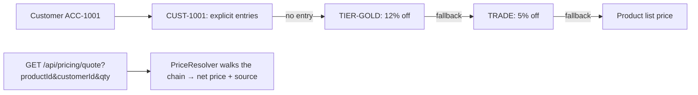

# Pricing: `PricingEndpoints.cs`

Three route areas, defined as two route groups plus one direct mapping:

| Group | Base route | Purpose |
|---|---|---|
| `api.MapGroup("/pricelists").WithTags("Pricing")` | `/api/pricelists` | Trade, tier and customer price lists and their quantity-break entries |
| `api.MapGroup("/customers").WithTags("Pricing")` | `/api/customers` | Customer (trade) accounts and the price list assigned to each |
| `api.MapGet("/pricing/quote", …)` | `/api/pricing/quote` | What a given customer pays for a product |

**How B2B prices are resolved** (`PriceResolver`): a customer account points at a price list, and each list can fall
back to a parent list. For example: customer list → tier list → TRADE list → product list price. For a product and
quantity, the first list in that chain with an **explicit entry** (the highest quantity break not above the quantity)
wins. Failing that, the first list with a **discount percent** applies that discount to the list price.



| # | Method | Route | Access | Purpose |
|---|---|---|---|---|
| 1 | GET | `/api/pricelists` | `ReadCatalogue` | All price lists with entry and customer counts |
| 2 | POST | `/api/pricelists` | `CatalogueAdmin` | Create a price list |
| 3 | PUT | `/api/pricelists/{id}` | `CatalogueAdmin` | Update discount, fallback parent, active flag |
| 4 | GET | `/api/pricelists/{id}/entries` | `ReadCatalogue` | Explicit prices and quantity breaks, paged |
| 5 | POST | `/api/pricelists/{id}/entries` | `CatalogueAdmin` | Add an entry |
| 6 | DELETE | `/api/pricelists/{id}/entries/{entryId}` | `CatalogueAdmin` | Remove an entry |
| 7 | GET | `/api/customers` | `ReadCatalogue` | Customer accounts |
| 8 | POST | `/api/customers` | `CatalogueAdmin` | Create a customer account |
| 9 | PUT | `/api/customers/{id}/pricelist?priceListId=` | `CatalogueAdmin` | Assign or clear the price list |
| 10 | GET | `/api/pricing/quote` | `ReadCatalogue` | Net price and the full fallback chain |

As controllers this is naturally **three** classes:

```csharp
[ApiController, Route("api/pricelists"), Tags("Pricing")] public sealed class PriceListsController(ICatalogueDbContext db, IActorContext actor, HybridCache cache) : ControllerBase { }
[ApiController, Route("api/customers"),  Tags("Pricing")] public sealed class CustomersController(ICatalogueDbContext db, IActorContext actor) : ControllerBase { }
[ApiController, Route("api/pricing"),    Tags("Pricing")] public sealed class PricingController(ICatalogueDbContext db, PricingService pricing) : ControllerBase { }
```

---

### 1. `GET /api/pricelists` · List price lists

| | |
|---|---|
| Access | `ReadCatalogue` |
| Responses | **200** `PriceListDto[] { id, code, name, kind (Trade, Tier, Customer, Promotion), currency, discountPercent, parentPriceListId, parentCode, isActive, entryCount, customerCount }` |

**Flow:** two grouped counts (entries per list, customers per list) and the lists themselves. The parent code is
looked up in memory from the same list, since there are only a few lists.

```csharp
// Minimal API (abridged)
lists.MapGet("", async (ICatalogueDbContext db, CancellationToken ct) =>
{
    var entryCounts = await db.PriceListEntries.GroupBy(e => e.PriceListId).Select(g => new { g.Key, C = g.Count() }).ToDictionaryAsync(x => x.Key, x => x.C, ct);
    var customerCounts = /* ... */;
    var all = await db.PriceLists.AsNoTracking().OrderBy(p => p.Kind).ThenBy(p => p.Code).ToListAsync(ct);
    return Results.Ok(all.Select(p => new PriceListDto(/* ..., parent code, counts */)));
}).RequireAuthorization("ReadCatalogue");
```

```csharp
// Controller (PriceListsController)
[HttpGet]
[Authorize(Policy = "ReadCatalogue")]
public async Task<IEnumerable<PriceListDto>> List(CancellationToken ct) { /* same */ }
```

---

### 2. `POST /api/pricelists` · Create

| | |
|---|---|
| Access | `CatalogueAdmin` |
| Body | `UpsertPriceListRequest { code, name, kind, discountPercent, parentPriceListId?, isActive }` |
| Responses | **201** `{ id }` · **400** unknown kind · **409** code already exists |

```csharp
// Minimal API
lists.MapPost("", async (UpsertPriceListRequest req, ICatalogueDbContext db, IActorContext actor, CancellationToken ct) =>
{
    if (!Enum.TryParse<PriceListKind>(req.Kind, true, out var kind)) return Results.BadRequest(new { error = $"Unknown kind '{req.Kind}'." });
    if (await db.PriceLists.AnyAsync(p => p.Code == req.Code.ToUpper(), ct)) return Results.Conflict(new { error = "Price list code already exists." });
    var list = new PriceList(req.Code, req.Name, kind, req.DiscountPercent, req.ParentPriceListId);
    // add, audit PriceListCreated, save
    return Results.Created($"/api/pricelists/{list.Id}", new { list.Id });
}).RequireAuthorization("CatalogueAdmin");
```

```csharp
// Controller
[HttpPost]
[Authorize(Policy = "CatalogueAdmin")]
public async Task<IActionResult> Create([FromBody] UpsertPriceListRequest req, CancellationToken ct)
{
    if (!Enum.TryParse<PriceListKind>(req.Kind, true, out var kind)) return BadRequest(new { error = $"Unknown kind '{req.Kind}'." });
    if (await db.PriceLists.AnyAsync(p => p.Code == req.Code.ToUpper(), ct)) return Conflict(new { error = "Price list code already exists." });
    // ... same
    return Created($"/api/pricelists/{list.Id}", new { list.Id });
}
```

---

### 3. `PUT /api/pricelists/{id}` · Update

| | |
|---|---|
| Access | `CatalogueAdmin` |
| Body | `UpsertPriceListRequest` (the code and kind don't change) |
| Responses | **204** · **400** the new parent would create a fallback cycle · **404** |

**Flow:** load every list into a dictionary, then walk the chain from the proposed parent. If it reaches this list
(A → B → A), reject it. Otherwise update the name, discount, parent and active flag, audit and save.

```csharp
// Minimal API
lists.MapPut("/{id:long}", async (long id, UpsertPriceListRequest req, ICatalogueDbContext db, IActorContext actor, CancellationToken ct) =>
{
    var all = await db.PriceLists.ToDictionaryAsync(p => p.Id, ct);
    if (!all.TryGetValue(id, out var list)) return Results.NotFound();
    if (req.ParentPriceListId is { } parent && PriceResolver.Chain(parent, all).Any(l => l.Id == id))
        return Results.BadRequest(new { error = "That fallback would create a cycle." });
    list.Update(req.Name, req.DiscountPercent, req.ParentPriceListId, req.IsActive);
    // audit, save
    return Results.NoContent();
}).RequireAuthorization("CatalogueAdmin");
```

```csharp
// Controller
[HttpPut("{id:long}")]
[Authorize(Policy = "CatalogueAdmin")]
public async Task<IActionResult> Update(long id, [FromBody] UpsertPriceListRequest req, CancellationToken ct) { /* same */ return NoContent(); }
```

---

### 4. `GET /api/pricelists/{id}/entries` · Entries

| | |
|---|---|
| Access | `ReadCatalogue` |
| Query | `search` (SKU or name prefix), `page`, `pageSize` (max 200) |
| Responses | **200** `PagedResult<EntryDto> { items: [{ id, productId, sku, productName, minQuantity, unitPrice, listPrice, validFromUtc, validToUtc }], … }` |

**Flow:** entries for the list, sorted by SKU then quantity break, each shown beside the product's current list
price so the effective discount is visible.

```csharp
// Minimal API (abridged)
lists.MapGet("/{id:long}/entries", async (long id, ICatalogueDbContext db, HttpResponse response, string? search,
    int? page, int? pageSize, CancellationToken ct) =>
{
    var q = db.PriceListEntries.AsNoTracking().Where(e => e.PriceListId == id);
    // search, count, page, project with list price
    return Results.Ok(new ProductEndpoints.PagedResult<EntryDto>(items, total, pg, ps));
}).RequireAuthorization("ReadCatalogue");
```

```csharp
// Controller
[HttpGet("{id:long}/entries")]
[Authorize(Policy = "ReadCatalogue")]
public async Task<IActionResult> Entries(long id, [FromQuery] string? search, [FromQuery] int? page, [FromQuery] int? pageSize, CancellationToken ct) { /* same */ }
```

---

### 5. `POST /api/pricelists/{id}/entries` · Add an entry

| | |
|---|---|
| Access | `CatalogueAdmin` |
| Body | `AddEntryRequest { sku, minQuantity, unitPrice, validFromUtc?, validToUtc? }` |
| Responses | **201** `{ id }` · **400** SKU not found, or ambiguous (the same SKU from several suppliers) · **404** list not found |

**Flow:** resolve the SKU to exactly one product (take 2 to detect ambiguity), create the entry (it starts today by
default), audit, save, and clear that product's cached detail, since its quotes change.

```csharp
// Minimal API (abridged)
lists.MapPost("/{id:long}/entries", async (long id, AddEntryRequest req, ICatalogueDbContext db, IActorContext actor,
    HybridCache cache, CancellationToken ct) =>
{
    var list = await db.PriceLists.FirstOrDefaultAsync(p => p.Id == id, ct);
    if (list is null) return Results.NotFound();
    var products = await db.Products.Where(p => p.Sku == sku).Select(p => p.Id).Take(2).ToListAsync(ct);
    if (products.Count == 0) return Results.BadRequest(new { error = $"No product with SKU {sku}." });
    if (products.Count > 1) return Results.BadRequest(new { error = $"SKU {sku} exists for several suppliers; use the product's own page." });
    // add entry, audit, save, cache.RemoveAsync(CacheTags.Product(products[0]))
    return Results.Created($"/api/pricelists/{id}/entries/{entry.Id}", new { entry.Id });
}).RequireAuthorization("CatalogueAdmin");
```

```csharp
// Controller
[HttpPost("{id:long}/entries")]
[Authorize(Policy = "CatalogueAdmin")]
public async Task<IActionResult> AddEntry(long id, [FromBody] AddEntryRequest req, CancellationToken ct) { /* same */ }
```

---

### 6. `DELETE /api/pricelists/{id}/entries/{entryId}` · Remove an entry

| | |
|---|---|
| Access | `CatalogueAdmin` |
| Responses | **204** · **404** (the entry must belong to that list) |

```csharp
// Minimal API
lists.MapDelete("/{id:long}/entries/{entryId:long}", async (long id, long entryId, ICatalogueDbContext db, IActorContext actor, CancellationToken ct) =>
{
    var entry = await db.PriceListEntries.FirstOrDefaultAsync(e => e.Id == entryId && e.PriceListId == id, ct);
    if (entry is null) return Results.NotFound();
    db.PriceListEntries.Remove(entry);
    // audit PriceListEntryRemoved, save
    return Results.NoContent();
}).RequireAuthorization("CatalogueAdmin");
```

Both `id` and `entryId` bind from the route because both names appear in the pattern.

```csharp
// Controller
[HttpDelete("{id:long}/entries/{entryId:long}")]
[Authorize(Policy = "CatalogueAdmin")]
public async Task<IActionResult> RemoveEntry(long id, long entryId, CancellationToken ct) { /* same */ return NoContent(); }
```

---

### 7. `GET /api/customers` · Customer accounts

| | |
|---|---|
| Access | `ReadCatalogue` |
| Responses | **200** `CustomerDto[] { id, accountNumber, name, priceListId, priceListCode, isActive }` |

```csharp
// Minimal API
customers.MapGet("", async (ICatalogueDbContext db, CancellationToken ct) =>
    Results.Ok(await db.CustomerAccounts.AsNoTracking().OrderBy(c => c.AccountNumber)
        .Select(c => new CustomerDto(c.Id, c.AccountNumber, c.Name, c.PriceListId, c.PriceList != null ? c.PriceList.Code : null, c.IsActive))
        .ToListAsync(ct)))
    .RequireAuthorization("ReadCatalogue");
```

```csharp
// Controller (CustomersController)
[HttpGet]
[Authorize(Policy = "ReadCatalogue")]
public async Task<IReadOnlyList<CustomerDto>> List(CancellationToken ct) => await db.CustomerAccounts.AsNoTracking().OrderBy(c => c.AccountNumber).Select(/* ... */).ToListAsync(ct);
```

---

### 8. `POST /api/customers` · Create an account

| | |
|---|---|
| Access | `CatalogueAdmin` |
| Body | `CreateCustomerRequest { accountNumber, name, priceListId? }` |
| Responses | **201** `{ id }` · **409** account number already exists |

Accounts are also created automatically when a buying company is approved (see [Organizations](11-organizations.md)).

```csharp
// Minimal API
customers.MapPost("", async (CreateCustomerRequest req, ICatalogueDbContext db, IActorContext actor, CancellationToken ct) =>
{
    if (await db.CustomerAccounts.AnyAsync(c => c.AccountNumber == req.AccountNumber.ToUpper(), ct))
        return Results.Conflict(new { error = "Account number already exists." });
    var customer = new CustomerAccount(req.AccountNumber, req.Name, req.PriceListId);
    // add, audit CustomerCreated, save
    return Results.Created($"/api/customers/{customer.Id}", new { customer.Id });
}).RequireAuthorization("CatalogueAdmin");
```

```csharp
// Controller
[HttpPost]
[Authorize(Policy = "CatalogueAdmin")]
public async Task<IActionResult> Create([FromBody] CreateCustomerRequest req, CancellationToken ct) { /* same */ }
```

---

### 9. `PUT /api/customers/{id}/pricelist?priceListId=…` · Assign a price list

| | |
|---|---|
| Access | `CatalogueAdmin` |
| Request | `priceListId` in the **query string**; omit it to clear the assignment |
| Responses | **204** · **404** |

**Binding note:** the handler is `(long id, long? priceListId, …)`. `id` matches the route, and `priceListId` is a
simple type that isn't in the route, so minimal APIs bind it from the **query string**. Simple types never bind from
the body. A client sends `PUT /api/customers/6/pricelist?priceListId=3` with no body.

```csharp
// Minimal API
customers.MapPut("/{id:long}/pricelist", async (long id, long? priceListId, ICatalogueDbContext db, IActorContext actor, CancellationToken ct) =>
{
    var customer = await db.CustomerAccounts.FirstOrDefaultAsync(c => c.Id == id, ct);
    if (customer is null) return Results.NotFound();
    customer.AssignPriceList(priceListId);
    // audit CustomerPriceListChanged, save
    return Results.NoContent();
}).RequireAuthorization("CatalogueAdmin");
```

```csharp
// Controller: the same contract needs [FromQuery] to be explicit
[HttpPut("{id:long}/pricelist")]
[Authorize(Policy = "CatalogueAdmin")]
public async Task<IActionResult> AssignPriceList(long id, [FromQuery] long? priceListId, CancellationToken ct) { /* same */ return NoContent(); }
```

---

### 10. `GET /api/pricing/quote` · Price quote

| | |
|---|---|
| Access | `ReadCatalogue` |
| Query | `productId` (required), `customerId?` or `priceListId?`, `qty?` (default 1) |
| Responses | **200** `{ product: {id, sku, name}, customer: {id, accountNumber, name} \| null, chain: [{code, name, kind, discountPercent}], quote: { listPrice, netUnitPrice, source, priceListCode, savingPercent, … } }` · **400** missing `productId` · **404** |

**Flow**
1. Load the product's current list price and currency.
2. `PricingService.ContextAsync` resolves either the customer (and its price list) or a price list given directly,
   then the full fallback chain.
3. `QuoteAsync` resolves the net price for the quantity and records **where it came from**, e.g. "CUST-1001 break 10+"
   or "TRADE −5%". The Pricing page's "price explorer" shows the chain and the result.

`productId` is a non-nullable `long`, so a request without it fails binding and returns **400** in both styles.

```csharp
// Minimal API (abridged)
api.MapGet("/pricing/quote", async (long productId, long? customerId, long? priceListId, int? qty,
    ICatalogueDbContext db, PricingService pricing, CancellationToken ct) =>
{
    var product = await db.Products.AsNoTracking().Where(p => p.Id == productId).Select(p => new { /* id, sku, name, active price */ }).FirstOrDefaultAsync(ct);
    if (product is null) return Results.NotFound();
    var (customer, chain) = await pricing.ContextAsync(customerId, priceListId, ct);
    var quote = (await pricing.QuoteAsync([(product.Id, product.Price, product.Currency ?? "GBP")], chain, qty ?? 1, ct))[product.Id];
    return Results.Ok(new { product = new { product.Id, product.Sku, product.Name }, customer = /* ... */, chain = /* ... */, quote });
}).RequireAuthorization("ReadCatalogue").WithTags("Pricing");
```

```csharp
// Controller (PricingController)
[HttpGet("quote")]
[Authorize(Policy = "ReadCatalogue")]
public async Task<IActionResult> Quote([FromQuery] long productId, [FromQuery] long? customerId, [FromQuery] long? priceListId, [FromQuery] int? qty, CancellationToken ct) { /* same */ }
```
