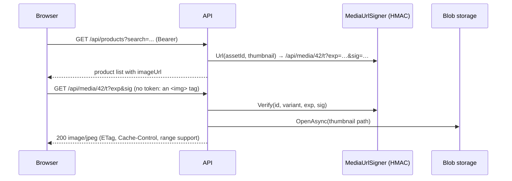

# Media: `MediaEndpoints.cs`

Product images and documents (datasheets, manuals, energy labels, certificates). The bytes are stored in a **private**
Blob container (`catalogue-media`), in Azurite under `./.azurite`, or on disk under `./.storage/media` when Azurite isn't
running. Browsers can't send a bearer token for ``, so the API gives out **HMAC-signed, short-lived URLs**
instead of making the container public.

The file maps three areas:

| Area | Mapping | Base route |
|---|---|---|
| Signed file download | direct `api.MapGet` | `/api/media/{id}/{variant}` |
| One product's assets | `api.MapGroup("/products/{productId:long}/assets")` | `/api/products/{productId}/assets` |
| Bulk tools and statistics | `api.MapGroup("/media")` | `/api/media` |

The products group includes a **route parameter in the group prefix** (`{productId:long}`). Every endpoint in the
group receives `productId` without repeating it. A controller does the same with
`[Route("api/products/{productId:long}/assets")]`.



| # | Method | Route | Access | Purpose |
|---|---|---|---|---|
| 1 | GET | `/api/media/{id}/{variant}` | anonymous + valid signature | Stream the original (`o`) or thumbnail (`t`) |
| 2 | GET | `/api/products/{productId}/assets` | `ReadCatalogue` | List a product's assets |
| 3 | POST | `/api/products/{productId}/assets` | `CatalogueAdmin` · 250 MB · 15 min | Upload up to 20 files |
| 4 | PUT | `/api/products/{productId}/assets/{assetId}` | `CatalogueAdmin` | Edit title, kind, sort order |
| 5 | POST | `/api/products/{productId}/assets/{assetId}/primary` | `CatalogueAdmin` | Make it the main image |
| 6 | DELETE | `/api/products/{productId}/assets/{assetId}` | `CatalogueAdmin` | Delete an asset |
| 7 | POST | `/api/media/bulk` | `SupplierAdmin` · 1 GB · 15 min | Import a supplier media pack (zip) |
| 8 | GET | `/api/media/stats` | `ReadCatalogue` | Storage mode, counts, bytes, link-fetch status |
| 9 | GET | `/api/media/fetches` | `ImportOps` | Feed media links and their download status |

```csharp
// As controllers: three classes, one per route prefix
[ApiController, Route("api/media"), Tags("Media")]                             public sealed class MediaController : ControllerBase { }          // 1, 7, 8, 9
[ApiController, Route("api/products/{productId:long}/assets"), Tags("Media")] public sealed class ProductAssetsController : ControllerBase { }  // 2–6
```

---

### 1. `GET /api/media/{id}/{variant}?exp=&sig=` · Signed download

| | |
|---|---|
| Access | `.AllowAnonymous()`: the **signature** is the authorization · `.DisableRequestTimeout()` (large PDFs stream as long as needed) |
| Request | route `id`, `variant` (`o` original, `t` thumbnail) · query `exp` (unix seconds), `sig` |
| Responses | **200** file stream (supports `Range`) · **304** ETag matches · **403** bad or expired signature · **404** |

**Flow**
1. `MediaUrlSigner.Verify` recomputes `HMAC-SHA256(key, "{id}:{variant}:{exp}")` and compares it in constant time.
   It also checks the expiry. The link is valid for about an hour, rounded to 5-minute steps so the browser cache keeps
   working. A tampered id, a swapped variant or an extended expiry all fail with 403.
2. Load the asset row, then compare the request's `If-None-Match` with an ETag built from the content hash. A match
   returns **304** without touching storage.
3. Open the thumbnail or the original from storage. Set `Cache-Control: private, max-age=3600` and
   `X-Content-Type-Options: nosniff` (the browser must not guess the type).
4. `Results.Stream(...)` streams the bytes with range processing (PDF viewers fetch parts of a file). Images are shown
   inline; documents get a download file name.

```csharp
// Minimal API
api.MapGet("/media/{id:long}/{variant}", async (long id, string variant, long exp, string? sig, HttpContext http,
    MediaUrlSigner signer, ICatalogueDbContext db, IMediaStorage storage, CancellationToken ct) =>
{
    if (variant is not ("o" or "t") || !signer.Verify(id, variant, exp, sig)) return Results.StatusCode(StatusCodes.Status403Forbidden);
    var asset = await db.ProductAssets.AsNoTracking().FirstOrDefaultAsync(a => a.Id == id, ct);
    if (asset is null) return Results.NotFound();
    var etag = new EntityTagHeaderValue($"\"{asset.Sha256[..16]}{variant}\"");
    if (http.Request.Headers.IfNoneMatch.ToString() == etag.ToString()) return Results.StatusCode(StatusCodes.Status304NotModified);
    var content = await storage.OpenAsync(variant == "t" && asset.ThumbnailPath is not null ? asset.ThumbnailPath : asset.StoragePath, ct);
    if (content is null) return Results.NotFound();
    http.Response.Headers.CacheControl = "private, max-age=3600";
    http.Response.Headers.XContentTypeOptions = "nosniff";
    var inline = asset.Kind == AssetKind.Image || variant == "t";
    return Results.Stream(content.Content, content.ContentType, inline ? null : asset.FileName, entityTag: etag, enableRangeProcessing: true);
}).AllowAnonymous().DisableRequestTimeout().WithTags("Media");
```

`id` and `variant` bind from the route. `exp` (a non-nullable `long`) and `sig` bind from the query string, so a URL
without `exp` fails binding with **400** before the handler runs.

```csharp
// Controller (MediaController)
[HttpGet("{id:long}/{variant}")]
[AllowAnonymous]
[DisableRequestTimeout]
public async Task<IActionResult> Download(long id, string variant, [FromQuery] long exp, [FromQuery] string? sig,
    [FromServices] MediaUrlSigner signer, [FromServices] IMediaStorage storage, CancellationToken ct)
{
    if (variant is not ("o" or "t") || !signer.Verify(id, variant, exp, sig)) return StatusCode(403);
    // ... same lookups and ETag
    Response.Headers.CacheControl = "private, max-age=3600";
    return File(content.Content, content.ContentType, inline ? null : asset.FileName, lastModified: null, entityTag: etag, enableRangeProcessing: true);
}
```

*Difference:* `Results.Stream` / `Results.File` correspond to the controller's `File(...)` overloads. Both support
ETags and range requests.

---

### 2. `GET /api/products/{productId}/assets` · List assets

| | |
|---|---|
| Access | `ReadCatalogue` |
| Responses | **200** `AssetDto[] { id, kind, title, fileName, contentType, sizeBytes, width, height, isPrimary, sortOrder, source (Upload, BulkZip, SupplierUrl), sourceUrl, uploadedBy, uploadedAtUtc, url, thumbnailUrl }` |

**Flow:** the primary image comes first, then the rest grouped by kind and ordered. Each URL is signed at the time of
the request.

```csharp
// Minimal API
products.MapGet("", async (long productId, ICatalogueDbContext db, MediaUrlSigner signer, CancellationToken ct) =>
    Results.Ok((await db.ProductAssets.AsNoTracking().Where(a => a.ProductId == productId)
        .OrderByDescending(a => a.IsPrimary).ThenBy(a => a.Kind).ThenBy(a => a.SortOrder).ThenBy(a => a.Id).ToListAsync(ct))
        .Select(a => ToDto(a, signer))))
    .RequireAuthorization("ReadCatalogue");
```

```csharp
// Controller (ProductAssetsController)
[HttpGet]
[Authorize(Policy = "ReadCatalogue")]
public async Task<IEnumerable<AssetDto>> List(long productId, CancellationToken ct) { /* same */ }
```

---

### 3. `POST /api/products/{productId}/assets` · Upload files

| | |
|---|---|
| Access | `CatalogueAdmin` · antiforgery disabled · size limit 250 MB · timeout `long-running` |
| Request | `multipart/form-data`: up to 20 files, optional `kind` (`Datasheet`, `Manual`, `EnergyLabel`…), optional `title` |
| Responses | **200** `{ added: AssetDto[], rejected: [{ file, error }] }` · **400** nothing accepted (with the reasons) · **404** product |

**Flow** for each file, in `MediaService.AddAsync`:
1. **Read into a buffer with a hard cap.** The `Content-Length` header is never trusted.
2. **Identify the file by its bytes ("magic numbers"), not its name.** Only JPEG, PNG, GIF, WebP (≤ 10 MB) and PDF
   (≤ 50 MB) are accepted. SVG and HTML are refused because they can carry script.
3. Work out the kind: images are `Image`; for PDFs the form value is used, or the kind is guessed from the file name.
   An image can't be stored as a document, or the other way round.
4. **Deduplicate by SHA-256.** Uploading the same bytes again returns the existing asset.
5. For images: decode them (a corrupt file is rejected), render a 320 px JPEG thumbnail, and store both.
6. The first image becomes the primary one.

Files that fail are listed in `rejected` with the reason; the rest are saved. The upload is audited
(`MediaUploaded`) and the product's cached detail cleared.

```csharp
// Minimal API (abridged)
products.MapPost("", async (long productId, HttpRequest request, ICatalogueDbContext db, MediaService media,
    MediaUrlSigner signer, IActorContext actor, HybridCache cache, CancellationToken ct) =>
{
    if (!await db.Products.AnyAsync(p => p.Id == productId, ct)) return Results.NotFound();
    var form = await request.ReadFormAsync(ct);
    foreach (var file in form.Files.Take(20))
    {
        try { added.Add(ToDto(await media.AddAsync(productId, file.OpenReadStream(), file.FileName, kind, form["title"].FirstOrDefault(), AssetSource.Upload, actor.ActorId, ct), signer)); }
        catch (MediaRejectedException ex) { rejected.Add(new { file = file.FileName, error = ex.Message }); }
    }
    // audit + cache invalidation when something was added
    return added.Count == 0 ? Results.BadRequest(new { error = "No file was accepted.", rejected }) : Results.Ok(new { added, rejected });
}).RequireAuthorization("CatalogueAdmin").DisableAntiforgery()
  .WithMetadata(new RequestSizeLimitAttribute(250L * 1024 * 1024)).WithRequestTimeout(Policies.LongRunning);
```

```csharp
// Controller
[HttpPost]
[Authorize(Policy = "CatalogueAdmin")]
[RequestSizeLimit(250L * 1024 * 1024)]
[RequestTimeout(Policies.LongRunning)]
public async Task<IActionResult> Upload(long productId, [FromForm] IFormFileCollection files, [FromForm] string? kind, [FromForm] string? title, CancellationToken ct) { /* same loop */ }
```

---

### 4. `PUT /api/products/{productId}/assets/{assetId}` · Edit metadata

| | |
|---|---|
| Access | `CatalogueAdmin` |
| Body | `UpdateAssetRequest { title, kind, sortOrder }` |
| Responses | **200** `AssetDto` · **400** unknown kind, or an image/document mismatch (the domain refuses it) · **404** |

```csharp
// Minimal API
products.MapPut("/{assetId:long}", async (long productId, long assetId, UpdateAssetRequest req, ICatalogueDbContext db,
    MediaUrlSigner signer, CancellationToken ct) =>
{
    var asset = await db.ProductAssets.FirstOrDefaultAsync(a => a.Id == assetId && a.ProductId == productId, ct);
    if (asset is null) return Results.NotFound();
    if (!Enum.TryParse<AssetKind>(req.Kind, true, out var kind)) return Results.BadRequest(new { error = $"Unknown kind '{req.Kind}'." });
    asset.Update(req.Title, kind, req.SortOrder);
    await db.SaveChangesAsync(ct);
    return Results.Ok(ToDto(asset, signer));
}).RequireAuthorization("CatalogueAdmin");
```

```csharp
// Controller
[HttpPut("{assetId:long}")]
[Authorize(Policy = "CatalogueAdmin")]
public async Task<IActionResult> Update(long productId, long assetId, [FromBody] UpdateAssetRequest req, CancellationToken ct) { /* same */ }
```

---

### 5. `POST /api/products/{productId}/assets/{assetId}/primary` · Set the main image

| | |
|---|---|
| Access | `CatalogueAdmin` |
| Responses | **204** · **404** (from `KeyNotFoundException` in the service, via the global handler) · **409** not an image |

**Flow:** `MediaService.SetPrimaryAsync` clears the flag on the product's other images and sets it on this one. Lists
cache the primary image id, so the `products` tag is cleared.

```csharp
// Minimal API
products.MapPost("/{assetId:long}/primary", async (long productId, long assetId, MediaService media, HybridCache cache, CancellationToken ct) =>
{
    await media.SetPrimaryAsync(productId, assetId, ct);
    await cache.RemoveByTagAsync(CacheTags.Products, ct);
    return Results.NoContent();
}).RequireAuthorization("CatalogueAdmin");
```

```csharp
// Controller
[HttpPost("{assetId:long}/primary")]
[Authorize(Policy = "CatalogueAdmin")]
public async Task<IActionResult> MakePrimary(long productId, long assetId, CancellationToken ct)
{
    await media.SetPrimaryAsync(productId, assetId, ct);   // exceptions → GlobalExceptionHandler in both styles
    await cache.RemoveByTagAsync(CacheTags.Products, ct);
    return NoContent();
}
```

*Note:* this handler doesn't check whether the asset exists itself. The service throws, and the shared
`GlobalExceptionHandler` turns the exception into the right status. Controllers get exactly the same behaviour from the
same exception-handler middleware.

---

### 6. `DELETE /api/products/{productId}/assets/{assetId}` · Delete

| | |
|---|---|
| Access | `CatalogueAdmin` |
| Responses | **204** · **404** |

**Flow:** `MediaService.DeleteAsync` removes the row and the stored blobs (original and thumbnail). If it was the
primary image, the next image is promoted. Then the deletion is audited (`MediaDeleted`) and the cache cleared.

```csharp
// Minimal API
products.MapDelete("/{assetId:long}", async (long productId, long assetId, MediaService media, ICatalogueDbContext db,
    IActorContext actor, HybridCache cache, CancellationToken ct) =>
{
    await media.DeleteAsync(productId, assetId, ct);
    db.AuditEvents.Add(new AuditEvent(actor.ActorId, "MediaDeleted", "Product", productId.ToString(), $"asset {assetId}", actor.CorrelationId));
    await db.SaveChangesAsync(ct);
    await cache.RemoveByTagAsync(CacheTags.Products, ct);
    return Results.NoContent();
}).RequireAuthorization("CatalogueAdmin");
```

```csharp
// Controller
[HttpDelete("{assetId:long}")]
[Authorize(Policy = "CatalogueAdmin")]
public async Task<IActionResult> Delete(long productId, long assetId, CancellationToken ct) { /* same */ return NoContent(); }
```

---

### 7. `POST /api/media/bulk` · Import a media pack

| | |
|---|---|
| Access | `SupplierAdmin` · antiforgery disabled · size limit 1 GB · timeout `long-running` |
| Request | `multipart/form-data` with one `.zip`. Entry names identify the product: `5060000000009.png`, `5060000000009_2.png`, `ECOTEC-30_manual.pdf` |
| Responses | **200** `BulkMediaReport { files, attached, duplicates, unmatched, rejected, items: [{ file, status, sku, productId, kind, message }] }` · **400** not a zip, or more than 5,000 entries |

**Flow**
1. For each entry, the part of the name before `_` is matched to a product: first by **GTIN** (when it is a valid
   barcode), then **MPN**, then **SKU**.
2. Matched files go through the same `MediaService.AddWithStatusAsync` checks as single uploads (magic bytes, size,
   dedupe, thumbnail).
3. Every file appears in the report as Attached, Duplicate, Unmatched or Rejected (with the reason). Audit
   `MediaPackImported`.

```csharp
// Minimal API (abridged)
media.MapPost("/bulk", async (HttpRequest request, BulkMediaImporter importer, ICatalogueDbContext db,
    IActorContext actor, HybridCache cache, CancellationToken ct) =>
{
    var form = await request.ReadFormAsync(ct);
    var file = form.Files.FirstOrDefault();
    if (file is null || !file.FileName.EndsWith(".zip", StringComparison.OrdinalIgnoreCase)) return Results.BadRequest(new { error = "Upload a .zip media pack." });
    try
    {
        var report = await importer.ImportAsync(file.OpenReadStream(), actor.ActorId, ct);
        // audit, save, clear products cache
        return Results.Ok(report);
    }
    catch (MediaRejectedException ex) { return Results.BadRequest(new { error = ex.Message }); }
    catch (InvalidDataException) { return Results.BadRequest(new { error = "The file is not a valid zip archive." }); }
}).RequireAuthorization("SupplierAdmin").DisableAntiforgery()
  .WithMetadata(new RequestSizeLimitAttribute(1024L * 1024 * 1024)).WithRequestTimeout(Policies.LongRunning);
```

```csharp
// Controller (MediaController)
[HttpPost("bulk")]
[Authorize(Policy = "SupplierAdmin")]
[RequestSizeLimit(1024L * 1024 * 1024)]
[RequestFormLimits(MultipartBodyLengthLimit = 1024L * 1024 * 1024)]
[RequestTimeout(Policies.LongRunning)]
public async Task<IActionResult> Bulk(IFormFile file, [FromServices] BulkMediaImporter importer, CancellationToken ct) { /* same */ }
```

---

### 8. `GET /api/media/stats` · Media statistics

| | |
|---|---|
| Access | `ReadCatalogue` |
| Responses | **200** `{ storage: { mode ("Blob" or "Disk"), location }, productsWithImage, assets: [{ kind, count, bytes }], totalBytes, fetches: [{ status, count }] }` |

**Flow:** cached for 20 seconds. Groups the assets by kind (count and total bytes) and counts products with a primary
image and feed-link downloads by status. `storage.mode` shows whether Azurite or the disk fallback is in use.

```csharp
// Minimal API (abridged)
media.MapGet("/stats", async (ICatalogueDbContext db, IMediaStorage storage, HybridCache cache, CancellationToken ct) =>
    Results.Ok(await cache.GetOrCreateAsync("media:stats", async token => new { storage = new { mode = storage.Mode, location = storage.Location }, /* counts */ },
        new HybridCacheEntryOptions { Expiration = TimeSpan.FromSeconds(20), LocalCacheExpiration = TimeSpan.FromSeconds(20) }, [CacheTags.Products], ct)))
    .RequireAuthorization("ReadCatalogue");
```

```csharp
// Controller
[HttpGet("stats")]
[Authorize(Policy = "ReadCatalogue")]
public async Task<IActionResult> Stats([FromServices] IMediaStorage storage, CancellationToken ct) { /* same */ }
```

---

### 9. `GET /api/media/fetches` · Links from supplier feeds

| | |
|---|---|
| Access | `ImportOps` |
| Query | `status` (`Pending`, `Done`, `Failed`), `take` (1–500, default 50) |
| Responses | **200** `[{ id, productId, kind, url, status, attempts, lastError, nextAttemptUtc, createdAtUtc }]` |

**Flow:** CSV feeds (`image_url`, `datasheet_url`) and EDI feeds (`IMD+F+IMG/DOC`) can carry links. The import records
them as `MediaFetchRequest` rows, and a background service downloads them with retries and backoff. Links to
private or loopback addresses are blocked to prevent SSRF. This endpoint shows that queue.

```csharp
// Minimal API
media.MapGet("/fetches", async (ICatalogueDbContext db, string? status, int? take, CancellationToken ct) =>
{
    var q = db.MediaFetchRequests.AsNoTracking();
    if (Enum.TryParse<MediaFetchStatus>(status, true, out var s)) q = q.Where(r => r.Status == s);
    return Results.Ok(await q.OrderByDescending(r => r.Id).Take(Math.Clamp(take ?? 50, 1, 500))
        .Select(r => new { r.Id, r.ProductId, kind = r.Kind.ToString(), r.Url, status = r.Status.ToString(), r.Attempts, r.LastError, r.NextAttemptUtc, r.CreatedAtUtc })
        .ToListAsync(ct));
}).RequireAuthorization("ImportOps");
```

```csharp
// Controller
[HttpGet("fetches")]
[Authorize(Policy = "ImportOps")]
public async Task<IActionResult> Fetches([FromQuery] string? status, [FromQuery] int? take, [FromServices] ICatalogueDbContext db, CancellationToken ct) { /* same */ }
```

> **Routing note:** `/api/media/stats`, `/api/media/fetches` and `/api/media/bulk` have **one** segment after `media`;
> the signed download `/api/media/{id}/{variant}` has **two**. They can never match the same URL, in either style.
