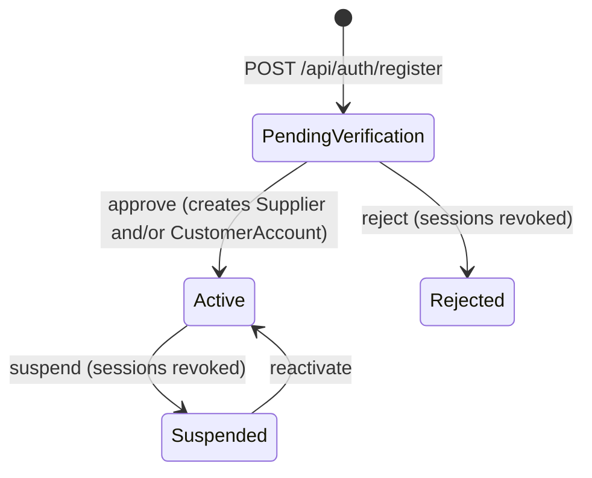

# Organizations: `OrganizationEndpoints.cs`

Base route **`/api/organizations`**: route group `api.MapGroup("/organizations").WithTags("Organizations")`.

Companies on the B2B platform. A company registers itself (see [Authentication](01-auth.md) `POST /register`) and waits
in `PendingVerification`. A **platform admin** checks it (KYB, "know your business") and approves it.

**Approving** creates the company's marketplace identities:
- a **Supplier**, when it sells, so it can list offers;
- a **CustomerAccount** on the TRADE price list, when it buys, so it gets trade prices and can place orders.

**Suspending or rejecting** a company signs all its users out at once by revoking their refresh tokens. Company admins
(`OrgAdmin` role) manage their own colleagues through the `/me` endpoints.



| # | Method | Route | Access | Purpose |
|---|---|---|---|---|
| 1 | GET | `/api/organizations` | `PlatformAdmin` | All companies (filter by status) |
| 2 | POST | `/api/organizations/{id}/approve` | `PlatformAdmin` | Verify and activate |
| 3 | POST | `/api/organizations/{id}/reject` | `PlatformAdmin` | Reject the registration |
| 4 | POST | `/api/organizations/{id}/suspend` | `PlatformAdmin` | Suspend an active company |
| 5 | POST | `/api/organizations/{id}/reactivate` | `PlatformAdmin` | Lift a suspension |
| 6 | GET | `/api/organizations/{id}/users` | `PlatformAdmin` | A company's users |
| 7 | GET | `/api/organizations/me` | signed in | My company, its marketplace identities and users |
| 8 | POST | `/api/organizations/me/users` | signed in + `OrgAdmin` role (checked in code) | Add a colleague |

```csharp
[ApiController]
[Route("api/organizations")]
[Tags("Organizations")]
public sealed class OrganizationsController(ICatalogueDbContext db, IActorContext actor, CurrentUser me) : ControllerBase { }
```

> **Route matching:** `/me` and `/{id:long}` sit side by side. Because of the `long` constraint, `me` can't be read as
> an id. Even without it, a literal segment (`me`) outranks a parameter, in both minimal APIs and controllers.

---

### 1. `GET /api/organizations` · List companies

| | |
|---|---|
| Access | `PlatformAdmin` |
| Query | `status?` (`PendingVerification`, `Active`, `Suspended`, `Rejected`) |
| Responses | **200** `OrganizationDto[] { id, name, vatNumber, country, canBuy, canSell, status, isPlatformOwner, supplierId, supplierCode, customerAccountId, customerAccountNumber, userCount, createdAtUtc, reviewedAtUtc, reviewedBy, reviewNote }` |

**Flow:** one projected query. `canBuy`/`canSell` are read from the `Capabilities` flags with bit tests that EF
translates to SQL. Pending companies are listed first.

```csharp
// Minimal API (abridged)
orgs.MapGet("", async (ICatalogueDbContext db, string? status, CancellationToken ct) =>
{
    var q = db.Organizations.AsNoTracking();
    if (Enum.TryParse<OrganizationStatus>(status, true, out var st)) q = q.Where(o => o.Status == st);
    var rows = await q.OrderBy(o => o.Status).ThenByDescending(o => o.CreatedAtUtc).Select(o => new OrganizationDto(/* ... */)).ToListAsync(ct);
    return Results.Ok(rows);
}).RequireAuthorization("PlatformAdmin");
```

```csharp
// Controller
[HttpGet]
[Authorize(Policy = "PlatformAdmin")]
public async Task<IReadOnlyList<OrganizationDto>> List([FromQuery] string? status, CancellationToken ct) { /* same */ }
```

---

### 2. `POST /api/organizations/{id}/approve` · Verify and activate

| | |
|---|---|
| Access | `PlatformAdmin` |
| Body | `ApproveRequest { priceListId?, supplierCode? }` (both optional) |
| Responses | **200** `{ id, status: "Active", supplierId, customerAccountId }` · **404** · **409** already active |

**Flow**
1. Load the company. If it is already active, return 409.
2. **If it sells and has no supplier yet:** generate a unique supplier code (from `supplierCode` or the company name,
   letters and digits only, with a number added on a clash) and create a `Supplier` with integration type `Manual`.
3. **If it buys and has no customer account yet:** create `CustomerAccount("ACC-00012", …)` on the given price list,
   or on `TRADE` by default.
4. `org.Approve(...)` links them and sets the status to `Active`. Audit `CompanyApproved`, save, clear the supplier
   cache and refresh the reference data.

```csharp
// Minimal API (abridged)
orgs.MapPost("/{id:long}/approve", async (long id, ApproveRequest req, ICatalogueDbContext db, IActorContext actor,
    IReferenceDataProvider refData, HybridCache cache, CancellationToken ct) =>
{
    var org = await db.Organizations.FirstOrDefaultAsync(o => o.Id == id, ct);
    if (org is null) return Results.NotFound();
    if (org.Status == OrganizationStatus.Active) return Results.Conflict(new { error = "Company is already active." });
    // create Supplier and/or CustomerAccount as needed
    org.Approve(actor.ActorId, supplierId, customerId);
    // audit, save, invalidate
    return Results.Ok(new { org.Id, status = org.Status.ToString(), supplierId, customerAccountId = customerId });
}).RequireAuthorization("PlatformAdmin");
```

```csharp
// Controller
[HttpPost("{id:long}/approve")]
[Authorize(Policy = "PlatformAdmin")]
public async Task<IActionResult> Approve(long id, [FromBody] ApproveRequest req, [FromServices] IReferenceDataProvider refData,
    [FromServices] HybridCache cache, CancellationToken ct) { /* same */ }
```

---

### 3–5. `POST /api/organizations/{id}/reject` · `/suspend` · `/reactivate`

| | |
|---|---|
| Access | `PlatformAdmin` |
| Body | reject and suspend: `ReviewRequest { note? }`; reactivate takes no body |
| Responses | **200** `{ id, status }` · **404** · **409** the platform owner company can't be changed, or an invalid transition (e.g. reactivating a company that isn't suspended) |

**Flow:** all three call the shared `Review(...)` helper and pass the domain change as a lambda:
1. Load the company. The platform owner (Catalogue Direct Ltd) is protected.
2. Apply the change: `o.Reject(...)`, `o.Suspend(...)` or `o.Reactivate(...)`. The domain enforces valid transitions
   and throws `InvalidOperationException`, which becomes 409.
3. When the new status is Suspended or Rejected, **revoke every active refresh token** of the company's users. Their
   current access tokens expire within 30 minutes, and sign-in is blocked by the status check in
   [`/auth/login`](01-auth.md).
4. Audit with the note and save.

```csharp
// Minimal API: three one-liners sharing one helper
orgs.MapPost("/{id:long}/reject", (long id, ReviewRequest req, ICatalogueDbContext db, IActorContext actor, CancellationToken ct)
    => Review(id, db, actor, ct, o => o.Reject(actor.ActorId, req.Note), "CompanyRejected", req.Note)).RequireAuthorization("PlatformAdmin");
orgs.MapPost("/{id:long}/suspend", (long id, ReviewRequest req, ICatalogueDbContext db, IActorContext actor, CancellationToken ct)
    => Review(id, db, actor, ct, o => o.Suspend(actor.ActorId, req.Note), "CompanySuspended", req.Note)).RequireAuthorization("PlatformAdmin");
orgs.MapPost("/{id:long}/reactivate", (long id, ICatalogueDbContext db, IActorContext actor, CancellationToken ct)
    => Review(id, db, actor, ct, o => o.Reactivate(actor.ActorId), "CompanyReactivated", null)).RequireAuthorization("PlatformAdmin");

private static async Task<IResult> Review(long id, ICatalogueDbContext db, IActorContext actor, CancellationToken ct,
    Action<Organization> change, string action, string? note)
{
    var org = await db.Organizations.FirstOrDefaultAsync(o => o.Id == id, ct);
    if (org is null) return Results.NotFound();
    if (org.IsPlatformOwner) return Results.Conflict(new { error = "The platform owner company cannot be changed here." });
    change(org);
    if (org.Status is OrganizationStatus.Suspended or OrganizationStatus.Rejected) { /* revoke all users' refresh tokens */ }
    // audit, save
    return Results.Ok(new { org.Id, status = org.Status.ToString() });
}
```

```csharp
// Controller
[HttpPost("{id:long}/reject")]
[Authorize(Policy = "PlatformAdmin")]
public Task<IActionResult> Reject(long id, [FromBody] ReviewRequest req, CancellationToken ct) => Review(id, o => o.Reject(actor.ActorId, req.Note), "CompanyRejected", req.Note, ct);

[HttpPost("{id:long}/suspend")]
[Authorize(Policy = "PlatformAdmin")]
public Task<IActionResult> Suspend(long id, [FromBody] ReviewRequest req, CancellationToken ct) => Review(id, o => o.Suspend(actor.ActorId, req.Note), "CompanySuspended", req.Note, ct);

[HttpPost("{id:long}/reactivate")]
[Authorize(Policy = "PlatformAdmin")]
public Task<IActionResult> Reactivate(long id, CancellationToken ct) => Review(id, o => o.Reactivate(actor.ActorId), "CompanyReactivated", null, ct);

private async Task<IActionResult> Review(long id, Action<Organization> change, string action, string? note, CancellationToken ct) { /* same, returning IActionResult */ }
```

---

### 6. `GET /api/organizations/{id}/users` · A company's users

| | |
|---|---|
| Access | `PlatformAdmin` |
| Responses | **200** `OrgUserDto[] { id, email, username, displayName, roles, status, lastLoginUtc, lockoutEndUtc }` |

```csharp
// Minimal API
orgs.MapGet("/{id:long}/users", (long id, ICatalogueDbContext db, CancellationToken ct) => Users(id, db, ct))
    .RequireAuthorization("PlatformAdmin");

private static async Task<IResult> Users(long orgId, ICatalogueDbContext db, CancellationToken ct) =>
    Results.Ok((await db.Users.AsNoTracking().Where(u => u.OrganizationId == orgId).OrderBy(u => u.Email).ToListAsync(ct))
        .Select(u => new OrgUserDto(u.Id, u.Email, u.Username, u.DisplayName, u.RoleList, u.Status.ToString(), u.LastLoginUtc, u.LockoutEndUtc)));
```

```csharp
// Controller
[HttpGet("{id:long}/users")]
[Authorize(Policy = "PlatformAdmin")]
public async Task<IEnumerable<OrgUserDto>> Users(long id, CancellationToken ct) => await LoadUsers(id, ct);
```

---

### 7. `GET /api/organizations/me` · My company

| | |
|---|---|
| Access | any signed-in user |
| Responses | **200** `{ id, name, vatNumber, country, canBuy, canSell, status, isPlatformOwner, supplier: {id, code, name}?, customerAccount: {id, accountNumber, priceList}?, users: OrgUserDto[] }` · **404** platform staff with no company |

**Flow:** the company id comes from the JWT claim (`org_id`) through `CurrentUser`. The handler loads the company with
its supplier, customer account and price list, and reuses the `Users(...)` helper. That helper returns an `IResult`, so
the value is read back with `as IValueHttpResult` to include it in this response.

```csharp
// Minimal API (abridged)
orgs.MapGet("/me", async (CurrentUser me, ICatalogueDbContext db, CancellationToken ct) =>
{
    if (me.OrganizationId is not { } oid) return Results.NotFound(new { error = "You are not a member of a company." });
    var org = await db.Organizations.AsNoTracking().Include(o => o.Supplier).Include(o => o.CustomerAccount).ThenInclude(c => c!.PriceList).FirstAsync(o => o.Id == oid, ct);
    return Results.Ok(new { org.Id, org.Name, /* ..., */ users = (await Users(oid, db, ct) as IValueHttpResult)?.Value });
}).RequireAuthorization();
```

```csharp
// Controller
[HttpGet("me")]
[Authorize]
public async Task<IActionResult> Mine(CancellationToken ct)
{
    if (me.OrganizationId is not { } oid) return NotFound(new { error = "You are not a member of a company." });
    // ... same
    return Ok(new { /* ..., */ users = await LoadUsers(oid, ct) });   // a helper returning data is simpler here
}
```

*Lesson:* a helper that returns plain data is easier to reuse than one that returns an HTTP result. That holds for both
styles.

---

### 8. `POST /api/organizations/me/users` · Add a colleague

| | |
|---|---|
| Access | signed in; the handler also requires the **`OrgAdmin` role**, otherwise `Results.Forbid()` → 403 |
| Body | `AddUserRequest { email, displayName, password, roles: string[] }` |
| Responses | **201** `{ id }` · **400** ValidationProblem (a role the company may not grant, a duplicate email, a weak password) · **403** |

**Flow**
1. Only an `OrgAdmin` of a company may add users, and only to their own company.
2. The **allowed roles** come from the company's capabilities. A buy-only company can't create a `Seller`, and nobody
   can grant platform roles such as `Admin`. This blocks privilege escalation.
3. Check the email is unique and the password meets the policy, hash the password, audit `UserAdded`, save.

```csharp
// Minimal API (abridged)
orgs.MapPost("/me/users", async (AddUserRequest req, CurrentUser me, ICatalogueDbContext db, IPasswordHasher<AppUser> hasher,
    IActorContext actor, CancellationToken ct) =>
{
    if (me.OrganizationId is not { } oid || !me.IsInRole(AppRoles.OrgAdmin)) return Results.Forbid();
    var org = await db.Organizations.FirstAsync(o => o.Id == oid, ct);
    var allowed = new List<string> { AppRoles.OrgAdmin };
    if (org.CanBuy) allowed.Add(AppRoles.Buyer);
    if (org.CanSell) allowed.Add(AppRoles.Seller);
    var bad = req.Roles.Except(allowed).ToList();
    if (bad.Count > 0) return Results.ValidationProblem(new Dictionary<string, string[]> { ["roles"] = [$"Not allowed for this company: {string.Join(", ", bad)}"] });
    // unique email, password policy, create user, audit
    return Results.Created($"/api/organizations/me/users/{user.Id}", new { user.Id });
}).RequireAuthorization();
```

```csharp
// Controller: the role check can be declarative
[HttpPost("me/users")]
[Authorize(Roles = AppRoles.OrgAdmin)]
public async Task<IActionResult> AddUser([FromBody] AddUserRequest req, [FromServices] IPasswordHasher<AppUser> hasher, CancellationToken ct)
{
    if (me.OrganizationId is not { } oid) return Forbid();
    // ... same allowed-roles check, uniqueness, policy, create
    return Created($"/api/organizations/me/users/{user.Id}", new { user.Id });
}
```

*Difference:* the minimal API could also use `.RequireAuthorization(p => p.RequireRole(AppRoles.OrgAdmin))`. This code
checks in the handler because it needs the organization id at the same moment anyway.
