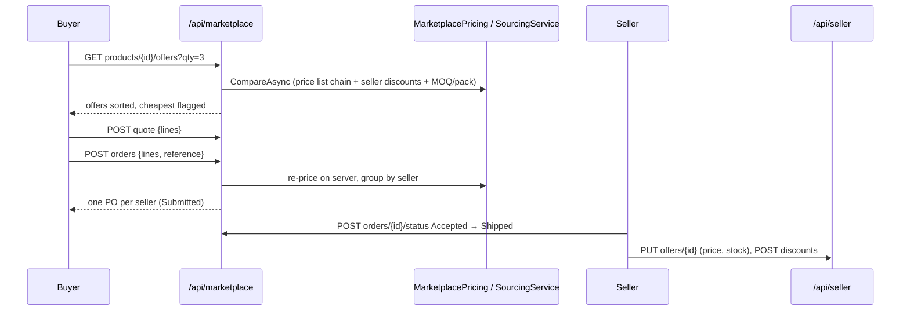

# Marketplace & seller portal: `MarketplaceEndpoints.cs`

Two route groups:

| Group | Base route | Default access |
|---|---|---|
| `api.MapGroup("/marketplace").WithTags("Marketplace")` | `/api/marketplace` | per endpoint (`Marketplace` or `Buyer`) |
| `api.MapGroup("/seller").WithTags("Seller portal").RequireAuthorization("Seller")` | `/api/seller` | **`Seller`** for every endpoint in the group |

Every company can **sell** (its supplier offers) and **buy** (from whichever seller is cheapest for it).

- **Pricing an offer for a buyer** (`MarketplacePricing`):
  1. Start from the seller's own price, or the list price.
  2. Apply the buyer's platform price list: quantity breaks on the content owner's offer, the tier or trade % on all offers.
  3. Apply that seller's discount for this buyer.
  4. Round the quantity up to the MOQ and pack size, and pick the cheapest offer by **line total**.

  A company never buys from itself.
- **Placing an order:** a basket becomes **one purchase order per seller**, priced again on the server; client prices
  are never trusted.
- **Order lifecycle:** the seller accepts, rejects and ships; the buyer can cancel until shipment. A rejected or
  cancelled order that was paid online is refunded automatically (see [Payments](13-payments.md)).



| # | Method | Route | Access | Purpose |
|---|---|---|---|---|
| 1 | GET | `/api/marketplace/products/{productId}/offers` | `Marketplace` | Every seller's offer, priced for me |
| 2 | POST | `/api/marketplace/quote` | `Marketplace` | Price a basket (cheapest per line) |
| 3 | POST | `/api/marketplace/orders` | `Buyer` | Place orders (one PO per seller) |
| 4 | GET | `/api/marketplace/orders` | `Marketplace` | My purchases or sales |
| 5 | GET | `/api/marketplace/orders/{id}` | `Marketplace` + ownership check | One order with lines and payments |
| 6 | POST | `/api/marketplace/orders/{id}/status` | `Marketplace` + role check | Accept, reject, ship or cancel |
| 7 | GET | `/api/seller/offers` | `Seller` | My offers and the cheapest competitor |
| 8 | PUT | `/api/seller/offers/{id}` | `Seller` + ownership | Update price, stock, lead time, MOQ, pack |
| 9 | POST | `/api/seller/products` | `Seller` | List a product (consolidated by GTIN) |
| 10 | GET | `/api/seller/discounts` | `Seller` | My discounts |
| 11 | POST | `/api/seller/discounts` | `Seller` | Give a buyer (or all buyers) a discount |
| 12 | DELETE | `/api/seller/discounts/{id}` | `Seller` + ownership | Switch a discount off |

```csharp
[ApiController, Route("api/marketplace"), Tags("Marketplace")]
public sealed class MarketplaceController(ICatalogueDbContext db, CurrentUser me, MarketplacePricing pricing, SourcingService sourcing) : ControllerBase { }

[ApiController, Route("api/seller"), Tags("Seller portal"), Authorize(Policy = "Seller")]   // = group.RequireAuthorization("Seller")
public sealed class SellerController(ICatalogueDbContext db, CurrentUser me, IActorContext actor, HybridCache cache) : ControllerBase { }
```

### Resource-level authorization

Policies only say *what kind* of user may call an endpoint. *Which* orders or offers they may touch is checked in code:

- `AccessAsync(order, me)` returns **Buyer** (my company placed it), **Seller** (it was placed with my supplier),
  **Staff** (platform staff acting for suppliers that aren't member companies) or **None**.
- A user with no access to an order gets **404**, not 403, so they can't tell that it exists.
- `SellerSupplier(me, requested)`: sellers always act for their own supplier; only Admin and SupplierManager may name
  another one.

Controllers would use the same helpers, or an `IAuthorizationHandler` for resource-based authorization
(`await authorizationService.AuthorizeAsync(User, order, "OrderAccess")`). That works the same in both styles.

---

### 1. `GET /api/marketplace/products/{productId}/offers` · Compare sellers

| | |
|---|---|
| Access | `Marketplace` |
| Query | `qty?` (default 1), `customerAccountId?` (platform staff only: preview prices as a given customer) |
| Responses | **200** `{ customerAccountId, offers: OfferQuote[] }`. Each quote has the seller, availability, lead time, MOQ, pack size, order quantity after rounding, base price, net unit price, total discount %, line total, an `explanation` (e.g. `HVX 95.00 → TIER −20% → HVX discount −10% = 68.40`), `purchasable` / `notPurchasableReason` ("Your own offer", "Discontinued", …) and `isCheapest` |

**Flow:** pick the buyer account (a buyer always prices as themselves), then `MarketplacePricing.CompareAsync` loads the
offers, the price-list chain, the entries and the active seller discounts in a few queries and computes everything in
memory.

```csharp
// Minimal API
market.MapGet("/products/{productId:long}/offers", async (long productId, int? qty, long? customerAccountId, CurrentUser me,
    MarketplacePricing pricing, CancellationToken ct) =>
{
    var customer = BuyerAccount(me, customerAccountId);
    var result = await pricing.CompareAsync(new Dictionary<long, int> { [productId] = qty ?? 1 }, customer, me.SupplierId, ct);
    return Results.Ok(new { customerAccountId = customer, offers = result[productId] });
}).RequireAuthorization("Marketplace");
```

```csharp
// Controller (MarketplaceController)
[HttpGet("products/{productId:long}/offers")]
[Authorize(Policy = "Marketplace")]
public async Task<IActionResult> Offers(long productId, [FromQuery] int? qty, [FromQuery] long? customerAccountId, CancellationToken ct)
{
    var customer = BuyerAccount(me, customerAccountId);
    var result = await pricing.CompareAsync(new Dictionary<long, int> { [productId] = qty ?? 1 }, customer, me.SupplierId, ct);
    return Ok(new { customerAccountId = customer, offers = result[productId] });
}
```

---

### 2. `POST /api/marketplace/quote` · Price a basket

| | |
|---|---|
| Access | `Marketplace` |
| Body | `QuoteRequest { lines: [{ productId, quantity, offerId? }], customerAccountId? }` (up to 200 lines) |
| Responses | **200** `BasketQuote { lines: [{ …, chosen, alternatives, ownerLineTotal, problem }], suppliers: [{ supplierCode, lines, subtotal }], total, ownerOnlyTotal, savings, currency }` · **400** more than 200 lines |

**Flow:** `SourcingService.QuoteAsync` merges duplicate lines, compares offers for every product at once, uses the
buyer's chosen offer when it is still purchasable (otherwise the cheapest, with a note), groups the result by seller,
and calculates the **saving** against buying everything from the content owner.

```csharp
// Minimal API
market.MapPost("/quote", async (QuoteRequest req, CurrentUser me, SourcingService sourcing, CancellationToken ct) =>
    Results.Ok(await sourcing.QuoteAsync(req.Lines, BuyerAccount(me, req.CustomerAccountId), me.SupplierId, ct)))
    .RequireAuthorization("Marketplace");
```

```csharp
// Controller
[HttpPost("quote")]
[Authorize(Policy = "Marketplace")]
public async Task<BasketQuote> Quote([FromBody] QuoteRequest req, CancellationToken ct) =>
    await sourcing.QuoteAsync(req.Lines, BuyerAccount(me, req.CustomerAccountId), me.SupplierId, ct);
```

---

### 3. `POST /api/marketplace/orders` · Place orders

| | |
|---|---|
| Access | `Buyer` |
| Body | `PlaceOrderRequest { lines: [{ productId, quantity, offerId? }], buyerReference?, note? }` |
| Responses | **200** `[{ id, number, supplierId, subtotal, currency, lines }]`, one entry per purchase order · **403** not a company user, or the company can't buy · **422** some lines can't be ordered, mixed currencies, or an empty basket |

**Flow**
1. The buyer must belong to a company that can buy and has a customer account.
2. `SourcingService.PlaceAsync` **prices the basket again on the server**, so client prices are ignored. It refuses
   unorderable lines, creates one `PurchaseOrder` per seller (number format `PO-yyMMdd-XXXXXX`, prices frozen on the
   lines), audits `PurchaseOrdersPlaced` with the total and the saving, and saves everything in one transaction.
3. Domain problems (`InvalidOperationException`) are returned as **422 Unprocessable Entity** with the reason.

```csharp
// Minimal API
market.MapPost("/orders", async (PlaceOrderRequest req, CurrentUser me, ICatalogueDbContext db, SourcingService sourcing, CancellationToken ct) =>
{
    if (me.OrganizationId is not { } orgId) return Results.Problem(statusCode: 403, title: "Only company users can place orders.");
    var org = await db.Organizations.AsNoTracking().FirstAsync(o => o.Id == orgId, ct);
    if (!org.CanBuy || org.CustomerAccountId is null) return Results.Problem(statusCode: 403, title: "Your company is not set up to buy.");
    try
    {
        var orders = await sourcing.PlaceAsync(req.Lines, orgId, org.CustomerAccountId, org.SupplierId, me.Name, req.BuyerReference, req.Note, ct);
        return Results.Ok(orders.Select(o => new { o.Id, o.Number, o.SupplierId, o.Subtotal, o.Currency, lines = o.Lines.Count }));
    }
    catch (InvalidOperationException ex) { return Results.Problem(statusCode: 422, title: "Order not placed", detail: ex.Message); }
}).RequireAuthorization("Buyer");
```

```csharp
// Controller
[HttpPost("orders")]
[Authorize(Policy = "Buyer")]
public async Task<IActionResult> Place([FromBody] PlaceOrderRequest req, CancellationToken ct)
{
    if (me.OrganizationId is not { } orgId) return Problem(statusCode: 403, title: "Only company users can place orders.");
    // ... same
    try { var orders = await sourcing.PlaceAsync(/* ... */); return Ok(orders.Select(/* ... */)); }
    catch (InvalidOperationException ex) { return UnprocessableEntity(new ProblemDetails { Title = "Order not placed", Detail = ex.Message }); }
}
```

---

### 4. `GET /api/marketplace/orders` · Purchases or sales

| | |
|---|---|
| Access | `Marketplace` |
| Query | `role` (`buyer`, the default: orders my company placed; or `seller`: orders to my company), `status?`, `payment?` (`Unpaid`, `Pending`, `Paid`, `Refunded`), `supplierId?` (staff only), `page`, `pageSize` (max 100) |
| Responses | **200** `PagedResult<OrderSummaryDto> { items: [{ id, number, status, buyerName, supplierId, supplierCode, supplierName, currency, subtotal, listValue, lines, buyerReference, createdAtUtc, updatedAtUtc, createdBy, paymentStatus }], … }` |

**Flow:** the role decides the filter:
- **buyer:** `BuyerOrganizationId == my company`;
- **seller:** `SupplierId == my supplier`;
- **platform staff:** the suppliers they manage (those that aren't member companies, plus the platform's own).

A user with no company gets an empty page, not an error.

```csharp
// Minimal API (abridged)
market.MapGet("/orders", async (string? role, string? status, string? payment, long? supplierId, int? page, int? pageSize, CurrentUser me,
    ICatalogueDbContext db, CancellationToken ct) =>
{
    var q = db.PurchaseOrders.AsNoTracking();
    // role-based scoping, status and payment filters
    var total = await q.CountAsync(ct);
    var items = await q.OrderByDescending(o => o.CreatedAtUtc).Skip(...).Take(...).Select(o => new OrderSummaryDto(/* ... */)).ToListAsync(ct);
    return Results.Ok(new ProductEndpoints.PagedResult<OrderSummaryDto>(items, total, pg, ps));
}).RequireAuthorization("Marketplace");
```

```csharp
// Controller
[HttpGet("orders")]
[Authorize(Policy = "Marketplace")]
public async Task<IActionResult> Orders([FromQuery] string? role, [FromQuery] string? status, [FromQuery] string? payment,
    [FromQuery] long? supplierId, [FromQuery] int? page, [FromQuery] int? pageSize, CancellationToken ct) { /* same */ }
```

---

### 5. `GET /api/marketplace/orders/{id}` · Order detail

| | |
|---|---|
| Access | `Marketplace`, and only the buyer, the seller or staff (`AccessAsync`) |
| Responses | **200** `{ id, number, status, paymentStatus, paidAtUtc, canPay, payments: PaymentDto[], currency, subtotal, listValue, buyerReference, note, statusNote, createdAtUtc, updatedAtUtc, createdBy, buyer, supplier, canAct: { seller, buyer }, lines: [...] }` · **404** not found or not yours |

**Flow:** load the order with lines, supplier and buyer, and check access (none → 404). Then add the payment attempts
and flags the UI uses for its buttons: `canAct.seller`, `canAct.buyer`, `canPay`.

```csharp
// Minimal API (abridged)
market.MapGet("/orders/{id:long}", async (long id, CurrentUser me, ICatalogueDbContext db, CancellationToken ct) =>
{
    var o = await db.PurchaseOrders.AsNoTracking().Include(x => x.Lines).Include(x => x.Supplier).Include(x => x.BuyerOrganization).FirstOrDefaultAsync(x => x.Id == id, ct);
    if (o is null) return Results.NotFound();
    var access = await AccessAsync(o, me, db, ct);
    if (access == Access.None) return Results.NotFound(); // don't reveal other companies' orders
    var payments = await PaymentEndpoints.Project(db.Payments.Where(p => p.PurchaseOrderId == o.Id).OrderByDescending(p => p.CreatedAtUtc)).ToListAsync(ct);
    return Results.Ok(new { /* ..., */ canPay = access is Access.Buyer && o.CanBePaid, payments, canAct = new { seller = access is Access.Seller or Access.Staff, buyer = access is Access.Buyer or Access.Staff }, /* lines */ });
}).RequireAuthorization("Marketplace");
```

```csharp
// Controller
[HttpGet("orders/{id:long}")]
[Authorize(Policy = "Marketplace")]
public async Task<IActionResult> Order(long id, CancellationToken ct)
{
    var o = await db.PurchaseOrders.AsNoTracking().Include(x => x.Lines)/*...*/.FirstOrDefaultAsync(x => x.Id == id, ct);
    if (o is null || await AccessAsync(o, me, db, ct) == Access.None) return NotFound();
    // ... same
}
```

---

### 6. `POST /api/marketplace/orders/{id}/status` · Change status

| | |
|---|---|
| Access | `Marketplace`. **Seller actions** (Accepted, Rejected, Shipped) need seller or staff access to the order; **Cancelled** needs buyer or staff access. |
| Body | `StatusRequest { status, note? }` |
| Responses | **200** `{ id, status, paymentStatus }` · **400** unknown status · **403** wrong side · **404** · **409** transition not allowed (e.g. Shipped before Accepted) · **502** a refund for a paid order failed at the provider |

**Flow**
1. Check access and which side may make the change.
2. `OrderStatusService.ChangeAsync`: `order.TransitionTo(next)` enforces the state machine
   (Submitted → Accepted, Rejected or Cancelled; Accepted → Shipped or Cancelled). For Rejected or Cancelled it
   **refunds online payments first**; if the refund fails, nothing is saved. It then audits and saves.
3. This service is shared with the assistant's approved proposals (accept, reject, ship or cancel order), so both paths
   behave the same way.

```csharp
// Minimal API
market.MapPost("/orders/{id:long}/status", async (long id, StatusRequest req, CurrentUser me, ICatalogueDbContext db,
    IActorContext actor, OrderStatusService statusService, CancellationToken ct) =>
{
    var o = await db.PurchaseOrders.FirstOrDefaultAsync(x => x.Id == id, ct);
    if (o is null) return Results.NotFound();
    if (!Enum.TryParse<PurchaseOrderStatus>(req.Status, true, out var next)) return Results.BadRequest(new { error = $"Unknown status '{req.Status}'." });
    var access = await AccessAsync(o, me, db, ct);
    var sellerAction = next is PurchaseOrderStatus.Accepted or PurchaseOrderStatus.Rejected or PurchaseOrderStatus.Shipped;
    if (access == Access.None || (sellerAction && access == Access.Buyer) || (next == PurchaseOrderStatus.Cancelled && access == Access.Seller))
        return Results.Problem(statusCode: 403, title: "You cannot change this order.");
    try { await statusService.ChangeAsync(o, next, req.Note, actor.ActorId, actor.CorrelationId, ct); }
    catch (InvalidOperationException ex) { return Results.Conflict(new { error = ex.Message }); }
    catch (PaymentException ex) { return Results.Problem(statusCode: ex.StatusCode, title: "Refund failed", detail: ex.Message); }
    return Results.Ok(new { o.Id, status = o.Status.ToString(), paymentStatus = o.PaymentStatus.ToString() });
}).RequireAuthorization("Marketplace");
```

```csharp
// Controller
[HttpPost("orders/{id:long}/status")]
[Authorize(Policy = "Marketplace")]
public async Task<IActionResult> ChangeStatus(long id, [FromBody] StatusRequest req, [FromServices] OrderStatusService statusService,
    [FromServices] IActorContext actor, CancellationToken ct) { /* same checks */ }
```

---

### 7. `GET /api/seller/offers` · My offers

| | |
|---|---|
| Access | `Seller` (from the group) |
| Query | `supplierId?` (Admin or SupplierManager only), `search?` (SKU or name prefix), `undercut?` (only offers where another seller is cheaper), `page`, `pageSize` |
| Responses | **200** `PagedResult<SellerOfferDto> { items: [{ id, productId, sku, productName, brand, supplierSku, price, listPrice, cost, currency, stock, leadTimeDays, minOrderQuantity, packSize, availability, isContentOwner, cheapestCompetitorPrice, competitors }], … }` · **403** the company isn't set up to sell |

**Flow:** filter to the seller's supplier. `undercut=true` adds an `EXISTS` sub-query for a cheaper competitor. Each
row is projected in SQL with the seller's stock, the cheapest competitor price and the number of competitors. This is
what the portal's **"Beat"** button uses.

```csharp
// Minimal API (abridged)
seller.MapGet("/offers", async (CurrentUser me, ICatalogueDbContext db, long? supplierId, string? search, bool? undercut,
    int? page, int? pageSize, CancellationToken ct) =>
{
    var sid = SellerSupplier(me, supplierId);
    if (sid is null) return Results.Problem(statusCode: 403, title: "Your company is not set up to sell.");
    var q = db.SupplierOffers.AsNoTracking().Where(o => o.SupplierId == sid);
    if (undercut == true) q = q.Where(o => db.SupplierOffers.Any(c => c.ProductId == o.ProductId && c.SupplierId != sid && c.Price != null && c.Price < o.Price));
    // search, count, page, projection with competitor min price
    return Results.Ok(new ProductEndpoints.PagedResult<SellerOfferDto>(items, total, pg, ps));
});   // no RequireAuthorization here: the group already requires "Seller"
```

```csharp
// Controller (SellerController, [Authorize(Policy = "Seller")] on the class)
[HttpGet("offers")]
public async Task<IActionResult> Offers([FromQuery] long? supplierId, [FromQuery] string? search, [FromQuery] bool? undercut,
    [FromQuery] int? page, [FromQuery] int? pageSize, CancellationToken ct) { /* same */ }
```

---

### 8. `PUT /api/seller/offers/{id}` · Update an offer

| | |
|---|---|
| Access | `Seller` + the offer must belong to my supplier (Admin and SupplierManager may edit any); otherwise **404** |
| Body | `UpdateOfferRequest { price?, quantity?, leadTimeDays?, minOrderQuantity?, packSize?, discontinued }` |
| Responses | **200** `{ id, availability }` · **400** ValidationProblem (negative values, lead time over 365) · **404** |

**Flow:** validate, then `offer.UpdateBySeller(...)`, which also derives **availability** from stock and lead time
(InStock, LowStock, OnOrder, Discontinued). Create or update the inventory row, audit `OfferUpdated`, save, and clear
the product's cached detail.

```csharp
// Minimal API (abridged)
seller.MapPut("/offers/{id:long}", async (long id, UpdateOfferRequest req, CurrentUser me, ICatalogueDbContext db,
    IActorContext actor, HybridCache cache, CancellationToken ct) =>
{
    var offer = await db.SupplierOffers.FirstOrDefaultAsync(o => o.Id == id, ct);
    if (offer is null || (!me.IsInRole(AppRoles.Admin) && !me.IsInRole(AppRoles.SupplierManager) && offer.SupplierId != me.SupplierId))
        return Results.NotFound();
    if (req.Price is < 0 || req.Quantity is < 0 || req.LeadTimeDays is < 0 or > 365)
        return Results.ValidationProblem(new Dictionary<string, string[]> { ["offer"] = ["Price, stock and lead time must be non-negative (lead time ≤ 365)."] });
    offer.UpdateBySeller(req.Price, req.Quantity, req.LeadTimeDays, req.MinOrderQuantity, req.PackSize, req.Discontinued);
    // inventory upsert, audit, save, cache.RemoveAsync(CacheTags.Product(offer.ProductId))
    return Results.Ok(new { offer.Id, availability = offer.Availability.ToString() });
});
```

```csharp
// Controller
[HttpPut("offers/{id:long}")]
public async Task<IActionResult> UpdateOffer(long id, [FromBody] UpdateOfferRequest req, CancellationToken ct) { /* same */ }
```

---

### 9. `POST /api/seller/products` · List a product

| | |
|---|---|
| Access | `Seller`, and the company must be able to sell |
| Body | `ListProductRequest { product: UpsertProductRequest, leadTimeDays?, minOrderQuantity?, packSize? }` (the same product shape as [Products](02-products.md); `price` is required) |
| Responses | **201** `{ productId, offerId, consolidated, status }` · **400** ValidationProblem · **403** · **409** you already list this SKU |

**Flow**
1. Validate with the same `ProductEndpoints.ValidateProduct` as the admin product editor (specs, required fields,
   GTIN), plus "price required".
2. **Consolidate by GTIN.** If a product with this GTIN already exists, the seller becomes **another offer** on it
   (`consolidated: true`), so buyers see every seller of the same boiler side by side.
3. Otherwise, create a new product owned by this seller. If the seller's supplier requires approval for new products,
   the product starts as `PendingApproval` and a change request is created (see [Approvals](08-approvals.md)).
   Otherwise it is active immediately.
4. Create the `SupplierOffer` with the seller's price and terms, and the stock row. Audit `SellerListedProduct` or
   `SellerAddedOffer`.

```csharp
// Minimal API (abridged)
seller.MapPost("/products", async (ListProductRequest req, CurrentUser me, ICatalogueDbContext db, IReferenceDataProvider refProvider,
    IActorContext actor, HybridCache cache, CancellationToken ct) =>
{
    var sid = SellerSupplier(me, req.Product.SupplierId);
    if (sid is null) return Results.Problem(statusCode: 403, title: "Your company is not set up to sell.");
    var problems = ProductEndpoints.ValidateProduct(req.Product, await refProvider.GetAsync(ct), out var attributes);
    if (req.Product.Price is null) problems["price"] = ["Set your selling price."];
    if (problems.Count > 0) return Results.ValidationProblem(problems);
    // duplicate SKU check, find by GTIN or create product (+ approval), create offer + inventory, audit, save
    return Results.Created($"/api/products/{product.Id}", new { productId = product.Id, offerId = offer.Id, consolidated = !created, status = product.Status.ToString() });
});
```

```csharp
// Controller
[HttpPost("products")]
public async Task<IActionResult> ListProduct([FromBody] ListProductRequest req, [FromServices] IReferenceDataProvider refProvider, CancellationToken ct) { /* same */ }
```

*Reuse across endpoint classes:* `ProductEndpoints.ValidateProduct` is `internal static`, so two endpoint classes share
one validation rule. With controllers you would move it to a shared service or validator class (for example a
FluentValidation validator), which would be cleaner for minimal APIs too.

---

### 10. `GET /api/seller/discounts` · My discounts

| | |
|---|---|
| Access | `Seller` |
| Query | `supplierId?` (Admin or SupplierManager only) |
| Responses | **200** `DiscountDto[] { id, customerAccountId, customerName, discountPercent, note, validFromUtc, validToUtc, isActive }` · **403** |

```csharp
// Minimal API
seller.MapGet("/discounts", async (CurrentUser me, ICatalogueDbContext db, long? supplierId, CancellationToken ct) =>
{
    var sid = SellerSupplier(me, supplierId);
    if (sid is null) return Results.Problem(statusCode: 403, title: "Your company is not set up to sell.");
    return Results.Ok(await db.SupplierDiscounts.AsNoTracking().Where(d => d.SupplierId == sid)
        .OrderByDescending(d => d.IsActive).ThenByDescending(d => d.Id).Select(d => new DiscountDto(/* ... */)).ToListAsync(ct));
});
```

```csharp
// Controller
[HttpGet("discounts")]
public async Task<IActionResult> Discounts([FromQuery] long? supplierId, CancellationToken ct) { /* same */ }
```

---

### 11. `POST /api/seller/discounts` · Create a discount

| | |
|---|---|
| Access | `Seller` (always for the caller's own supplier) |
| Body | `CreateDiscountRequest { customerAccountId? (null = all buyers), discountPercent (above 0, up to 90), validToUtc?, note? }` |
| Responses | **201** `{ id }` · **403** · **400** the percentage is out of range (the domain throws `ArgumentOutOfRangeException`, which the global handler maps to 400) |

**Flow:** the discount starts now and stacks on top of the buyer's platform price list when offers are compared. Audit
`SupplierDiscountCreated`.

```csharp
// Minimal API
seller.MapPost("/discounts", async (CreateDiscountRequest req, CurrentUser me, ICatalogueDbContext db, IActorContext actor, CancellationToken ct) =>
{
    var sid = SellerSupplier(me, null);
    if (sid is null) return Results.Problem(statusCode: 403, title: "Your company is not set up to sell.");
    var d = new SupplierDiscount(sid.Value, req.CustomerAccountId, req.DiscountPercent, DateTime.UtcNow, req.ValidToUtc, req.Note);
    // add, audit, save
    return Results.Created($"/api/seller/discounts/{d.Id}", new { d.Id });
});
```

```csharp
// Controller
[HttpPost("discounts")]
public async Task<IActionResult> CreateDiscount([FromBody] CreateDiscountRequest req, CancellationToken ct) { /* same */ }
```

---

### 12. `DELETE /api/seller/discounts/{id}` · Switch a discount off

| | |
|---|---|
| Access | `Seller`, and the discount must belong to my supplier (Admin may remove any) |
| Responses | **204** · **404** |

**Flow:** the discount is **deactivated**, not deleted, so past prices and orders can still be explained.

```csharp
// Minimal API
seller.MapDelete("/discounts/{id:long}", async (long id, CurrentUser me, ICatalogueDbContext db, CancellationToken ct) =>
{
    var d = await db.SupplierDiscounts.FirstOrDefaultAsync(x => x.Id == id, ct);
    if (d is null || (d.SupplierId != me.SupplierId && !me.IsInRole(AppRoles.Admin))) return Results.NotFound();
    d.Deactivate();
    await db.SaveChangesAsync(ct);
    return Results.NoContent();
});
```

```csharp
// Controller
[HttpDelete("discounts/{id:long}")]
public async Task<IActionResult> DeleteDiscount(long id, CancellationToken ct) { /* same */ return NoContent(); }
```
