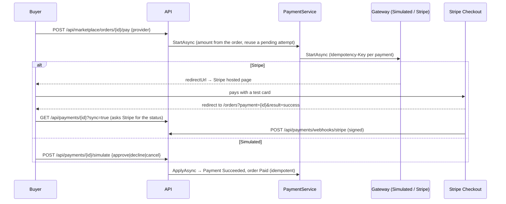

# Payments: `PaymentEndpoints.cs`

Online payment of purchase orders. Mapped as a route group `api.MapGroup("/payments").WithTags("Payments")` plus one
endpoint under the marketplace path (`/api/marketplace/orders/{id}/pay`).

By default a B2B order is **settled on the buyer's trade account**: nothing to do. A buyer can also pay online through a
**gateway**:

- **Simulated:** in-app approve/decline, database only, no money moves. Enabled in Development.
- **Stripe Checkout:** a hosted card page. With `sk_test_` keys, Stripe's free test mode.

The amount always comes from the stored order, never from the browser. At most one payment per order can succeed,
enforced by a filtered unique index. A paid order that is later rejected or cancelled is refunded automatically through
the same gateway (see [Marketplace](12-marketplace.md) endpoint 6).



| # | Method | Route | Access | Purpose |
|---|---|---|---|---|
| 1 | GET | `/api/payments/methods` | `Marketplace` | Gateways enabled on this server |
| 2 | POST | `/api/marketplace/orders/{id}/pay` | `Buyer` | Start a payment for my order |
| 3 | GET | `/api/payments/{id}` | `Marketplace` + order access | Payment status (`?sync=true` asks the provider) |
| 4 | POST | `/api/payments/{id}/simulate` | `Buyer` (own order, simulated payments only) | Approve, decline or cancel a test payment |
| 5 | GET | `/api/payments/` | `Marketplace` | Payments made, received, or all (staff), with totals |
| 6 | POST | `/api/payments/webhooks/stripe` | **anonymous**, verified by signature | Stripe event notifications |

```csharp
[ApiController, Route("api/payments"), Tags("Payments")]
public sealed class PaymentsController(ICatalogueDbContext db, PaymentService payments, CurrentUser me) : ControllerBase { }
// The /pay endpoint would live on MarketplaceController (route api/marketplace/orders/{id}/pay),
// or use an absolute route template on this controller: [HttpPost("/api/marketplace/orders/{id:long}/pay")]
```

*Difference:* in a minimal API, one static class can map routes under **any** prefix (here `/payments` and
`/marketplace/...`). A controller's routes hang off its class-level `[Route]`, unless an action uses a template starting
with `/`.

---

### 1. `GET /api/payments/methods` · Available gateways

| | |
|---|---|
| Access | `Marketplace` |
| Responses | **200** `[{ provider: "Simulated" \| "Stripe", name, testMode }]` (an empty array means on account only) |

**Flow:** the gateways come from DI. `AddCataloguePayments` registers the simulator only when
`Payments:Simulated:Enabled` is set, and Stripe only when a secret key is configured. Live keys are refused unless
explicitly allowed.

```csharp
// Minimal API
group.MapGet("/methods", (PaymentService payments) =>
    Results.Ok(payments.Gateways.Select(g => new PaymentMethodDto(g.Provider.ToString(), g.DisplayName, g.IsTestMode))))
    .RequireAuthorization("Marketplace");
```

```csharp
// Controller
[HttpGet("methods")]
[Authorize(Policy = "Marketplace")]
public IEnumerable<PaymentMethodDto> Methods() => payments.Gateways.Select(g => new PaymentMethodDto(g.Provider.ToString(), g.DisplayName, g.IsTestMode));
```

---

### 2. `POST /api/marketplace/orders/{id}/pay` · Start a payment

| | |
|---|---|
| Access | `Buyer`; the order must belong to the caller's company (otherwise 404) |
| Body | `PayRequest { provider: "Simulated" \| "Stripe" }` |
| Responses | **200** `{ paymentId, provider, status: "Pending", amount, currency, isTest, redirectUrl }` (`redirectUrl` is set for Stripe, null for the simulator) · **400** unknown or disabled provider · **404** · **409** already paid, or the order can't be paid (shipped, rejected, cancelled) · **502** the gateway is unavailable |

**Flow** in `PaymentService.StartAsync`:
1. Load the order and check that it belongs to the caller's company and is payable (Submitted or Accepted, not paid).
2. **Double-click protection:** if a pending attempt for the same provider and amount is less than 30 minutes old,
   return it rather than creating another. Older pending attempts are cancelled, at the provider too.
3. Create the `Payment` (the amount is copied from the order) and mark the order `PaymentStatus = Pending`.
4. Ask the gateway to start a checkout. Stripe gets the amount in minor units and an `Idempotency-Key`
   (`catalogue-checkout-{paymentId}`), so a retried request can't create two sessions. The return URLs come from
   configuration (`Payments:ReturnBaseUrl`), never from request headers. If the gateway fails, the attempt is marked
   failed, the order becomes payable again, and **502** is returned.

```csharp
// Minimal API
api.MapPost("/marketplace/orders/{id:long}/pay", async (long id, PayRequest req, CurrentUser me, ICatalogueDbContext db,
    PaymentService payments, PaymentOptions options, CancellationToken ct) =>
{
    if (me.OrganizationId is not { } orgId) return Results.Problem(statusCode: 403, title: "Only company users can pay orders.");
    if (!Enum.TryParse<PaymentProvider>(req.Provider, true, out var provider)) return Results.BadRequest(new { error = $"Unknown payment method '{req.Provider}'." });
    var email = await db.Users.Where(u => u.Id == me.UserId).Select(u => u.Email).FirstOrDefaultAsync(ct);
    try
    {
        var (payment, checkout) = await payments.StartAsync(id, orgId, provider, me.Name, email, options.ReturnBaseUrl, ct);
        return Results.Ok(new { paymentId = payment.Id, provider = payment.Provider.ToString(), status = payment.Status.ToString(),
            payment.Amount, payment.Currency, payment.IsTest, redirectUrl = checkout.RedirectUrl });
    }
    catch (PaymentException ex) { return Results.Problem(statusCode: ex.StatusCode, title: "Payment not started", detail: ex.Message); }
}).RequireAuthorization("Buyer").WithTags("Payments");
```

```csharp
// Controller (MarketplaceController)
[HttpPost("orders/{id:long}/pay")]
[Authorize(Policy = "Buyer")]
public async Task<IActionResult> Pay(long id, [FromBody] PayRequest req, [FromServices] PaymentService payments,
    [FromServices] PaymentOptions options, CancellationToken ct)
{
    // ... same
    catch (PaymentException ex) { return Problem(statusCode: ex.StatusCode, title: "Payment not started", detail: ex.Message); }
}
```

---

### 3. `GET /api/payments/{id}?sync=` · Payment status

| | |
|---|---|
| Access | `Marketplace`, plus access to the payment's order (buyer, seller or staff); otherwise **404** |
| Query | `sync=true`: if the payment is pending, ask the provider for its current state first (buyer or staff only) |
| Responses | **200** `PaymentDto { id, orderId, orderNumber, provider, status, isTest, amount, currency, checkoutUrl, paymentReference, refundReference, failureReason, createdBy, createdAtUtc, completedAtUtc, refundedAtUtc, buyerName, supplierCode, supplierName }` · **404** · **502** the provider is unreachable |

**Flow:** when the buyer returns from Stripe, the SPA calls this with `sync=true` and polls for a few seconds.
`PaymentService.SyncAsync` fetches the Checkout Session from Stripe and applies the result. This makes local
development work **without webhook forwarding**. Applying an outcome is **idempotent**: a webhook and a sync arriving
together can't double-count.

```csharp
// Minimal API (abridged)
group.MapGet("/{id:long}", async (long id, bool? sync, CurrentUser me, ICatalogueDbContext db, PaymentService payments, CancellationToken ct) =>
{
    var payment = await db.Payments.Include(p => p.PurchaseOrder).FirstOrDefaultAsync(p => p.Id == id, ct);
    if (payment is null) return Results.NotFound();
    var access = await MarketplaceEndpoints.AccessAsync(payment.PurchaseOrder!, me, db, ct);
    if (access == MarketplaceEndpoints.Access.None) return Results.NotFound();
    if (sync == true && access is MarketplaceEndpoints.Access.Buyer or MarketplaceEndpoints.Access.Staff)
        await payments.SyncAsync(payment, me.Name, ct);   // PaymentException → problem, HttpRequestException → 502
    return Results.Ok(await Project(db.Payments.Where(p => p.Id == id)).FirstAsync(ct));
}).RequireAuthorization("Marketplace");
```

```csharp
// Controller
[HttpGet("{id:long}")]
[Authorize(Policy = "Marketplace")]
public async Task<IActionResult> Get(long id, [FromQuery] bool? sync, CancellationToken ct) { /* same */ }
```

---

### 4. `POST /api/payments/{id}/simulate` · Complete a test payment

| | |
|---|---|
| Access | `Buyer`, own order only (otherwise 404), **simulated** payments only (otherwise 400) |
| Body | `SimulateRequest { outcome: "approve" \| "decline" \| "cancel" }` |
| Responses | **200** `PaymentDto` · **400** wrong provider or outcome · **404** · **409** already completed |

**Flow:** the outcome becomes a `GatewayResult` and goes through the **same** `PaymentService.ApplyAsync` as a real
Stripe confirmation:
- **approve** → Succeeded, and the order is marked Paid;
- **decline** or **cancel** → the attempt is closed and the order becomes payable again.

No card data is ever entered.

```csharp
// Minimal API (abridged)
group.MapPost("/{id:long}/simulate", async (long id, SimulateRequest req, CurrentUser me, ICatalogueDbContext db,
    PaymentService payments, CancellationToken ct) =>
{
    var payment = await db.Payments.Include(p => p.PurchaseOrder).FirstOrDefaultAsync(p => p.Id == id, ct);
    if (payment is null || payment.PurchaseOrder!.BuyerOrganizationId != me.OrganizationId) return Results.NotFound();
    if (payment.Provider != PaymentProvider.Simulated) return Results.Problem(statusCode: 400, title: "Only simulated payments can be completed here.");
    if (payment.Status != PaymentAttemptStatus.Pending) return Results.Conflict(new { error = $"Payment {payment.Id} is already {payment.Status.ToString().ToLowerInvariant()}." });
    var result = req.Outcome.ToLowerInvariant() switch
    {
        "approve" => new GatewayResult(PaymentAttemptStatus.Succeeded, $"sim_pi_{Guid.NewGuid():N}", null),
        "decline" => new GatewayResult(PaymentAttemptStatus.Failed, null, "Declined by the test checkout (simulated)"),
        "cancel" => new GatewayResult(PaymentAttemptStatus.Cancelled, null, "Buyer left the test checkout"),
        _ => null
    };
    if (result is null) return Results.BadRequest(new { error = "Outcome must be approve, decline or cancel." });
    await payments.ApplyAsync(payment, result, me.Name, ct);
    return Results.Ok(await Project(db.Payments.Where(p => p.Id == id)).FirstAsync(ct));
}).RequireAuthorization("Buyer");
```

```csharp
// Controller
[HttpPost("{id:long}/simulate")]
[Authorize(Policy = "Buyer")]
public async Task<IActionResult> Simulate(long id, [FromBody] SimulateRequest req, CancellationToken ct) { /* same */ }
```

---

### 5. `GET /api/payments/` · Payment list with totals

| | |
|---|---|
| Access | `Marketplace` |
| Query | `role` (`buyer` by default: paid by my company; `seller`: received for orders to my company; `all`: staff only), `status?`, `page`, `pageSize` |
| Responses | **200** `{ items: PaymentDto[], total, page, pageSize, collected: [{ currency, amount, count }], refunded: [{ currency, amount, count }] }` |

**Flow:** scope by role. Callers without a company or supplier get an empty result via `Where(_ => false)`. The
**collected** and **refunded** totals are grouped by currency in SQL, then the page is projected.

> The route is mapped as `group.MapGet("/", …)`, so the URL ends with a slash (`/api/payments/`). `MapGet("", …)` on a
> group (as in Approvals) gives the path without the slash. ASP.NET Core routing treats a trailing slash as a match
> either way.

```csharp
// Minimal API (abridged)
group.MapGet("/", async (string? role, string? status, int? page, int? pageSize, CurrentUser me, ICatalogueDbContext db, CancellationToken ct) =>
{
    var q = db.Payments.AsNoTracking();
    // role scoping, status filter
    var collected = await q.Where(p => p.Status == PaymentAttemptStatus.Succeeded).GroupBy(p => p.Currency)
        .Select(g => new { currency = g.Key, amount = g.Sum(p => p.Amount), count = g.Count() }).ToListAsync(ct);
    // refunded, page
    return Results.Ok(new { items, total, page = pg, pageSize = ps, collected, refunded });
}).RequireAuthorization("Marketplace");
```

```csharp
// Controller
[HttpGet]
[Authorize(Policy = "Marketplace")]
public async Task<IActionResult> List([FromQuery] string? role, [FromQuery] string? status, [FromQuery] int? page, [FromQuery] int? pageSize, CancellationToken ct) { /* same */ }
```

---

### 6. `POST /api/payments/webhooks/stripe` · Stripe webhook

| | |
|---|---|
| Access | **`.AllowAnonymous()`**. Stripe has no bearer token; the request is authenticated by the **`Stripe-Signature`** header. Hidden from Swagger (`.ExcludeFromDescription()`). |
| Request | the raw JSON event body (up to 512 KB) and the `Stripe-Signature: t=…,v1=…` header |
| Responses | **200** (accepted, also for events we ignore or don't recognise, so Stripe doesn't retry) · **400** bad signature · **404** webhooks not configured |

**Flow**
1. Without `Payments:Stripe:WebhookSecret`, return **404**: the endpoint is effectively off.
2. Read the **raw** body. The signature covers the exact bytes, so the body must not be model-bound and re-serialised.
3. `StripeWebhook.Verify`: compute `HMAC-SHA256(secret, "{t}.{body}")`, compare in constant time, and reject
   timestamps more than **5 minutes** old (replay protection).
4. Handle `checkout.session.completed`, `async_payment_succeeded`, `async_payment_failed` and `expired`. Find the
   payment by its Checkout Session id and call the same idempotent `ApplyAsync`.
5. Failures that a retry can't fix (for example "already paid by another attempt") are logged and audited, and still
   answered with 200.

```csharp
// Minimal API (abridged)
group.MapPost("/webhooks/stripe", async (HttpRequest request, PaymentOptions options, ICatalogueDbContext db,
    PaymentService payments, ILoggerFactory loggers, CancellationToken ct) =>
{
    if (string.IsNullOrEmpty(options.StripeWebhookSecret)) return Results.NotFound();
    using var reader = new StreamReader(request.Body);
    var payload = await reader.ReadToEndAsync(ct);
    if (!StripeWebhook.Verify(payload, request.Headers["Stripe-Signature"], options.StripeWebhookSecret, DateTimeOffset.UtcNow))
        return Results.BadRequest(new { error = "Invalid signature." });
    // parse type, find payment by session id, ApplyAsync(...)
    return Results.Ok();
}).AllowAnonymous().ExcludeFromDescription();
```

Because the handler takes `HttpRequest` and no complex type, minimal APIs **don't read the body**, so the handler gets
the untouched stream.

```csharp
// Controller
[HttpPost("webhooks/stripe")]
[AllowAnonymous]
[ApiExplorerSettings(IgnoreApi = true)]
public async Task<IActionResult> StripeWebhook([FromServices] PaymentOptions options, CancellationToken ct)
{
    if (string.IsNullOrEmpty(options.StripeWebhookSecret)) return NotFound();
    using var reader = new StreamReader(Request.Body);                       // no [FromBody] parameter → body left untouched
    var payload = await reader.ReadToEndAsync(ct);
    if (!Catalogue.Infrastructure.Payments.StripeWebhook.Verify(payload, Request.Headers["Stripe-Signature"], options.StripeWebhookSecret, DateTimeOffset.UtcNow))
        return BadRequest(new { error = "Invalid signature." });
    // ... same
    return Ok();
}
```
