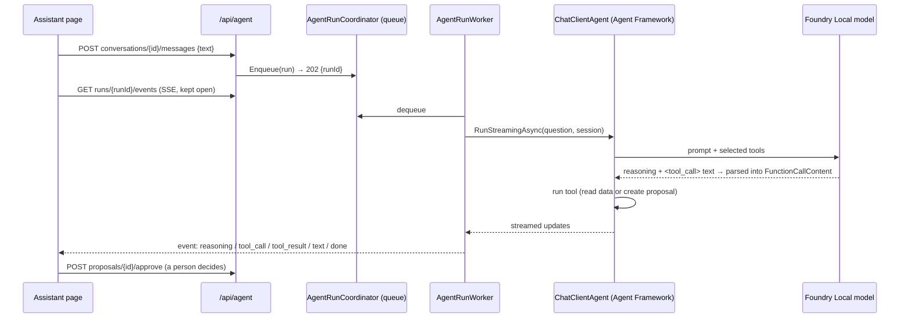

# Assistant, operations review & analytics: `AgentEndpoints.cs`

The file holds two static classes:

| Class | Mapping | Base route |
|---|---|---|
| `AgentEndpoints` | `api.MapGroup("/agent").WithTags("Assistant").RequireAuthorization()` and a sub-group `agent.MapGroup("/reviews").RequireAuthorization("ImportOps")` | `/api/agent` |
| `AnalyticsEndpoints` | `api.MapGet("/analytics", …)` | `/api/analytics` |

The assistant is a Microsoft Agent Framework agent running on the local Foundry Local model.

**Background runs.** A model call can take seconds (Ministral 3B) or minutes (Qwen 3.5 9B) on a laptop GPU, so model
work never runs inside the HTTP request:
1. A `POST` **queues a run** (`AgentRunCoordinator`; one GPU, so one run at a time) and returns `202` with a `runId`.
2. The client follows the run over **Server-Sent Events**: status, reasoning, tool calls, answer text, done.
3. Events are buffered, so a client can reconnect and replay from the last event id.

**Human in the loop.** The agent never changes data. It creates **proposals**, and a person with permission approves
them through these endpoints.



| # | Method | Route | Access | Purpose |
|---|---|---|---|---|
| 1 | GET | `/api/agent/status` | signed in | Model, queue and review status |
| 2 | POST | `/api/agent/model/load` | `PlatformAdmin` | Start loading the model in the background |
| 3 | GET | `/api/agent/conversations` | signed in | My conversations |
| 4 | POST | `/api/agent/conversations` | signed in | Start a conversation |
| 5 | GET | `/api/agent/conversations/{id}` | signed in (owner) | Messages, tool traces, proposals, active run |
| 6 | DELETE | `/api/agent/conversations/{id}` | signed in (owner) | Delete a conversation |
| 7 | POST | `/api/agent/conversations/{id}/messages` | signed in · rate limit `agent` | Ask a question (queues a run) |
| 8 | GET | `/api/agent/runs/{id}/events` | run owner or staff · no timeout | Server-Sent Events stream |
| 9 | POST | `/api/agent/runs/{id}/cancel` | run owner or staff | Stop a run |
| 10 | GET | `/api/agent/proposals` | signed in | Proposals (staff: all; others: their own) |
| 11 | POST | `/api/agent/proposals/{id}/approve` | signed in + permission for that action | Execute a proposal |
| 12 | POST | `/api/agent/proposals/{id}/reject` | signed in + permission, or the requester | Reject a proposal |
| 13 | GET | `/api/agent/reviews/` | `ImportOps` | Review history |
| 14 | GET | `/api/agent/reviews/{id}` | `ImportOps` | One review: briefing, findings, proposals |
| 15 | POST | `/api/agent/reviews/` | `ImportOps` · rate limit `agent` | Run the operations review workflow now |
| 16 | GET | `/api/analytics` | signed in · 15-min timeout | Analytics dashboard data |

```csharp
// As controllers
[ApiController, Route("api/agent"), Authorize, Tags("Assistant")]
public sealed class AgentController(AgentRunCoordinator runs, CurrentUser me, ICatalogueDbContext db) : ControllerBase { }       // 1–12

[ApiController, Route("api/agent/reviews"), Authorize(Policy = "ImportOps"), Tags("Assistant")]
public sealed class ReviewsController(ICatalogueDbContext db, OperationsReviewRunner runner) : ControllerBase { }              // 13–15

[ApiController, Route("api/analytics"), Authorize, Tags("Analytics")]
public sealed class AnalyticsController(AnalyticsService analytics, CurrentUser me) : ControllerBase { }                        // 16
```

*Nested groups:* `agent.MapGroup("/reviews").RequireAuthorization("ImportOps")` **inherits** the parent group's prefix
and its `RequireAuthorization()`. A controller has no class nesting, so the reviews controller repeats the full route
and policy.

---

### 1. `GET /api/agent/status` · Model and queue status

| | |
|---|---|
| Query | `refresh=true` re-checks Foundry Local now (status is otherwise cached for 20 s) |
| Responses | **200** `{ enabled, model: { model, modelId, serviceRunning, modelCached, modelLoaded, ready, supportsToolCalling, device, error, endpoint (staff only), checkedAtUtc }, queue: { waiting, running, myRun }, limits, review: { enabled, intervalHours, useModel, last } }` |

**Flow:** `FoundryLocalRuntime.GetStatusAsync` discovers the service port with `foundry server status -o json`, maps
the model alias to the id used for chat via `/v1/models`, and checks whether it is loaded
(`foundry model list --loaded`). The handler adds the queue state and the last review.

```csharp
// Minimal API (abridged)
agent.MapGet("/status", async (FoundryLocalRuntime runtime, AgentRunCoordinator runs, AgentOptions options, ICatalogueDbContext db,
    CurrentUser me, bool? refresh, CancellationToken ct) =>
{
    var s = await runtime.GetStatusAsync(refresh == true, ct);
    // last review, my active run
    return Results.Ok(new { enabled = options.Enabled && s.Enabled, model = new { /* ... */ }, queue = new { /* ... */ }, limits = new { /* ... */ }, review = new { /* ... */ } });
});
```

```csharp
// Controller
[HttpGet("status")]
public async Task<IActionResult> Status([FromQuery] bool? refresh, [FromServices] FoundryLocalRuntime runtime, [FromServices] AgentOptions options, CancellationToken ct) { /* same */ }
```

---

### 2. `POST /api/agent/model/load` · Load the model

| | |
|---|---|
| Access | `PlatformAdmin` |
| Responses | **202** with `Location: /api/agent/status` |

**Flow:** starts `EnsureReadyAsync` with `Task.Run` and returns immediately. It starts the service if needed and runs
`foundry model load <alias>`, which takes about a minute. The UI polls `/status`. This is "fire and forget": the work
is independent of the request, so it uses `CancellationToken.None`.

```csharp
// Minimal API
agent.MapPost("/model/load", (FoundryLocalRuntime runtime, ILogger<FoundryLocalRuntime> log) =>
{
    _ = Task.Run(async () =>
    {
        try { await runtime.EnsureReadyAsync(CancellationToken.None); }
        catch (Exception ex) { log.LogWarning("Model load requested from the UI failed: {Error}", ex.Message); }
    });
    return Results.Accepted("/api/agent/status");
}).RequireAuthorization("PlatformAdmin");
```

```csharp
// Controller
[HttpPost("model/load")]
[Authorize(Policy = "PlatformAdmin")]
public IActionResult LoadModel([FromServices] FoundryLocalRuntime runtime, [FromServices] ILogger<FoundryLocalRuntime> log)
{
    _ = Task.Run(async () => { try { await runtime.EnsureReadyAsync(CancellationToken.None); } catch (Exception ex) { log.LogWarning(ex.Message); } });
    return Accepted("/api/agent/status");
}
```

---

### 3. `GET /api/agent/conversations` · My conversations

| | |
|---|---|
| Responses | **200** `[{ id (GUID), title, messageCount, createdAtUtc, updatedAtUtc }]` (the 50 most recent) |

```csharp
// Minimal API
agent.MapGet("/conversations", async (CurrentUser me, ICatalogueDbContext db, CancellationToken ct) =>
    Results.Ok(await db.AgentConversations.AsNoTracking().Where(c => c.UserId == me.UserId).OrderByDescending(c => c.UpdatedAtUtc).Take(50)
        .Select(c => new { c.Id, c.Title, c.MessageCount, c.CreatedAtUtc, c.UpdatedAtUtc }).ToListAsync(ct)));
```

```csharp
// Controller
[HttpGet("conversations")]
public async Task<IActionResult> Conversations(CancellationToken ct) => Ok(await db.AgentConversations.AsNoTracking().Where(c => c.UserId == me.UserId)/*...*/.ToListAsync(ct));
```

---

### 4. `POST /api/agent/conversations` · Start a conversation

| | |
|---|---|
| Responses | **201** `{ id, title }` · **403** no user id in the token |

```csharp
// Minimal API
agent.MapPost("/conversations", async (CurrentUser me, ICatalogueDbContext db, CancellationToken ct) =>
{
    if (me.UserId is not { } uid) return Results.Problem(statusCode: 403, title: "Sign in again.");
    var c = new AgentConversation(uid, me.Name);
    db.AgentConversations.Add(c);
    await db.SaveChangesAsync(ct);
    return Results.Created($"/api/agent/conversations/{c.Id}", new { c.Id, c.Title });
});
```

```csharp
// Controller
[HttpPost("conversations")]
public async Task<IActionResult> StartConversation(CancellationToken ct) { /* same */ return Created($"/api/agent/conversations/{c.Id}", new { c.Id, c.Title }); }
```

---

### 5. `GET /api/agent/conversations/{id}` · Conversation detail

| | |
|---|---|
| Route | `{id:guid}`: a GUID route constraint |
| Responses | **200** `{ id, title, createdAtUtc, updatedAtUtc, activeRunId, messages: [{ id, role, content, reasoning, error, durationMs, inputTokens, outputTokens, createdAtUtc, tools: [{ name, arguments, result, failed, durationMs }] }], proposals: [...] }` · **404** not found or not mine |

**Flow:** the conversation must belong to the caller. The tool trace is stored as a JSON string and is returned as
real JSON, not as an escaped string. `activeRunId` lets a page reload re-attach to a run that is still going.

```csharp
// Minimal API (abridged)
agent.MapGet("/conversations/{id:guid}", async (Guid id, CurrentUser me, ICatalogueDbContext db, AgentRunCoordinator runs, CancellationToken ct) =>
{
    var c = await db.AgentConversations.AsNoTracking().FirstOrDefaultAsync(x => x.Id == id && x.UserId == me.UserId, ct);
    if (c is null) return Results.NotFound();
    // messages (tool trace parsed), proposals of this conversation, active run
    return Results.Ok(new { /* ... */ });
});
```

```csharp
// Controller
[HttpGet("conversations/{id:guid}")]
public async Task<IActionResult> Conversation(Guid id, CancellationToken ct) { /* same */ }
```

---

### 6. `DELETE /api/agent/conversations/{id}` · Delete

| | |
|---|---|
| Responses | **204** · **404** · **409** a run is still active in it |

**Flow:** messages are removed by a cascade delete. A conversation with an active run can't be deleted, so the run
can't end up writing into a conversation that no longer exists.

```csharp
// Minimal API
agent.MapDelete("/conversations/{id:guid}", async (Guid id, CurrentUser me, ICatalogueDbContext db, AgentRunCoordinator runs, CancellationToken ct) =>
{
    var c = await db.AgentConversations.FirstOrDefaultAsync(x => x.Id == id && x.UserId == me.UserId, ct);
    if (c is null) return Results.NotFound();
    if (runs.Active().Any(r => r.ConversationId == id)) return Results.Conflict(new { error = "Wait for the current answer or cancel it first." });
    db.AgentConversations.Remove(c);
    await db.SaveChangesAsync(ct);
    return Results.NoContent();
});
```

```csharp
// Controller
[HttpDelete("conversations/{id:guid}")]
public async Task<IActionResult> DeleteConversation(Guid id, CancellationToken ct) { /* same */ }
```

---

### 7. `POST /api/agent/conversations/{id}/messages` · Ask a question

| | |
|---|---|
| Access | signed in · rate limit **`agent`**: 30 per hour per user (each run occupies the GPU for minutes) |
| Body | `AskRequest { text }` (1–2,000 characters) |
| Responses | **202** `{ runId }` with `Location: /api/agent/runs/{runId}/events` · **400** ValidationProblem · **404** conversation · **429** queue full, the user already has a run, or the rate limit was hit |

**Flow**
1. `AgentPrincipalFactory` builds the user the agent acts for. It evaluates **every API policy** for the current user
   with `IAuthorizationService`, so the agent can only use tools that this user could call as endpoints.
2. `CatalogueAssistant.AskAsync` stores the user's message and queues a run.

What the run does later, in the background worker:
1. Restore the agent session saved on the conversation.
2. A **tool router** picks the tools relevant to the question (fewer tool definitions means faster prompts on a local
   model).
3. Every tool is wrapped in `GuardedFunction`: a call budget, errors returned to the model as data, results truncated,
   and a trace kept.
4. Run the `ChatClientAgent` with streaming. Reasoning, tool calls and text are published as events.
5. Save the answer, the trace, the token usage and the updated session, and audit `AgentTurn`.

```csharp
// Minimal API
agent.MapPost("/conversations/{id:guid}/messages", async (Guid id, AskRequest req, AgentPrincipalFactory principals,
    CatalogueAssistant assistant, CancellationToken ct) =>
{
    var text = req.Text?.Trim() ?? "";
    if (text.Length is 0 or > 2000) return Results.ValidationProblem(new Dictionary<string, string[]> { ["text"] = ["Ask a question of 1 to 2,000 characters."] });
    try
    {
        var run = await assistant.AskAsync(await principals.CurrentAsync(ct), id, text, ct);
        return Results.Accepted($"/api/agent/runs/{run.Id}/events", new { runId = run.Id });
    }
    catch (KeyNotFoundException) { return Results.NotFound(); }
    catch (AgentBusyException ex) { return Results.Problem(statusCode: 429, title: "Assistant busy", detail: ex.Message); }
}).RequireRateLimiting(Policies.Agent);
```

```csharp
// Controller
[HttpPost("conversations/{id:guid}/messages")]
[EnableRateLimiting(Policies.Agent)]
public async Task<IActionResult> Ask(Guid id, [FromBody] AskRequest req, [FromServices] AgentPrincipalFactory principals,
    [FromServices] CatalogueAssistant assistant, CancellationToken ct)
{
    // ... same validation
    var run = await assistant.AskAsync(await principals.CurrentAsync(ct), id, text, ct);
    return Accepted($"/api/agent/runs/{run.Id}/events", new { runId = run.Id });
}
```

---

### 8. `GET /api/agent/runs/{id}/events` · Server-Sent Events

| | |
|---|---|
| Access | the run's owner, staff for scheduled reviews, or Admin · **`.DisableRequestTimeout()`**: the 30-second default would cut a stream that lasts minutes · hidden from Swagger |
| Request | `after=<seq>` or the `Last-Event-ID` header, to replay from that event |
| Responses | `text/event-stream`: events `queued`, `started`, `status`, `step`, `reasoning`, `tool_call`, `tool_result`, `text`, `saved`, `review`, `done`, plus a `: keep-alive` comment every 15 s · **404** |

**Flow:** the handler **writes to the response itself**. It sets the content type and disables buffering, then for
each event from `run.ReadAsync(after)` writes `id:`, `event:` and `data:` lines and flushes. It returns no `IResult`:
the method's return type is `Task`, so the endpoint is a plain request delegate. The run lives in the background
service, so if the browser disconnects the run keeps going, and the client can reconnect and replay.

```csharp
// Minimal API (abridged)
agent.MapGet("/runs/{id:guid}/events", async (Guid id, int? after, HttpContext http, CurrentUser me, AgentRunCoordinator runs, CancellationToken ct) =>
{
    var run = runs.Get(id);
    if (run is null || !CanSee(run, me)) { http.Response.StatusCode = 404; return; }
    var lastEventId = int.TryParse(http.Request.Headers["Last-Event-ID"], out var l) ? l : after ?? 0;
    http.Response.ContentType = "text/event-stream";
    http.Response.Headers.CacheControl = "no-cache";
    http.Features.Get<IHttpResponseBodyFeature>()?.DisableBuffering();
    await foreach (var e in run.ReadAsync(lastEventId, ct))
    {
        if (e.Type == "heartbeat") await http.Response.WriteAsync(": keep-alive\n\n", ct);
        else await http.Response.WriteAsync($"id: {e.Seq}\nevent: {e.Type}\ndata: {JsonSerializer.Serialize(e.Data, Json)}\n\n", ct);
        await http.Response.Body.FlushAsync(ct);
    }
}).ExcludeFromDescription().DisableRequestTimeout();
```

```csharp
// Controller
[HttpGet("runs/{id:guid}/events")]
[DisableRequestTimeout]
[ApiExplorerSettings(IgnoreApi = true)]
public async Task Events(Guid id, [FromQuery] int? after, CancellationToken ct)   // void-like action that writes Response directly
{
    var run = runs.Get(id);
    if (run is null || !CanSee(run, me)) { Response.StatusCode = 404; return; }
    Response.ContentType = "text/event-stream";
    await foreach (var e in run.ReadAsync(after ?? 0, ct)) { /* write + flush */ }
}
```

> On .NET 10, minimal APIs can also return `TypedResults.ServerSentEvents(IAsyncEnumerable<SseItem<T>>)`. Writing to the
> response by hand, as here, makes the heartbeat and the replay ids explicit.

---

### 9. `POST /api/agent/runs/{id}/cancel` · Stop a run

| | |
|---|---|
| Responses | **202** · **404** |

**Flow:** cancels the run's `CancellationTokenSource`. The model call is aborted, whatever was produced so far is
saved with "Stopped before the answer was complete.", and `done` is published with status `Cancelled`.

```csharp
// Minimal API
agent.MapPost("/runs/{id:guid}/cancel", (Guid id, CurrentUser me, AgentRunCoordinator runs) =>
{
    var run = runs.Get(id);
    if (run is null || !CanSee(run, me)) return Results.NotFound();
    run.Cancel();
    return Results.Accepted();
});
```

```csharp
// Controller
[HttpPost("runs/{id:guid}/cancel")]
public IActionResult Cancel(Guid id) { var run = runs.Get(id); if (run is null || !CanSee(run, me)) return NotFound(); run.Cancel(); return Accepted(); }
```

---

### 10. `GET /api/agent/proposals` · Proposals

| | |
|---|---|
| Query | `status?` (`Pending`, `Executed`, `Rejected`, `Failed`, `Expired`) |
| Responses | **200** `[{ id, kind, targetId, targetLabel, reason, source ("assistant" or "operations-review"), conversationId, reviewId, requestedBy, status, decidedBy, decidedAtUtc, result, createdAtUtc, expiresAtUtc }]` (the 100 most recent) |

**Flow:** platform staff see every proposal; other users see the ones they asked for. A pending proposal past its
expiry (3 days) is reported as `Expired`; the scheduler also marks it so in the database.

```csharp
// Minimal API
agent.MapGet("/proposals", async (string? status, CurrentUser me, ICatalogueDbContext db, CancellationToken ct) =>
{
    var q = db.AgentActionProposals.AsNoTracking();
    if (!me.IsPlatformStaff) q = q.Where(p => p.RequestedBy == me.Name);
    if (Enum.TryParse<ProposalStatus>(status, true, out var st)) q = q.Where(p => p.Status == st);
    return Results.Ok((await q.OrderByDescending(p => p.Id).Take(100).ToListAsync(ct)).Select(ToDto));
});
```

```csharp
// Controller
[HttpGet("proposals")]
public async Task<IActionResult> Proposals([FromQuery] string? status, CancellationToken ct) { /* same */ }
```

---

### 11 & 12. `POST /api/agent/proposals/{id}/approve` · `/reject`

| | |
|---|---|
| Body | `DecideRequest { note? }` (at most 500 characters) |
| Responses | **200** `{ message, proposal }` · **403** the approver may not perform this action · **404** · **409** already decided, expired, or the target changed (e.g. the order is no longer Submitted) · **502** a refund failed while cancelling or rejecting a paid order |

**Flow** in `AgentActionExecutor.DecideAsync`:
1. The proposal must be pending and not expired.
2. **Re-validate against the approver**, not the person or agent that proposed it. `ProposalTargets.ValidateAsync`
   checks that the approver has the permission (ImportOps for reprocessing, CatalogueAdmin for price changes, the
   selling company for accept/reject/ship, the buying company for cancel) and that the target is still in a valid
   state.
3. On approval, run the action through **the same services as the regular endpoints**:
   - `ImportReprocessService` → [Imports](05-imports.md) endpoint 6
   - `ApprovalService` → [Approvals](08-approvals.md) endpoint 3
   - `OrderStatusService` → [Marketplace](12-marketplace.md) endpoint 6, including refunds
4. Record `Executed` (with the result) or `Failed` (with the reason), and audit `AgentProposalExecuted`, `Rejected` or
   `Failed`. If the action fails halfway, the change tracker is cleared so the failure record is saved without any
   partial change.
5. **Reject** is allowed for anyone permitted to approve it, for the person who asked, and for Admin.

```csharp
// Minimal API
agent.MapPost("/proposals/{id:long}/approve", (long id, DecideRequest req, AgentPrincipalFactory principals, AgentActionExecutor executor, CancellationToken ct) =>
    Decide(id, true, req.Note, principals, executor, ct));
agent.MapPost("/proposals/{id:long}/reject", (long id, DecideRequest req, AgentPrincipalFactory principals, AgentActionExecutor executor, CancellationToken ct) =>
    Decide(id, false, req.Note, principals, executor, ct));

private static async Task<IResult> Decide(long id, bool approve, string? note, AgentPrincipalFactory principals, AgentActionExecutor executor, CancellationToken ct)
{
    if (note is { Length: > 500 }) return Results.ValidationProblem(new Dictionary<string, string[]> { ["note"] = ["At most 500 characters."] });
    var result = await executor.DecideAsync(id, approve, note, await principals.CurrentAsync(ct), ct);
    return result.StatusCode == 200
        ? Results.Ok(new { message = result.Message, proposal = result.Proposal is null ? null : ToDto(result.Proposal) })
        : Results.Problem(statusCode: result.StatusCode, title: approve ? "Not executed" : "Not rejected", detail: result.Message);
}
```

```csharp
// Controller
[HttpPost("proposals/{id:long}/approve")]
public Task<IActionResult> Approve(long id, [FromBody] DecideRequest req, [FromServices] AgentPrincipalFactory principals, [FromServices] AgentActionExecutor executor, CancellationToken ct)
    => Decide(id, true, req.Note, principals, executor, ct);

[HttpPost("proposals/{id:long}/reject")]
public Task<IActionResult> Reject(long id, [FromBody] DecideRequest req, [FromServices] AgentPrincipalFactory principals, [FromServices] AgentActionExecutor executor, CancellationToken ct)
    => Decide(id, false, req.Note, principals, executor, ct);
```

---

### 13. `GET /api/agent/reviews/` · Review history

| | |
|---|---|
| Access | `ImportOps` (on the `/reviews` sub-group) |
| Responses | **200** `[{ id, trigger ("manual" or "schedule"), requestedBy, status, startedAtUtc, completedAtUtc, durationMs, critical, warnings, infos, proposalCount, generatedByModel, modelId, error }]` (the 30 most recent) |

```csharp
// Minimal API
reviews.MapGet("/", async (ICatalogueDbContext db, CancellationToken ct) =>
    Results.Ok(await db.OperationsReviews.AsNoTracking().OrderByDescending(r => r.Id).Take(30).Select(r => new { /* ... */ }).ToListAsync(ct)));
```

```csharp
// Controller (ReviewsController)
[HttpGet]
public async Task<IActionResult> List(CancellationToken ct) => Ok(await db.OperationsReviews.AsNoTracking().OrderByDescending(r => r.Id).Take(30)/*...*/.ToListAsync(ct));
```

---

### 14. `GET /api/agent/reviews/{id}` · One review

| | |
|---|---|
| Access | `ImportOps` |
| Responses | **200** `{ …summary, briefing, findings: [{ severity, area, title, detail, action? }], snapshot, proposals }` · **404** |

**Flow:** findings and the snapshot are stored as JSON and returned as JSON, alongside the proposals that review created.

```csharp
// Minimal API (abridged)
reviews.MapGet("/{id:long}", async (long id, ICatalogueDbContext db, AgentRunCoordinator runs, CancellationToken ct) =>
{
    var r = await db.OperationsReviews.AsNoTracking().FirstOrDefaultAsync(x => x.Id == id, ct);
    if (r is null) return Results.NotFound();
    var proposals = await db.AgentActionProposals.AsNoTracking().Where(p => p.ReviewId == id).OrderBy(p => p.Id).ToListAsync(ct);
    return Results.Ok(new { /* ..., */ findings = JsonSerializer.Deserialize<JsonElement>(r.FindingsJson), proposals = proposals.Select(ToDto) });
});
```

```csharp
// Controller
[HttpGet("{id:long}")]
public async Task<IActionResult> Get(long id, CancellationToken ct) { /* same */ }
```

---

### 15. `POST /api/agent/reviews/` · Run the operations review

| | |
|---|---|
| Access | `ImportOps` · rate limit `agent` |
| Responses | **202** `{ reviewId, runId }` with `Location: /api/agent/reviews/{reviewId}` · **429** a review is already running, or the queue is full |

**Flow:** `OperationsReviewRunner.StartAsync` creates the `OperationsReview` row and queues a run that executes an
**Agent Framework workflow** of four executors:

1. `collect-signals`: deterministic queries over imports, approvals, orders, payments, companies, catalogue and media.
2. `triage`: rules turn the signals into findings by severity, with suggested safe actions (reprocess a failed import,
   approve a ±2% price change).
3. `briefing`: the agent writes the briefing by calling a `submit_briefing` tool. If the model is unavailable or slow,
   a rule-based briefing is used, so a review always completes.
4. `publish`: save the review and create proposals for the suggested actions.

Progress is streamed as `step` events on the run (follow it with endpoint 8). The same runner is triggered by a
scheduler every 12 hours.

```csharp
// Minimal API
reviews.MapPost("/", async (CurrentUser me, OperationsReviewRunner runner, CancellationToken ct) =>
{
    try
    {
        var (reviewId, run) = await runner.StartAsync("manual", me.Name, me.UserId ?? 0, ct);
        return Results.Accepted($"/api/agent/reviews/{reviewId}", new { reviewId, runId = run.Id });
    }
    catch (AgentBusyException ex) { return Results.Problem(statusCode: 429, title: "Review not started", detail: ex.Message); }
}).RequireRateLimiting(Policies.Agent);
```

```csharp
// Controller (ReviewsController)
[HttpPost]
[EnableRateLimiting(Policies.Agent)]
public async Task<IActionResult> Start(CancellationToken ct)
{
    try { var (reviewId, run) = await runner.StartAsync("manual", me.Name, me.UserId ?? 0, ct); return Accepted($"/api/agent/reviews/{reviewId}", new { reviewId, runId = run.Id }); }
    catch (AgentBusyException ex) { return Problem(statusCode: 429, title: "Review not started", detail: ex.Message); }
}
```

---

<a id="analytics"></a>
### 16. `GET /api/analytics?range=` · Analytics dashboard

| | |
|---|---|
| Access | any signed-in user · timeout `long-running` (the first build of a period scans millions of rows) |
| Query | `range`: `today`, `7d` (default), `15d`, `1m`, `3m`, `6m`, `1y` |
| Responses | **200** `AnalyticsReport { range, fromUtc, toUtc, bucket (Hour, Day, Week, Month), labels, scope ("platform" or "company"), kpis: [{ key, label, value, previous, unit, spark }], series: { orders, payments, catalogue, media, imports, approvals, companies, activity }, breakdowns: { orderStatus, paymentStatus, paymentProvider, importStatus, changeStatus, productStatus, availability, companyStatus, mediaKind, topActions }, rankings: { topSuppliers, topProducts, categories, offersBySupplier }, snapshot, computedAtUtc }` · **400** unknown range · **403** a company user with no company |

**Flow**
1. **Scope:** platform staff see everything. A company user sees their own orders and payments (as buyer or seller)
   plus the shared catalogue. Imports, approvals, companies and activity are staff-only.
2. `AnalyticsWindow.For(range)` builds the buckets and the **previous period** of equal length, used for the deltas
   ("+12% vs previous").
3. `AnalyticsService` aggregates each series in SQL by hour or day and rolls up to weeks or months in memory. Per-day
   product counts for the 7.2 million products are computed once and cached for 10 minutes, so changing the period is
   fast. The whole report is cached for 2 minutes per range and scope.

```csharp
// Minimal API
api.MapGet("/analytics", async (string? range, CurrentUser me, AnalyticsService analytics, CancellationToken ct) =>
{
    if (range is not null && !AnalyticsWindow.Ranges.Contains(range.ToLowerInvariant()))
        return Results.ValidationProblem(new Dictionary<string, string[]> { ["range"] = [$"Use one of: {string.Join(", ", AnalyticsWindow.Ranges)}."] });
    var scope = new AnalyticsScope(me.IsPlatformStaff, me.OrganizationId, me.SupplierId);
    if (!scope.Platform && me.OrganizationId is null) return Results.Problem(statusCode: 403, title: "No company on this account.");
    return Results.Ok(await analytics.GetAsync(range, scope, ct));
}).RequireAuthorization().WithTags("Analytics").WithRequestTimeout(Policies.LongRunning);
```

```csharp
// Controller (AnalyticsController)
[HttpGet]
[RequestTimeout(Policies.LongRunning)]
public async Task<IActionResult> Get([FromQuery] string? range, CancellationToken ct)
{
    if (range is not null && !AnalyticsWindow.Ranges.Contains(range.ToLowerInvariant()))
    {
        ModelState.AddModelError("range", $"Use one of: {string.Join(", ", AnalyticsWindow.Ranges)}.");
        return ValidationProblem(ModelState);
    }
    var scope = new AnalyticsScope(me.IsPlatformStaff, me.OrganizationId, me.SupplierId);
    if (!scope.Platform && me.OrganizationId is null) return Problem(statusCode: 403, title: "No company on this account.");
    return Ok(await analytics.GetAsync(range, scope, ct));
}
```
